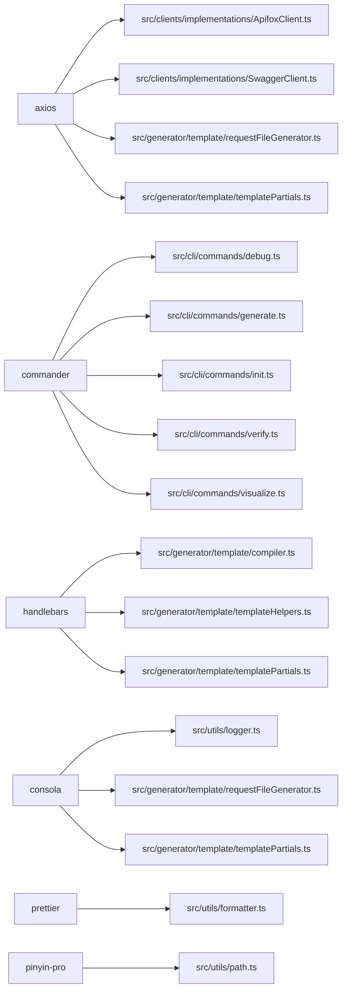

# 技术栈

Relevant source files

- src/cli/commands/debug.ts
- src/cli/commands/generate.ts
- src/cli/commands/init.ts
- src/cli/commands/verify.ts
- src/cli/commands/visualize.ts
- src/clients/implementations/ApifoxClient.ts
- src/clients/implementations/SwaggerClient.ts
- src/generator/template/compiler.ts
- src/generator/template/requestFileGenerator.ts
- src/generator/template/templateHelpers.ts
- src/generator/template/templatePartials.ts
- src/utils/formatter.ts
- src/utils/logger.ts
- src/utils/path.ts
- tsdown.config.ts

本页基于仓库中依赖清单与源码 import 扫描结果，说明该项目的技术选型全貌：运行时为 **ESM**，包管理器为 **pnpm**，源码以 TypeScript 编写并运行在 Node 生态之上；命令行入口基于 `commander` 拆分为 `debug` / `generate` / `init` / `verify` / `visualize` 五个子命令（锚点：`src/cli/commands/debug.ts`、`src/cli/commands/generate.ts`、`src/cli/commands/init.ts`、`src/cli/commands/verify.ts`、`src/cli/commands/visualize.ts`）。

从 import 分布可以看出三层核心能力：**远程接口描述获取**（`axios`，落在 `src/clients/implementations/ApifoxClient.ts`、`src/clients/implementations/SwaggerClient.ts`）、**模板化产物生成**（`handlebars`，落在 `src/generator/template/compiler.ts`、`src/generator/template/templateHelpers.ts`、`src/generator/template/templatePartials.ts`）、以及**产物格式化与日志输出**（`prettier`、`consola`）。开发侧则由 `tsdown`（构建/打包配置）、`vitest`（测试）、`oxlint`（静态检查）、`vitepress`（文档站点）、`husky` + `standard-version`（提交钩子与版本发布）构成工具链。

## 技术选型总览

| 维度        | 结论                                                                      | 证据锚点                                               |
| ----------- | ------------------------------------------------------------------------- | ------------------------------------------------------ |
| 运行时      | ESM                                                                       | 依赖清单运行时字段（ESM）                              |
| 包管理器    | pnpm                                                                      | 依赖清单包管理器字段（pnpm）                           |
| 构建工具    | 数据未识别为具体工具；开发依赖中存在 `tsdown` 及其配置 `tsdown.config.ts` | `tsdown.config.ts`                                     |
| CLI 框架    | commander                                                                 | 五个命令文件，见下文                                   |
| HTTP 客户端 | axios                                                                     | `src/clients/implementations/ApifoxClient.ts`          |
| 模板引擎    | handlebars                                                                | `src/generator/template/compiler.ts`                   |
| 代码格式化  | prettier（运行时依赖）                                                    | `src/utils/formatter.ts`；commit:a77450db (2026-10-11) |
| 日志输出    | consola                                                                   | `src/utils/logger.ts`                                  |
| 测试框架    | vitest                                                                    | `vitest.config.ts`                                     |
| 静态检查    | oxlint                                                                    | commit:66550b85 (2026-09-06)                           |
| 文档站点    | vitepress                                                                 | commit:19d62434 (2025-12-08)                           |

核心依赖的 import 关系如下（节点均为依赖名与真实文件路径）：

## 核心依赖

### CLI 与命令行框架

| 依赖      | 版本    | 首个 import 点            | 其他使用点（锚点）                                                                                                |
| --------- | ------- | ------------------------- | ----------------------------------------------------------------------------------------------------------------- |
| commander | ^15.0.0 | src/cli/commands/debug.ts | src/cli/commands/generate.ts、src/cli/commands/init.ts、src/cli/commands/verify.ts、src/cli/commands/visualize.ts |

`commander` 的引入点全部落在 `src/cli/commands/` 目录内，且每个命令文件各自引入一次，说明命令行解析与子命令注册被集中在命令层，其余模块（客户端、生成器、工具）不直接依赖它。这也意味着 commander 的升级影响面被限制在这五个文件（锚点：`src/cli/commands/debug.ts`、`src/cli/commands/generate.ts`、`src/cli/commands/init.ts`、`src/cli/commands/verify.ts`、`src/cli/commands/visualize.ts`）。

### 网络请求与客户端实现

| 依赖  | 版本    | 首个 import 点                              | 其他使用点（锚点）                                                                                                                       |
| ----- | ------- | ------------------------------------------- | ---------------------------------------------------------------------------------------------------------------------------------------- |
| axios | ^1.20.0 | src/clients/implementations/ApifoxClient.ts | src/clients/implementations/SwaggerClient.ts、src/generator/template/requestFileGenerator.ts、src/generator/template/templatePartials.ts |

`axios` 同时出现在客户端实现层（`src/clients/implementations/ApifoxClient.ts`、`src/clients/implementations/SwaggerClient.ts`）与生成器的模板层（`src/generator/template/requestFileGenerator.ts`、`src/generator/template/templatePartials.ts`）。后者这两个文件同时引入 `consola`，属于生成器目录内既有模板渲染又有网络与日志依赖的文件，是升级 axios 时需要重点回归的位置。

### 模板引擎

| 依赖       | 版本   | 首个 import 点                     | 其他使用点（锚点）                                                                    |
| ---------- | ------ | ---------------------------------- | ------------------------------------------------------------------------------------- |
| handlebars | ^4.7.9 | src/generator/template/compiler.ts | src/generator/template/templateHelpers.ts、src/generator/template/templatePartials.ts |

`handlebars` 的使用范围收敛在 `src/generator/template/` 三个文件内，与 `compiler.ts`（编译）、`templateHelpers.ts`（辅助方法）、`templatePartials.ts`（局部模板）的文件命名形成对应关系（推断：三文件分别承担编译入口、辅助函数注册与局部模板组织职责，依据是文件名与同一目录内的共同 import 关系）。升级 Handlebars 大版本时，需关注的回归面基本等价于这三个文件。

### 输出、格式化与文本处理

| 依赖       | 版本    | 首个 import 点                                 | 其他使用点（锚点）                                              |
| ---------- | ------- | ---------------------------------------------- | --------------------------------------------------------------- |
| consola    | ^3.4.2  | src/generator/template/requestFileGenerator.ts | src/generator/template/templatePartials.ts、src/utils/logger.ts |
| prettier   | ^3.9.6  | src/utils/formatter.ts                         | —                                                               |
| pinyin-pro | ^3.29.3 | src/utils/path.ts                              | —                                                               |

`consola` 由通用日志模块 `src/utils/logger.ts` 引入，同时被生成器模板层的两个文件直接引入（`src/generator/template/requestFileGenerator.ts`、`src/generator/template/templatePartials.ts`），因此日志能力的变更会同时波及工具层与生成器层。

`prettier` 的唯一源码引入点是 `src/utils/formatter.ts`，但它的归类是**运行时依赖**而非开发依赖，这一位置由提交记录明确交代：commit:a77450db (2026-10-11)「fix: 将 prettier 移至运行时依赖以修复产物绝对路径导入报错」，另有 commit:d35a4446 (2025-08-24)「fix: prettier」。据此可确认格式化能力需要在产物生成链路上随包分发，属于运行时行为的一部分；若在依赖整理中把它挪回开发依赖，会重现已被修复的产物导入问题（锚点：commit:a77450db）。

`pinyin-pro` 的唯一引入点是 `src/utils/path.ts`，说明它服务于路径/命名工具模块（锚点：`src/utils/path.ts`）；升级影响面限于该文件。

## 开发依赖

| 依赖             | 版本           | 首个 import 点             | 开发场景用途                                                                                                                                                                                 |
| ---------------- | -------------- | -------------------------- | -------------------------------------------------------------------------------------------------------------------------------------------------------------------------------------------- |
| husky            | ^9.1.7         | 无源码 import（脚本调用）  | Git 钩子管理                                                                                                                                                                                 |
| oxlint           | ^1.81.0        | 无源码 import（脚本调用）  | 静态检查；commit:66550b85 (2026-09-06)「chore: 全量升级依赖并将 ESLint 替换为 OxLint」                                                                                                       |
| standard-version | ^9.5.0         | 无源码 import（脚本调用）  | 版本发布与变更日志；commit:474ef91e (2025-09-05)「chore: 迁移到 standard-version，更新路径工具函数」、commit:eb22be8a (2026-01-02)「fix: standard-version配置」                              |
| tsdown           | ^0.23.0        | tsdown.config.ts           | 构建/打包配置                                                                                                                                                                                |
| tsx              | ^4.23.13       | 无源码 import（脚本调用）  | TypeScript 脚本直接执行                                                                                                                                                                      |
| typescript       | ^5.9.3         | src/cli/commands/verify.ts | 类型检查与编译；commit:7c5ab74a (2026-10-11)「fix: 修复 TypeScript 类型检查错误并修正 vitest 配置位置」、commit:8590dea9 (2026-01-07)「fix: 修复TypeScript编译错误并更新所有依赖到最新版本」 |
| vitepress        | 2.0.0-alpha.15 | 无源码 import（脚本调用）  | 文档站点；commit:19d62434 (2025-12-08)「chore: 清理不再使用的依赖并升级VitePress」                                                                                                           |
| vitest           | ^5.0.0         | vitest.config.ts           | 单元测试                                                                                                                                                                                     |

开发依赖可分为三条线：

- **质量与提交规范线**：`oxlint`（静态检查，由 commit:66550b85 记录完成了从 ESLint 的整体替换）、`husky`（钩子）、`standard-version`（版本与变更日志，commit:474ef91e 记录迁移到该工具，commit:eb22be8a 记录了配置修正）。这三者均无源码 import 点，只通过脚本调用。
- **构建与执行线**：`tsdown`（唯一带配置文件 `tsdown.config.ts` 的构建类依赖）、`tsx`（脚本执行，无 import 点）、`typescript`（既用于开发期类型检查，也被 `src/cli/commands/verify.ts` 直接引入，见下）。
- **测试与文档线**：`vitest`（配置在 `vitest.config.ts`；commit:7c5ab74a (2026-10-11) 提到同时"修正 vitest 配置位置"）、`vitepress`（文档站点，commit:19d62434 (2025-12-08) 记录清理无用依赖并升级）。

需要特别留意的两点：

1. `typescript` 被 `src/cli/commands/verify.ts` 直接引入，即它并非只在开发期使用，而被源码命令层引用（锚点：`src/cli/commands/verify.ts`）。这意味着该依赖被归类为开发依赖，但存在运行期使用路径，安装方式变更时需单独验证。
2. `vitest` 对应的覆盖率包出现在「声明未用依赖」列表中（见下文），二者关系需人工核对。

## 声明未用依赖

下表由源码 import 扫描推导（覆盖 .ts/.js/.vue/.css），存在动态加载、字符串引用等扫描盲区，清理前请人工复核。

| 依赖                            | 版本     |
| ------------------------------- | -------- |
| @clack/prompts                  | ^1.7.0   |
| dayjs                           | ^1.11.23 |
| @commitlint/cli                 | ^21.2.2  |
| @commitlint/config-conventional | ^21.2.2  |
| @types/node                     | ^26.4.1  |
| @vitest/coverage-v8             | ^5.0.0   |
| lint-staged                     | ^17.5.0  |
| prettier-config-ali             | ^1.5.0   |

其中 `@commitlint/cli`、`@commitlint/config-conventional`、`lint-staged` 属于典型的「通过配置文件或 Git 钩子调用」类工具，而项目中 `husky` 已作为开发依赖存在（脚本调用），因此这些包是否被钩子配置间接使用，需要在清理前结合配置文件人工确认，不宜仅凭 import 扫描结果直接删除。

## 待确认

1. **构建工具**：依赖清单未识别出具体构建工具，但 `tsdown` 及其配置 `tsdown.config.ts` 存在，构建与产物发布的实际执行链路缺证据。
2. **脚本类开发依赖的调用位置**：`husky`、`oxlint`、`standard-version`、`tsx`、`vitepress` 均只检出脚本调用，缺少具体命令与触发时机的证据。
3. **`typescript` 的运行期可用性**：它被 `src/cli/commands/verify.ts` 引入却归类为开发依赖，实际发布包中该路径能否正常工作待确认。
4. **未检出引用的工具链依赖入口**：`@commitlint/cli`、`@commitlint/config-conventional`、`lint-staged`、`prettier-config-ali` 的调用入口缺证据。

## Related

- 同目录：[overview.md](overview.md) · [environment.md](environment.md)
- 互补职责：[overview.md](../01-overview/overview.md)
- 共享 7 个源文件、共享 44 个符号：[onboarding.md](../05-guides/onboarding.md)
- 共享 6 个源文件、共享 25 个符号：[troubleshooting.md](../05-guides/troubleshooting.md)
- 共享 7 个源文件、共享 10 个符号：[modules.md](../02-architecture/modules.md)
- 总入口：[README](../README.md)

<!-- wiki:source: llm -->
