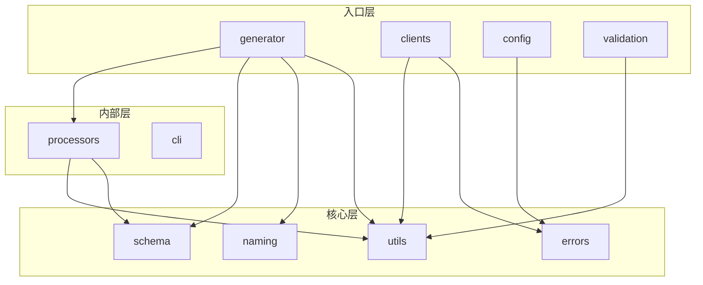
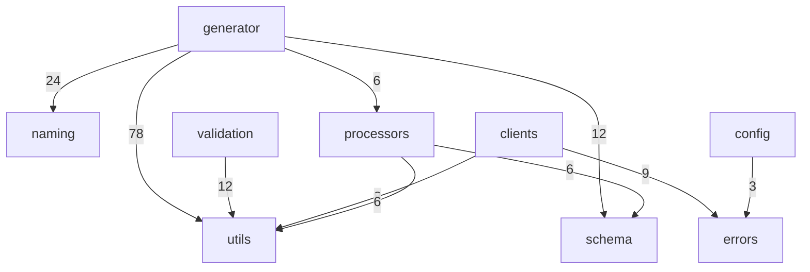

Relevant source files

- src/cli/commands/debug.ts
- src/cli/commands/generate.ts
- src/cli/commands/init.ts
- src/cli/commands/verify.ts
- src/cli/constants.ts
- src/cli/program.ts
- src/config/index.ts
- src/config/loader.ts
- src/naming/index.ts
- src/naming/sanitizer.ts
- src/naming/strategy.ts
- src/processors/common.ts
- src/processors/openapi.ts
- src/schema/freeForm.ts
- src/schema/index.ts

## 整体架构设计思路与架构图

系统采用单向依赖的分层架构：全部代码集中在单一 `src` 源根下（12 个功能聚合簇的归属标识均为 `src`），11 个模块按依赖方向被划分为三层。判定依据不是目录约定，而是依赖统计——凡是「扇出为 0、扇入极高」的模块被归入核心层（`utils` 扇入 104、`naming` 扇入 24、`schema` 扇入 18、`errors` 扇入 12），它们是只被调用、不调用别人的稳定底座；凡是「只有出向调用、没有入向调用」的模块被归入入口层（`generator`、`clients`、`config`、`validation`），它们是外部请求进入系统的起点；夹在两者之间的 `processors`（扇入 6、扇出 12）与 `cli`（扇入 0、扇出 0）被归入内部层。数据中另有一个 `types` 模块未被纳入分层判定，其定位待确认。

各模块的层次归属、判定依据与规模如下：

| 模块         | 层次                   | 判定依据                 | 文件数 |
| ------------ | ---------------------- | ------------------------ | ------ |
| `generator`  | 入口层                 | 仅有出向调用、无入向调用 | 37     |
| `clients`    | 入口层                 | 仅有出向调用             | 7      |
| `config`     | 入口层                 | 仅有出向调用             | 2      |
| `validation` | 入口层                 | 仅有出向调用             | 7      |
| `errors`     | 核心层                 | 扇入 12、扇出 0          | 4      |
| `naming`     | 核心层                 | 扇入 24、扇出 0          | 3      |
| `schema`     | 核心层                 | 扇入 18、扇出 0          | 3      |
| `utils`      | 核心层                 | 扇入 104、扇出 0         | 16     |
| `processors` | 内部层                 | 扇入 6、扇出 12          | 2      |
| `cli`        | 内部层                 | 扇入 0、扇出 0           | 8      |
| `types`      | 未出现在分层判定结果中 | 信息不足                 | 6      |

从职责看，核心层是「无业务倾向的能力层」：`utils` 被 `generator`、`validation`、`clients`、`processors` 四个上层模块共同调用，是全局复用面最广的基础设施；`schema` 与 `naming` 分别承载结构定义与命名规则，被 `generator` 与 `processors` 复用；`errors` 是错误类型层，被 `clients` 与 `config` 使用。入口层是「流程发起层」：体量最大的 `generator`（37 个文件）同时调用 `utils`、`naming`、`schema` 和 `processors`，是本系统的主干流程；`clients` 负责对外部交互并产出 `errors`/`utils` 语义；`config` 只向下依赖 `errors`，是配置装载的最小入口；`validation` 只依赖 `utils`，是校验入口。内部层中 `processors` 承担转换职责，向下使用 `schema` 与 `utils`。

层间协作遵循严格的单向可达性，全部调用边如下表，方向只有「入口层 → 内部层/核心层」与「内部层 → 核心层」两类，数据中不存在任何核心层指向入口层的反边——这正是核心层扇出为 0 的直接后果。入口层允许跨层直连核心层（如 `generator → utils`、`validation → utils`），因此系统中没有强制的逐层穿透约束，而是「稳定底座 + 直达复用」的宽松分层。

| 调用方 → 被调用方          | 跨层关系        | 证据（调用对）           |
| -------------------------- | --------------- | ------------------------ |
| `generator` → `utils`      | 入口层 → 核心层 | `generator → utils`      |
| `generator` → `naming`     | 入口层 → 核心层 | `generator → naming`     |
| `generator` → `schema`     | 入口层 → 核心层 | `generator → schema`     |
| `generator` → `processors` | 入口层 → 内部层 | `generator → processors` |
| `processors` → `schema`    | 内部层 → 核心层 | `processors → schema`    |
| `processors` → `utils`     | 内部层 → 核心层 | `processors → utils`     |
| `validation` → `utils`     | 入口层 → 核心层 | `validation → utils`     |
| `clients` → `errors`       | 入口层 → 核心层 | `clients → errors`       |
| `clients` → `utils`        | 入口层 → 核心层 | `clients → utils`        |
| `config` → `errors`        | 入口层 → 核心层 | `config → errors`        |

功能聚合进一步印证了「取数 → 转换 → 生成 → 输出」的纵向切分：12 个聚合簇中，围绕 `fetchDataInternal`/`fetch`/`FetchError` 的 30 成员簇（内聚度 0.77）对应外部取数，围绕 `sanitizeTypeName`/`openApiPropertyToZodType`/`generateZodSchemaFromOpenApiSchema` 的 48 成员簇（内聚度 0.78）与围绕 `processOpenApiData`/`injectJsonValueIfNeeded` 的 13 成员簇（内聚度 0.67）对应数据转换，围绕 `generateFiles`/`generateHookFiles`/`writeFormattedFile` 的 38 成员簇（内聚度 0.64）与围绕 `compileTemplate`/`renderQuery` 的 26 成员簇（内聚度 0.83）对应代码生成与渲染，围绕 `validateConfiguration`（18 成员，内聚度 0.93）与 `loadConfig`/`ConfigError`（16 成员，内聚度 0.85）的两个高内聚簇分别对应校验与配置入口。【推断】核心层统一扇出为 0、上层只单向依赖，符合「依赖指向稳定方向」的设计取向；推断依据是分层统计中核心层无任何反向出边这一结构特征，而非文档或注释证据。

**待确认**

- `types` 模块（6 个文件、0 个符号）未出现在分层判定结果中，也未出现在任何调用边里，其系统定位与使用方式缺证据。
- `cli` 模块扇入与扇出均为 0，与其余模块无依赖边，它在系统中的接入与调用方式缺证据。
- 现有数据只到模块与符号名粒度，未提供文件路径与行号，具体实现位置的定位能力待确认。

## 核心模块详解（1/2）：generator、utils、clients、types、validation、errors

本节覆盖六个模块：核心代码生成链路（generator）、跨模块基础设施（utils）、外部数据源客户端（clients）、类型定义集合（types）、配置校验（validation）与结构化错误系统（errors）。本批各模块均只含 TypeScript 代码，不存在多语言分工。

### 一、generator：代码生成主链路

**定位与规模**：37 个 TypeScript 文件，是本节体量最大的模块。模块入口自述为“代码生成器主模块”（src/generator/index.ts:1）。

**内部文件职责**（均为文件头自述原文）：

| 文件                                              | 自述职责                                                                                                                                                                                          | 锚点                                                |
| ------------------------------------------------- | ------------------------------------------------------------------------------------------------------------------------------------------------------------------------------------------------- | --------------------------------------------------- |
| src/generator/index.ts                            | 代码生成器主模块                                                                                                                                                                                  | src/generator/index.ts:1                            |
| src/generator/extractor.ts                        | 从 OpenAPI 操作中提取响应和路径参数；请求参数提取已下沉至 requestParameters.ts（含 body/query/path 分组与 `@ParameterObject` 展开），此处 re-export 以保持既有 `from '../extractor'` 的导入兼容性 | src/generator/extractor.ts:1                        |
| src/generator/template/compiler.ts                | 提供 Handlebars 模板编译和缓存功能                                                                                                                                                                | src/generator/template/compiler.ts:1                |
| src/generator/template/templateDefinitions.ts     | 提供所有 Handlebars 模板的纯字符串定义                                                                                                                                                            | src/generator/template/templateDefinitions.ts:1     |
| src/generator/template/hookTemplateDefinitions.ts | 提供 react-query v5 / swr v2 / ahooks v3（vue-query v5 复用 react-query 模板）的 query / mutation Hook 模板，类型注解、请求函数表达式等差异通过模板数据（预渲染字符串 + 三花括号）注入            | src/generator/template/hookTemplateDefinitions.ts:1 |
| src/generator/template/zod/types.ts               | Zod 类型模板模块，处理 Zod 类型的模板生成                                                                                                                                                         | src/generator/template/zod/types.ts:1               |

**关键符号逐一说明**：

| 符号                   | 类型     | 锚点                                                | 签名                                                                         |
| ---------------------- | -------- | --------------------------------------------------- | ---------------------------------------------------------------------------- |
| `compileTemplate`      | function | src/generator/template/compiler.ts:34               | `(template: string)`                                                         |
| `collectRefTypeNames`  | function | src/generator/template/zod/recursive.ts:62          | `(schema: OpenApiSchema, selfName: string)`                                  |
| `buildCommonImports`   | function | src/generator/generators/hookGenerator.ts:187       | `(isJS, importedFunctions, importedTypes, importedSchemas, config, dirPath)` |
| `buildRequestBinding`  | function | src/generator/requestBinding.ts:141                 | `(input: RequestBindingInput)`                                               |
| `buildOptionsArgument` | function | src/generator/template/adapters/ahooksAdapter.ts:28 | `(data: HookInterfaceData)`                                                  |
| `buildKeyItems`        | function | src/generator/template/adapters/swrAdapter.ts:22    | `(data: HookInterfaceData, includeParams: boolean)`                          |

| 符号                   | 用途说明                                                                                                                                                                                                                                                                                      |
| ---------------------- | --------------------------------------------------------------------------------------------------------------------------------------------------------------------------------------------------------------------------------------------------------------------------------------------- |
| `compileTemplate`      | 将模板字符串编译为可执行渲染函数并提供缓存，是模板层与生成层之间的唯一编译入口（src/generator/template/compiler.ts:34）                                                                                                                                                                       |
| `collectRefTypeNames`  | 按文档描述“收集 schema 树中引用的其他类型名（`$ref` 末段，过滤自身）”，用于“递归类型 interface 的 `import type` 生成”，入参为 OpenAPI Schema 对象与自身类型名（用于过滤自引用），返回去重后的引用类型名数组（src/generator/template/zod/recursive.ts:62）                                     |
| `buildCommonImports`   | “组装库无关的 import 段（API 函数 + 类型模块 + 响应校验 Schema）”；入参携带是否为 JavaScript 目标、引用的 API 函数名集合、引用的类型名集合、需值导入的响应 Schema 名集合（zod 校验开启时）、API 配置与标签目录路径，返回 import 段代码字符串（src/generator/generators/hookGenerator.ts:187） |
| `buildRequestBinding`  | 以 `RequestBindingInput` 为唯一入参构建请求参数绑定结构，是参数提取结果落到生成代码之间的绑定构造点（src/generator/requestBinding.ts:141）                                                                                                                                                    |
| `buildOptionsArgument` | “构建 useRequest 第二参数：有前缀时生成 cacheKey，否则直接透传 options”，返回形如 `, options` 或 `, { cacheKey: 'user:getUserFunc', ...(options ?? {}) }` 的模板字符串片段，体现 ahooks 缓存键由接口前缀派生（src/generator/template/adapters/ahooksAdapter.ts:28）                           |
| `buildKeyItems`        | “构建 SWR key 数组项字符串（query 含参数对象，mutation 仅前缀 + 函数名）”，`includeParams` 决定是否纳入参数对象（query 为 true，mutation 为 false），返回逗号分隔的数组项字符串（src/generator/template/adapters/swrAdapter.ts:22）                                                           |

**设计意图（有源码自述证据者优先引用）**：

- 模板层与生成层解耦：模板以“纯字符串定义”集中存放（src/generator/template/templateDefinitions.ts:1），编译与缓存集中在一处（src/generator/template/compiler.ts:1），生成器只消费编译结果。
- 以模板数据注入替代模板分支：Hook 模板文件自述“类型注解、请求函数表达式等差异通过模板数据（预渲染字符串 + 三花括号）注入，避免模板分支爆炸”（src/generator/template/hookTemplateDefinitions.ts:1）——这解释了为何 ahooks / swr 的差异被收进 `buildOptionsArgument`、`buildKeyItems` 这类适配器函数，而非在模板里写条件分支。
- 兼容性优先的重构策略：extractor 自述“请求参数提取已下沉至 requestParameters.ts（含 body/query/path 分组与 `@ParameterObject` 展开），此处 re-export 以保持既有 `from '../extractor'` 的导入兼容性”（src/generator/extractor.ts:1），说明该模块经历过职责下沉重构，并以再导出维持调用方不变。

**依赖方向**：generator 依赖 utils、naming、schema、processors 四个模块，不被本批其他模块引用（usedBy 为空）。

### 二、utils：跨模块基础设施

**定位与规模**：16 个 TypeScript 文件。它被 generator、validation、clients、processors 四个模块引用，是本节 fanIn 视角下最基础的公共层。

**内部文件职责**（文件头自述原文）：

| 文件                | 自述职责                                                                                              | 锚点                  |
| ------------------- | ----------------------------------------------------------------------------------------------------- | --------------------- |
| src/utils/config.ts | 配置解析、验证和预设应用功能                                                                          | src/utils/config.ts:1 |
| src/utils/logger.ts | 基于 consola 封装的统一日志模块，提供运行时 debug 开关，“消除全项目的 if(process.env.DEBUG) 手动守卫” | src/utils/logger.ts:1 |
| src/utils/file.ts   | 文件操作工具函数                                                                                      | src/utils/file.ts:1   |
| src/utils/escape.ts | 代码注入防护工具，对进入生成代码的远端自由文本进行转义                                                | src/utils/escape.ts:1 |
| src/utils/hooks.ts  | 钩子函数的执行和错误处理                                                                              | src/utils/hooks.ts:1  |
| src/utils/path.ts   | 中文到拼音转换、路径生成等功能                                                                        | src/utils/path.ts:1   |

**关键符号逐一说明**：

| 符号                  | 类型     | 锚点                         | 签名                                               |
| --------------------- | -------- | ---------------------------- | -------------------------------------------------- |
| `cleanOutputDir`      | function | src/utils/file.ts:96         | `(dirPath: string, excludeFiles: string[] = [])`   |
| `completeCurrentStep` | method   | src/utils/progress.ts:41     | `(description?: string)`                           |
| `buildParamAccess`    | function | src/utils/escape.ts:97       | `(requestParamName: string, rawParamName: string)` |
| `begin`               | method   | src/utils/schemaSafety.ts:54 | `(schema: object)`                                 |
| `HookManager`         | class    | src/utils/hooks.ts:12        | —                                                  |
| `assertValidMethod`   | function | src/utils/config.ts:69       | `(method: string)`                                 |

- `cleanOutputDir`：清理输出目录，并以 `excludeFiles` 白名单保留不应删除的文件，是生成前清理阶段的入口（src/utils/file.ts:96）。
- `completeCurrentStep`：进度模型中“完成当前步骤”的动作，接受可选描述文本，供进度上报复用（src/utils/progress.ts:41）。
- `buildParamAccess`：按文档描述“生成参数访问表达式——合法标识符用点访问（`params.code`），非法标识符用方括号访问（`params['user-id']`）”，入参为请求参数变量名与来自 `{paramName}` 占位符的原始路径参数名，返回安全的成员访问表达式（src/utils/escape.ts:97）。
- `begin`：所属 `CircularRefGuard` 的“标记 schema 开始处理。若该对象已在处理链中，返回 true（循环引用）”，调用方据此跳过；文档示例给出 `if (guard.begin(schema)) return null;` 的使用范式（src/utils/schemaSafety.ts:54）。
- `HookManager`：文档自述“负责执行用户定义的钩子函数，并提供统一的错误处理”，即用户钩子的集中执行点与错误收敛点（src/utils/hooks.ts:12）。
- `assertValidMethod`：对 HTTP 方法入参做合法性断言，把配置层的非法值拦截在生成之前（src/utils/config.ts:69）。

**设计意图（有证据）**：

- 日志模块自述其存在理由是一个时序问题：“consola 在模块导入时根据 `process.env.DEBUG` 固化日志级别，但 CLI 的 debug 命令在 action 中才设置该变量，导致 consola 内置级别检测失效。本模块通过运行时布尔开关解决该时序问题，debug 命令调用 `setDebugEnabled(true)` 即可”（src/utils/logger.ts:1）——这是绕开库初始化时序缺陷的运行时开关设计。
- escape 模块自述防御目标明确列三类：JSDoc 注释逃逸、字符串字面量逃逸（单引号/反斜杠）、模板字符串逃逸（反引号 / `${}`）（src/utils/escape.ts:1），说明生成代码中的远端自由文本被视为不可信输入。
- schemaSafety 的环形守卫与 generator 中递归类型处理（`collectRefTypeNames` 过滤自引用）指向同一问题域：OpenAPI schema 图的环状引用需要显式防护，否则递归遍历不终止。

**依赖与复用**：utils 自身不依赖本批任何模块（dependsOn 为空），被 generator、validation、clients、processors 复用，属于零依赖的基础层，也是本批唯一被多个模块共同引用的模块。

### 三、clients：外部数据源适配层

**定位与规模**：7 个 TypeScript 文件。模块入口自述“负责与不同类型的 API 服务器通信，支持插件化客户端架构”（src/clients/index.ts:1）。

**内部文件职责**（文件头自述原文）：

| 文件                                         | 自述职责                                                            | 锚点                                           |
| -------------------------------------------- | ------------------------------------------------------------------- | ---------------------------------------------- |
| src/clients/index.ts                         | 客户端主模块，负责与不同类型的 API 服务器通信，支持插件化客户端架构 | src/clients/index.ts:1                         |
| src/clients/base/BaseClient.ts               | 客户端抽象基类，为所有 API 客户端提供统一的接口和通用功能           | src/clients/base/BaseClient.ts:1               |
| src/clients/base/registry.ts                 | 客户端注册器，管理所有 API 客户端的注册和查找                       | src/clients/base/registry.ts:1                 |
| src/clients/base/index.ts                    | 客户端基础模块导出                                                  | src/clients/base/index.ts:1                    |
| src/clients/implementations/ApifoxClient.ts  | Apifox 客户端实现                                                   | src/clients/implementations/ApifoxClient.ts:1  |
| src/clients/implementations/SwaggerClient.ts | Swagger/OpenAPI 客户端实现                                          | src/clients/implementations/SwaggerClient.ts:1 |

**关键符号**：本模块的 topSymbols 均落在注册器上：

| 符号               | 类型   | 锚点                             | 签名                  |
| ------------------ | ------ | -------------------------------- | --------------------- |
| `autoSelectClient` | method | src/clients/base/registry.ts:84  | `(config: ApiConfig)` |
| `clear`            | method | src/clients/base/registry.ts:154 | `()`                  |

- `autoSelectClient`：按文档描述“根据配置自动选择合适的客户端”，入参为 API 配置，返回匹配的客户端实例（src/clients/base/registry.ts:84）。它使“数据源类型选择”从显式配置项收敛为按配置自动推导。
- `clear`：“清除所有注册的客户端”，用于重置注册表状态（src/clients/base/registry.ts:154）。

**架构形态**：由 BaseClient（抽象基类）+ 两个具体实现（ApifoxClient、SwaggerClient）+ Registry（注册与查找）构成典型的“插件化 + 注册表”组合；新增数据源只需实现基类契约并注册，这与入口“支持插件化客户端架构”的自述一致（src/clients/index.ts:1）。具体注册与查找的调用落点在本批数据中未提供调用边，**待确认**具体注册时机（启动期注册还是按需注册）所需的调用链证据。

**依赖方向**：clients 依赖 errors（错误类型）与 utils（基础工具），usedBy 为空。

### 四、types：类型定义集合

**定位与规模**：6 个 TypeScript 文件，无 topSymbols、无依赖与被依赖关系，属于纯声明层。

| 文件                | 自述职责         | 锚点                  |
| ------------------- | ---------------- | --------------------- |
| src/types/index.ts  | 类型定义统一导出 | src/types/index.ts:1  |
| src/types/config.ts | 配置相关类型定义 | src/types/config.ts:1 |
| src/types/api.ts    | API 相关类型定义 | src/types/api.ts:1    |
| src/types/hooks.ts  | 钩子函数类型定义 | src/types/hooks.ts:1  |
| src/types/enums.ts  | 枚举类型定义     | src/types/enums.ts:1  |
| src/types/output.ts | 输出相关类型定义 | src/types/output.ts:1 |

其职责边界清晰：config（配置）、api（接口模型）、hooks（钩子）、enums（枚举）、output（输出产物）五类领域类型，经 index 统一再导出。多个模块的签名直接使用该层的类型（如 clients 的 `autoSelectClient(config: ApiConfig)`、generator 的 `buildCommonImports(..., config: ApiConfig, ...)`、validation 的 `computeOutputDir(svc: ServiceConfig, ...)`），说明该模块在静态层面承担全项目的类型契约。

### 五、validation：配置校验

**定位与规模**：7 个 TypeScript 文件。入口自述“统一管理和调用所有验证规则”（src/validation/index.ts:1）。

| 文件                               | 自述职责                                             | 锚点                                 |
| ---------------------------------- | ---------------------------------------------------- | ------------------------------------ |
| src/validation/index.ts            | 配置验证系统入口，统一管理和调用所有验证规则         | src/validation/index.ts:1            |
| src/validation/errors.ts           | 验证错误类型定义，定义验证过程中使用的错误类型和接口 | src/validation/errors.ts:1           |
| src/validation/reporter.ts         | 验证结果报告器，负责格式化并输出验证报告             | src/validation/reporter.ts:1         |
| src/validation/validators/basic.ts | 基础类型验证器，验证配置中各个字段的基本类型和值     | src/validation/validators/basic.ts:1 |
| src/validation/validators/url.ts   | URL 相关验证器，验证配置中 URL 字段的有效性          | src/validation/validators/url.ts:1   |
| src/validation/validators/logic.ts | 逻辑关系验证器，验证配置项之间的逻辑关系和一致性     | src/validation/validators/logic.ts:1 |

**关键符号**：

| 符号               | 类型     | 锚点                                        | 签名                                          |
| ------------------ | -------- | ------------------------------------------- | --------------------------------------------- |
| `computeOutputDir` | function | src/validation/validators/serviceDirs.ts:27 | `(svc: ServiceConfig, baseOutputDir: string)` |

`computeOutputDir` 按文档描述为“计算单个服务的 outputDir（join(baseOutputDir, folder ?? name)）”（src/validation/validators/serviceDirs.ts:27）。它把多服务输出目录的推导规则集中在一处，供校验期提前判定目录冲突或路径合法性，避免生成阶段才暴露路径问题。

**设计意图（推断）**：validators 目录下按 basic / url / logic 三类切分，配合独立的 errors 与 reporter，形成“单条规则（validators）—错误模型（errors）—报告呈现（reporter）”的分层，这从文件命名与各自文件头自述可读出（src/validation/validators/basic.ts:1、src/validation/errors.ts:1、src/validation/reporter.ts:1）；该分层是否为可插拔规则注册机制，**待确认**，需 index.ts 内部实现证据。

**依赖方向**：validation 依赖 utils，usedBy 为空。

### 六、errors：结构化错误系统

**定位与规模**：4 个 TypeScript 文件。入口自述“提供结构化的错误类型和解决方案建议”（src/errors/index.ts:1）。

| 文件                     | 自述职责                                               | 锚点                       |
| ------------------------ | ------------------------------------------------------ | -------------------------- |
| src/errors/index.ts      | 统一的错误处理系统，提供结构化的错误类型和解决方案建议 | src/errors/index.ts:1      |
| src/errors/errorCodes.ts | 错误代码枚举，定义项目中所有错误类型的唯一标识         | src/errors/errorCodes.ts:1 |

**关键符号**：

| 符号                    | 类型     | 锚点                           | 签名                                                                                    |
| ----------------------- | -------- | ------------------------------ | --------------------------------------------------------------------------------------- |
| `constructor`           | method   | src/errors/errorClasses.ts:60  | `(code: ErrorCode, message: string, solutions: ErrorSolution[], originalError?: Error)` |
| `configInvalid`         | function | src/errors/errorFactory.ts:51  | `(message: string, solutions: ErrorSolution[])`                                         |
| `configMissingRequired` | function | src/errors/errorFactory.ts:102 | `(field: string)`                                                                       |
| `configNotFound`        | function | src/errors/errorFactory.ts:19  | `(configPath: string)`                                                                  |

- 错误类构造函数：以错误代码 + 消息 + 解决方案列表 + 可选原始错误为参数（src/errors/errorClasses.ts:60），说明错误对象自带“解法”而不只是信息；“原始错误可选”保留了向下包装底层异常的通道。
- `configInvalid / configMissingRequired / configNotFound`：三个配置类错误的工厂函数（src/errors/errorFactory.ts:51、src/errors/errorFactory.ts:102、src/errors/errorFactory.ts:19）。`configMissingRequired` 只接受字段名，属于结构化生成（由工厂补齐文案与解法）；`configNotFound` 接受配置文件路径；`configInvalid` 接受自定义消息与解决方案列表。三者覆盖“文件不存在 / 字段缺失 / 值非法”三段配置失败路径。

**设计意图（有证据）**：

- 首次提交即“feat: 统一错误处理”（commit:6f6dea17，2026-01-07），说明错误系统是项目起步期的基线能力，而非后期补丁。
- 高频提交主题为“重构代码结构，拆分大文件并优化模块组织（×2）”（commit:f8e9f197，2026-07-20），与 utils 中 extractor 等下沉重构的自述一致，反映该项目持续做模块拆分。

**依赖与复用**：errors 自身不依赖本批任何模块，被 clients 与 config 引用，即错误模型是客户端层的公共失败出口。

### 本批模块关系小结

| 模块       | 文件数 | 本批依赖                          | 本批被引用                                 | 角色           |
| ---------- | ------ | --------------------------------- | ------------------------------------------ | -------------- |
| generator  | 37     | utils、naming、schema、processors | —                                          | 生成主链路     |
| utils      | 16     | —                                 | generator、validation、clients、processors | 零依赖基础层   |
| clients    | 7      | errors、utils                     | —                                          | 外部数据源适配 |
| types      | 6      | —                                 | —                                          | 类型契约层     |
| validation | 7      | utils                             | —                                          | 配置校验       |
| errors     | 4      | —                                 | clients、config                            | 结构化错误模型 |

依赖自上而下单向汇聚到 utils 与 errors 两个无出边模块：utils 被 generator / validation / clients / processors 复用，errors 被 clients / config 复用，types 则以类型契约形式被各模块签名直接引用。

**待确认**：generator 与 naming、schema、processors 的具体调用边未在本批数据中出现，跨模块调用路径需结合下一批模块数据确认；clients 注册器的注册时机同样缺少调用链证据。

## 核心模块详解（2/2）：config、naming、schema、processors、cli

本节覆盖 5 个模块：配置加载（config）、命名策略（naming）、Schema 中立层（schema）、OpenAPI 数据处理（processors）与命令行层（cli）。5 个模块均为 TypeScript 单一语言实现，无混合语言职责划分。

| 模块       | 文件数 | 语言       | 声明依赖       | 被哪些模块引用        | 本批提供的符号明细           |
| ---------- | ------ | ---------- | -------------- | --------------------- | ---------------------------- |
| config     | 2      | TypeScript | errors         | 本批数据未记录        | 3 个（类 1、方法 1、函数 1） |
| naming     | 3      | TypeScript | 无             | generator             | 未提供符号级明细             |
| schema     | 3      | TypeScript | 无             | generator、processors | 未提供符号级明细             |
| processors | 2      | TypeScript | schema、utils  | generator             | 4 个（均为函数）             |
| cli        | 8      | TypeScript | 本批数据未记录 | 本批数据未记录        | 3 个（均为函数）             |

从分层看，本批出现了两条明确的层次约束：schema 被声明为「中立层」，由 processors 与 generator 共用（`src/schema/index.ts:1`）；cli 则是一层对外命令入口，包含产物类型检查这类生成后质量关卡。

---

### config：配置文件加载与缓存

**职责**

config 模块承担配置文件的加载与缓存。文件头自述为「配置文件加载器 支持配置缓存以提高性能」（`src/config/loader.ts:1`），`src/config/index.ts` 则作为配置模块的统一导出入口，自述为「配置模块导出」（`src/config/index.ts:1`）。也就是说，该模块对外只暴露配置加载相关能力，内部实现集中在 `src/config/loader.ts`，并由 `index.ts` 收敛导出面。

模块声明依赖 errors（`config → errors`），即加载过程中的失败语义由错误模块承载；在本批数据范围内，未记录任何模块引用 config。

**核心符号**

| 符号                 | 类型     | 位置                       | 签名                    | 作用                                                                                                              |
| -------------------- | -------- | -------------------------- | ----------------------- | ----------------------------------------------------------------------------------------------------------------- |
| `ConfigCacheManager` | class    | `src/config/loader.ts:26`  | —                       | 配置缓存管理器（`src/config/loader.ts:26` 处的类文档注释原文）                                                    |
| `clear`              | method   | `src/config/loader.ts:75`  | `()`                    | 清除所有缓存（`src/config/loader.ts:75` 处的方法文档注释原文）                                                    |
| `clearConfigCache`   | function | `src/config/loader.ts:230` | `(configPath?: string)` | 按可选配置路径清除配置缓存；无文档注释，行为依签名与函数名可辨（`configPath` 为可选参数，未传时应作用于全部缓存） |

三者构成「缓存管理器 + 单条清理 + 全局清理」的组合：`ConfigCacheManager` 提供实例级缓存容器，`clear` 清空其内部缓存，模块级 `clearConfigCache` 则是外部可调用的清缓存入口。

**设计意图（含证据）**

- 缓存是显式设计目标，而非实现细节：文件头自述「支持配置缓存以提高性能」（`src/config/loader.ts:1`）。
- 缓存需要一个被外部主动失效的出口：cli 的生成命令文件头明确写到 watch 模式下的「缓存清理：重新生成前清除配置加载缓存，确保拿到配置文件的新内容」（`src/cli/commands/generate.ts:1`），这与 config 暴露的 `clearConfigCache`（`src/config/loader.ts:230`）形成呼应——配置缓存必须在重新生成前失效，否则监视模式会持续使用旧配置。
- 演进证据：config 的首次提交为 `4388e7de`（2025-09-29），主题「refactor: 重组项目结构和代码架构」，说明该模块是在一次结构重组中被确立的。

---

### naming：命名策略与名称清理

**职责**

naming 是「统一命名口径」的模块，由 3 个 TypeScript 文件组成，职责按文件头划分为三层：

| 文件           | 自述职责                                                                                   | 锚点                        |
| -------------- | ------------------------------------------------------------------------------------------ | --------------------------- |
| `strategy.ts`  | 命名策略模块：提供灵活的命名策略接口和默认实现，用于统一管理接口、函数、类型名称的生成逻辑 | `src/naming/strategy.ts:1`  |
| `sanitizer.ts` | 名称清理模块：提供标识符名称清理和规范化功能，确保生成的代码符合 TypeScript 标识符命名规则 | `src/naming/sanitizer.ts:1` |
| `index.ts`     | 命名策略模块：提供统一的命名策略和名称清理功能                                             | `src/naming/index.ts:1`     |

即：`strategy.ts` 定义「怎么命名」（接口名、函数名、类型名的生成规则，且以策略接口 + 默认实现的形态提供可替换性），`sanitizer.ts` 负责「命名结果是否合法」（清理与规范化，保证符合 TypeScript 标识符规则），`index.ts` 合并导出两类能力。

被命名策略服务的下游是 generator：本批数据显示 naming 被 generator 引用，且 naming 自身不声明依赖其他模块，属于典型的下游消费、上游无依赖的基础能力层。本批未提供该模块的符号级明细，因此具体策略接口名、默认实现类名与清理函数名待确认。

**设计意图（含证据）**

- 命名逻辑被刻意从生成器中拆出：naming 的首次提交为 `f9369dc3`（2026-06-22），主题「refactor: 重构客户端架构并拆分生成器模块」（commit:f9369dc3）——拆分生成器是 naming 独立的直接动因。
- 该主题是持续性的重构方向：高频提交主题记录「重构客户端架构并拆分生成器模块（×2）」（commit:db7ac47c，2026-10-09）。
- 可替换性是显式目标：`strategy.ts` 的文件头强调「灵活的命名策略接口和默认实现」（`src/naming/strategy.ts:1`），说明命名规则被设计为可替换的策略，而非硬编码在生成流程中。

---

### schema：面向 processors 与 generator 的中立层

**职责**

schema 是一个刻意保持「与生成无关」的中立层。目录入口自述为「Schema 中立层 提供与生成无关的 OpenAPI schema 分析/提取工具，供 processors 与 generator 共用，避免两包相互依赖形成环」（`src/schema/index.ts:1`）。其成员文件的职责为：

| 文件           | 自述职责                                                                                                                                                                                                                                                                                                                                 | 锚点                        |
| -------------- | ---------------------------------------------------------------------------------------------------------------------------------------------------------------------------------------------------------------------------------------------------------------------------------------------------------------------------------------- | --------------------------- |
| `operation.ts` | OpenAPI 操作内容（content）提取工具：从单个 `OpenApiOperation` 中按 content-type 优先级提取请求体/响应的 schema 及内容类型信息；纯函数、无副作用；属于中立层，processors 与 generator 共用，避免 processors → generator 的反向依赖                                                                                                       | `src/schema/operation.ts:1` |
| `freeForm.ts`  | 自由格式对象（free-form）检测与 `JsonValue` 类型定义：Java Jackson 的动态类型（`JsonNode` / `ObjectNode` / `ArrayNode` 等）在 springdoc-openapi 导出时因结构运行时才能确定，会产出 free-form schema（如 `{ type: 'object' }` 或 `{ additionalProperties: true }`），本模块负责识别这类 schema 并为其生成相应类型（数据中该段自述被截断） | `src/schema/freeForm.ts:1`  |
| `index.ts`     | 中立层的统一出口                                                                                                                                                                                                                                                                                                                         | `src/schema/index.ts:1`     |

被引用关系印证了「中立」定位：schema 同时被 processors 与 generator 引用，而 processors 又声明依赖 schema——若把 schema 相关逻辑留在 generator 内，就会出现 processors 反向依赖 generator 的环。本批未提供 schema 的符号级明细，具体导出函数名待确认。

**设计意图（含证据）**

- 拆分动机是解环，且有明确文字承诺：`src/schema/operation.ts:1` 与 `src/schema/index.ts:1` 均写明「避免 processors → generator 的反向依赖」。
- 首次提交主题与之完全一致：`4465253d`（2026-08-24）「refactor: 拆解循环依赖并加固 watch 模式与多服务失败隔离」（commit:4465253d）。
- 无副作用约束：`operation.ts` 自述「纯函数、无副作用」（`src/schema/operation.ts:1`），使其可被上层任意复用而不引入状态耦合。
- 现实驱动：`freeForm.ts` 的文件头把 free-form schema 的来源归因于 Java Jackson 动态类型在 springdoc-openapi 导出时的运行时结构（`src/schema/freeForm.ts:1`），说明该文件服务于真实导出场景中的类型缺口。

---

### processors：OpenAPI 数据处理

**职责**

processors 处理 OpenAPI 原始数据并提取接口、类型与类别信息，由两个文件构成：`src/processors/openapi.ts` 自述为「OpenAPI 数据处理模块 处理 OpenAPI 格式的数据，提取接口、类型和类别信息」（`src/processors/openapi.ts:1`）；`src/processors/common.ts` 自述为「公共处理模块 提供数据处理相关的公共函数」（`src/processors/common.ts:1`）。

依赖方向清晰：processors 声明依赖 schema 与 utils，被 generator 引用。即数据加工发生在本模块，但 schema 分析与提取这类通用能力取自 schema 中立层，文件与路径等通用能力取自 utils——这条依赖链正是 schema 中立层存在的意义。

**核心符号**

| 符号                             | 位置                            | 签名                                                                     | 作用                                                                                                                                                                                                                            |
| -------------------------------- | ------------------------------- | ------------------------------------------------------------------------ | ------------------------------------------------------------------------------------------------------------------------------------------------------------------------------------------------------------------------------- |
| `applyTransformPath`             | `src/processors/openapi.ts:40`  | `(transform: (path: string) => string, path: string)`                    | 应用 `transformPath` 转换函数，处理异常与返回值校验；当函数抛错或返回非字符串时归一为 `E3005 GenerateError`（`src/processors/openapi.ts:40`）                                                                                   |
| `containsFreeFormProperty`       | `src/processors/openapi.ts:68`  | `(schema: unknown, depth = 0)`                                           | 递归检测 schema 树中是否含 free-form 属性（`additionalProperties: true` / `{}`），用于判断是否需要注入内置 `JsonValue` 类型；仅做存在性检测、不收集具体位置；`depth` 用于递归深度控制以防 DoS（`src/processors/openapi.ts:68`） |
| `collectSchemasFromPaths`        | `src/processors/openapi.ts:111` | `(paths: NonNullable<OpenApiDocument['paths']>)`                         | 从 OpenAPI `paths` 中收集所有 requestBody / response 的 schema，用于预扫描是否含 free-form 属性，扁平化返回所有 schema 节点（`src/processors/openapi.ts:111`）                                                                  |
| `collectUsedTypesFromProperties` | `src/processors/common.ts:72`   | `(\n  properties: ApiProperty[],\n  processedData: ProcessedApiData,\n)` | 无文档注释；依签名与所在「公共处理模块」定位推断：遍历属性列表，将被引用的类型收集进已处理数据（`src/processors/common.ts:72`）——**推断**，依据为参数名 `properties` / `processedData` 与函数名语义                             |

其中 `applyTransformPath` 的受控失败策略值得注意：第三方改造函数（`transformPath`）抛错或返回非字符串，都被归一为 `E3005 GenerateError`，把不可控的用户回调转化为统一的生成错误语义（`src/processors/openapi.ts:40`）。

**设计意图（含证据）**

- free-form 的处理是「先检测、后注入」两阶段：`collectSchemasFromPaths`（`src/processors/openapi.ts:111`）做扁平化预扫描，`containsFreeFormProperty`（`src/processors/openapi.ts:68`）做存在性递归判断，两者共同决定是否需要注入内置 `JsonValue` 类型。
- 安全与健壮性是本模块的长期主题：高频提交主题记录「修复 pathprefix 正则注入、远端数据 dos、代码注入与路径遍历等安全问题（×2）、处理 any 类型（×2）、拆解循环依赖并加固 watch 模式与多服务失败隔离（×2）」（commit:cf83c605，2026-09-02）。这与 `containsFreeFormProperty` 中带 `depth` 的递归防 DoS 设计（`src/processors/openapi.ts:68`）方向一致。
- 首次提交为 `4388e7de`（2025-09-29）「refactor: 重组项目结构和代码架构」（commit:4388e7de）。

---

### cli：命令入口与生成后质量关卡

**职责**

cli 由 8 个 TypeScript 文件组成，是工具的对外命令层。本批给出了 6 个文件的职责自述，覆盖命令注册、各子命令与常量：

| 文件                   | 自述职责                                                                                                                                                                                                                                                                                                        | 锚点                             |
| ---------------------- | --------------------------------------------------------------------------------------------------------------------------------------------------------------------------------------------------------------------------------------------------------------------------------------------------------------- | -------------------------------- |
| `program.ts`           | CLI 程序入口，定义所有命令行命令                                                                                                                                                                                                                                                                                | `src/cli/program.ts:1`           |
| `constants.ts`         | CLI 常量定义，包含默认配置模板等常量                                                                                                                                                                                                                                                                            | `src/cli/constants.ts:1`         |
| `commands/generate.ts` | 代码生成命令，支持单次生成与监视模式；watch 模式设计为防抖（一次保存常触发多个文件系统事件，合并为一次重新生成）、互斥（上一次生成未结束时只排队一次重跑，避免并发 `cleanOutputDir` 竞争）、缓存清理（重新生成前清除配置加载缓存，确保拿到配置文件的新内容）                                                    | `src/cli/commands/generate.ts:1` |
| `commands/debug.ts`    | 诊断命令（dry-run 模式）：加载配置、获取 API 定义、处理数据并打印诊断报告，但不生成任何文件；与 generate 的区别是在「处理数据」阶段后停止，绝不调用 `generateFiles`，因此不会清空或写入输出目录                                                                                                                 | `src/cli/commands/debug.ts:1`    |
| `commands/init.ts`     | 初始化命令，创建配置文件                                                                                                                                                                                                                                                                                        | `src/cli/commands/init.ts:1`     |
| `commands/verify.ts`   | 产物类型检查命令：对生成的代码运行 TypeScript 类型检查（`tsc --noEmit` 语义），作为生成后的质量关卡，暴露缺失 import、类型冲突等问题，弥补消费方 tsconfig 通常将生成目录排除在类型检查之外的盲区；typescript 编译器优先复用消费方项目的依赖（从 `process.cwd` 向上解析），其次回退到本工具自身的 `node_modules` | `src/cli/commands/verify.ts:1`   |

命令之间的边界被写得非常明确：generate 写入产物，debug 在同一条流水线的「处理数据」阶段后终止、绝不写盘（`src/cli/commands/debug.ts:1`），二者互为安全的对照。

**核心符号**

| 符号                     | 位置                             | 签名                                                                     | 作用                                                                                                                                                                                                                                                 |
| ------------------------ | -------------------------------- | ------------------------------------------------------------------------ | ---------------------------------------------------------------------------------------------------------------------------------------------------------------------------------------------------------------------------------------------------- |
| `collectTypeScriptFiles` | `src/cli/commands/verify.ts:47`  | `(dirs: string[])`                                                       | 无文档注释；依签名与所在 verify 命令推断：从给定目录收集待检查的 TypeScript 文件（`src/cli/commands/verify.ts:47`）——**推断**，依据为参数 `dirs` 与函数名语义                                                                                        |
| `buildCompilerOptions`   | `src/cli/commands/verify.ts:106` | `(\n  ts: TSModule,\n  projectRoot: string,\n  outputDirs: string[],\n)` | 构建编译选项：复用消费方 `tsconfig.json` 的 paths 别名等配置（强制 `noEmit`）；无 tsconfig 时使用默认选项，并按生成代码的别名约定推导 `@/*`（`@` ≡ 生成目录路径中第一个 `src/` 段，见 `pathUtils.getAliasPath`）（`src/cli/commands/verify.ts:106`） |
| `checkGeneratedFiles`    | `src/cli/commands/verify.ts:163` | `(\n  outputDirs: string[],\n  projectRoot: string,\n)`                  | 接收产物目录与消费方项目根目录，执行 `verify.ts` 文件头所述的生成产物类型检查（`src/cli/commands/verify.ts:163`）                                                                                                                                    |

`buildCompilerOptions` 的设计意图写在文档注释里：类型检查必须理解消费方的路径别名，所以优先读取消费方 `tsconfig.json`；当消费方没有 tsconfig 时，则按生成代码自身的别名约定（`@/*` 对应生成目录中第一个 `src/` 段）推导回退选项（`src/cli/commands/verify.ts:106`）。这是把「检查结果可信」前置到「编译选项正确」的处理。

**设计意图（含证据）**

- verify 的存在理由是一个被点明的盲区：消费方 tsconfig 通常把生成目录排除在类型检查之外，因此工具自带一道类型检查关卡（`src/cli/commands/verify.ts:1`）。
- watch 模式的三个约束都是针对具体故障写的：防抖对应「一次保存触发多个文件系统事件」，互斥对应「并发 `cleanOutputDir` 竞争」，缓存清理对应「拿到配置文件的新内容」（`src/cli/commands/generate.ts:1`）。
- dry-run 只读是显式承诺：debug「绝不调用 `generateFiles`，因此不会清空或写入输出目录」（`src/cli/commands/debug.ts:1`）。
- 本批数据未记录 cli 与其余模块的依赖边，也未记录任何模块引用 cli，其内部文件间的调用关系待确认。

---

### 本批模块的层次关系小结

| 方向                                                            | 证据                                                                                                                                                  |
| --------------------------------------------------------------- | ----------------------------------------------------------------------------------------------------------------------------------------------------- |
| schema → 被 processors 与 generator 共用（中立层）              | `src/schema/index.ts:1`、`src/schema/operation.ts:1`、processors 声明依赖 schema                                                                      |
| processors → schema、utils                                      | 本批依赖数据；`src/schema/operation.ts:1` 明确「避免 processors → generator 的反向依赖」                                                              |
| naming → 被 generator 使用，自身无依赖                          | 本批引用数据；`src/naming/strategy.ts:1`、`src/naming/sanitizer.ts:1`                                                                                 |
| cli → 独立命令层，内部含生成 / 诊断 / 初始化 / 类型检查四类命令 | `src/cli/program.ts:1`、`src/cli/commands/generate.ts:1`、`src/cli/commands/debug.ts:1`、`src/cli/commands/init.ts:1`、`src/cli/commands/verify.ts:1` |
| config → 被 watch 流程复用（重新生成前清缓存）                  | `src/config/loader.ts:230`、`src/cli/commands/generate.ts:1`                                                                                          |

**待确认**

1. config 的下游调用方：本批数据未记录任何模块引用 config，除 `src/cli/commands/generate.ts:1` 对「清除配置加载缓存」的文字描述外，缺少 `clearConfigCache` / `ConfigCacheManager` 的具体调用点证据。
2. naming 的具体导出形态：3 个文件已明确职责划分，但未提供符号级明细，策略接口名、默认实现类名与清理函数名无法列出。
3. schema 的具体导出形态：同上，`operation.ts` / `freeForm.ts` 的导出函数与类型名未在数据中给出。
4. cli 的依赖边：8 个文件中仅 6 个有职责自述，与其余模块的依赖/被依赖关系在本批数据中均未记录。

## 模块依赖分析与横切关注点

### 依赖全景

下图仅包含数据中记录的模块与调用边，边标签为调用次数。

数据中另有 `types`、`cli` 两个模块，未记录任何依赖边（既无出边也无入边），在上图中不作为连线节点出现。

### 依赖边明细

| 调用方       | 被调用方     | 调用次数 |
| ------------ | ------------ | -------- |
| `generator`  | `utils`      | 78       |
| `generator`  | `naming`     | 24       |
| `generator`  | `schema`     | 12       |
| `validation` | `utils`      | 12       |
| `clients`    | `errors`     | 9        |
| `clients`    | `utils`      | 8        |
| `generator`  | `processors` | 6        |
| `processors` | `schema`     | 6        |
| `processors` | `utils`      | 6        |
| `config`     | `errors`     | 3        |

### 扇入 / 扇出分布

| 模块         | 出向依赖数 | 入向被依赖数 | 被调用总次数（入边合计） |
| ------------ | ---------- | ------------ | ------------------------ |
| `generator`  | 4          | 0            | 0                        |
| `processors` | 2          | 1            | 6                        |
| `clients`    | 2          | 0            | 0                        |
| `validation` | 1          | 0            | 0                        |
| `config`     | 1          | 0            | 0                        |
| `utils`      | 0          | 4            | 104                      |
| `errors`     | 0          | 2            | 12                       |
| `schema`     | 0          | 2            | 18                       |
| `naming`     | 0          | 1            | 24                       |
| `types`      | 0          | 0            | 0                        |
| `cli`        | 0          | 0            | 0                        |

### 关键依赖路径分析

- **`utils` 是全图唯一的公共底座。** 它被 4 个模块调用（`generator` 78 次、`validation` 12 次、`clients` 8 次、`processors` 6 次，合计 104 次），自身没有任何出向依赖（`utils` 无依赖边）。任何对 `utils` 的接口变更都会同时影响生成、校验、客户端、处理器四条链路。
- **`generator` 是最大的调用方，也是最重的编排者。** 它独占全部 4 条出向依赖（`utils` 78、`naming` 24、`schema` 12、`processors` 6，合计 120 次调用），且没有任何模块调用它，处于调用图的根位置。
- **两级生成链路。** `generator` → `processors`（6 次），`processors` 再向下调用 `schema`（6 次）与 `utils`（6 次）。`generator` 也直接调用 `schema`（12 次），即 schema 能力既被 `generator` 直接使用（12 次），也被 `processors` 间接使用（6 次），合计 18 次入边调用。
- **`naming` 是单一消费者模块。** 只有 `generator` 调用它（24 次），依赖面最窄，但调用频次仅次于 `utils`。
- **错误处理与配置构成一条独立末梢链路。** `clients` → `errors`（9 次）与 `config` → `errors`（3 次）汇聚到 `errors`，`errors` 无出向依赖。
- **给定边界内未出现循环依赖**：依赖方向整体自 `generator` / `clients` / `config` / `validation` 指向 `utils` / `naming` / `schema` / `processors` / `errors`，被依赖方均无回指边。

### 横切关注点

#### 错误处理

- 错误处理以独立模块 `errors` 承载，是依赖图中的汇聚终点（无出向依赖），被两处消费：`clients`（9 次）与 `config`（3 次），合计 12 次调用。
- `errors` 不依赖任何其他模块，意味着错误定义本身不反向耦合到业务模块，可被多模块安全复用。
- 注意：`generator`、`processors`、`validation`、`utils` 这 4 个模块在记录的边界中均**没有到 `errors` 的调用边**，即错误处理在这条主链路上没有被记录为经 `errors` 模块中转。

#### 配置管理

- `config` 模块只依赖 `errors`（3 次调用），自身没有任何入向调用边，在记录的依赖图里处于末梢位置。
- 也就是说，数据尚未体现出 `generator`、`clients` 等消费方是如何取得配置的；配置的注入与分发路径**待确认**（缺少 `config` 的入向调用边证据）。

#### 校验

- `validation` 是独立模块，仅依赖 `utils`（12 次调用），没有任何模块被记录为调用它，即它不在已记录的生成/客户端调用链中。
- 校验结果如何回传给调用方**待确认**（缺少 `validation` 的入向依赖或错误上报边证据）。

#### 日志与可观测性

- 数据中没有出现任何日志、指标或追踪相关的模块或依赖边。
- 日志机制（落点、级别、输出目标）**待确认**：缺少相关模块、依赖边或调用点的记录。

### 待确认

1. 错误处理的具体机制（错误类型的构造与传播方式）—— 仅有 `clients`、`config` 到 `errors` 的调用边，缺少函数级签名或返回值证据。
2. 配置的消费路径 —— `config` 无入向调用边，无法确认谁读取配置、何时读取。
3. 日志/可观测性实现 —— 依赖图中无任何相关模块或边。

## Related

- 同目录：[modules.md](modules.md) · [workspaces.md](workspaces.md) · [package-boundaries.md](package-boundaries.md)
- 互补职责：[modules.md](../02-architecture/modules.md)
- 共享 2 个源文件、共享 24 个符号：[chapter:config-validation/config-loading-cache.md](../09-chapters/config-validation/config-loading-cache.md)
- 共享 4 个源文件、共享 17 个符号：[glossary.md](../07-reference/glossary.md)
- 共享 3 个源文件、共享 16 个符号：[api.md](../03-interface/api.md)
- 总入口：[README](../README.md)

<!-- wiki:source: llm -->
