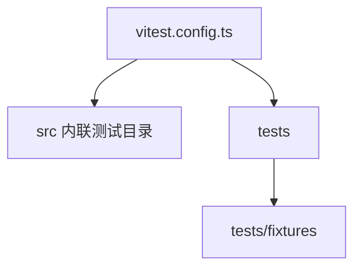

# 测试体系

<details>
<summary>Relevant source files</summary>

- vitest.config.ts

</details>

本页说明本项目用什么框架跑测试、测试代码放在哪里、如何执行命令，以及测试覆盖的模块范围。

## 测试体系概览

| 项                      | 事实                                                 | 证据                                             |
| ----------------------- | ---------------------------------------------------- | ------------------------------------------------ |
| 测试框架                | vitest                                               | `vitest.config.ts`                               |
| 配置文件                | `vitest.config.ts`（仓库根目录，测试发现的入口配置） | `vitest.config.ts`                               |
| 测试目录数量            | 17 个（16 个源码内联测试目录 + 1 个顶层测试目录）    | `src/cli/commands/__tests__` 等，见下表；`tests` |
| 夹具目录                | `tests/fixtures`                                     | `tests/fixtures`                                 |
| 测试文件数 / 生产文件数 | 55 / 111（全仓统计）                                 | 全仓扫描结果                                     |
| 覆盖率阈值              | 未检测到                                             | `vitest.config.ts`                               |
| 测试专用环境变量        | 未检测到                                             | 全仓扫描结果                                     |
| 测试专用常量            | 未检测到                                             | 全仓扫描结果                                     |
| 测试专用依赖            | 未检测到                                             | 全仓扫描结果                                     |

整体布局可概括为：源码内联单元测试为主，顶层 `tests/` 目录 + `tests/fixtures` 承担跨模块场景与共享输入数据。



## 测试目录分布

测试目录按被测源码领域切分，绝大多数为紧贴源码的 `__tests__` 目录：

| 被测领域         | 测试目录                                |
| ---------------- | --------------------------------------- |
| CLI 命令         | `src/cli/commands/__tests__`            |
| 客户端（聚合层） | `src/clients/__tests__`                 |
| 客户端基类       | `src/clients/base/__tests__`            |
| 客户端各实现     | `src/clients/implementations/__tests__` |
| 配置             | `src/config/__tests__`                  |
| 错误体系         | `src/errors/__tests__`                  |
| 生成器（聚合层） | `src/generator/__tests__`               |
| 具体生成器       | `src/generator/generators/__tests__`    |
| 模板             | `src/generator/template/__tests__`      |
| zod 模板         | `src/generator/template/zod/__tests__`  |
| 命名规则         | `src/naming/__tests__`                  |
| 处理器           | `src/processors/__tests__`              |
| Schema           | `src/schema/__tests__`                  |
| 工具函数         | `src/utils/__tests__`                   |
| 校验（聚合层）   | `src/validation/__tests__`              |
| 具体校验器       | `src/validation/validators/__tests__`   |
| 顶层 / 跨模块    | `tests`                                 |

## 两类测试：单元覆盖 vs 生成结果正确性

单元测试覆盖达标（工具内部函数被测试执行过）与生成结果正确（输出代码可编译、类型与请求行为符合 OpenAPI 契约）是两个独立命题。前者由上述 `__tests__/` 就近单测保证；后者由 `tests/e2e/` 的生成结果正确性测试保证（对标 Orval 的公开测试思路：生成多种目标代码后，对产物做类型检查与快照验证）。

| 项           | 事实                                                                                            | 证据                                      |
| ------------ | ----------------------------------------------------------------------------------------------- | ----------------------------------------- |
| E2E 目录     | `tests/e2e`（由 `vitest.config.ts` 的 include 纳入 `pnpm test`）                                | `vitest.config.ts`、`tests/e2e/*.test.ts` |
| 契约夹具     | `tests/e2e/fixtures/openApiContract.ts`（路径/查询/JSON/multipart 参数、顶层枚举、嵌套 $ref）   | `tests/e2e/fixtures/openApiContract.ts`   |
| 共享脚手架   | `tests/e2e/helpers.ts`（本地 HTTP 数据源、真实配置文件驱动、tsc noEmit 检查、axios 适配器捕获） | `tests/e2e/helpers.ts`                    |
| 临时输出目录 | `.tmp-e2e/`（`.gitignore` 的 `.tmp*` 规则覆盖，不进入版本库）                                   | `.gitignore`                              |
| 目标矩阵     | TS+typescript、TS+zod、JS、多服务+isolated 四类目标各一个测试文件                               | `tests/e2e/*.e2e.test.ts`                 |
| zod 测试依赖 | `zod@^3` devDependency（生成代码按 zod 3 API 生成，测试需用同版本做类型检查与运行时校验）       | `package.json`                            |

每个 E2E 用例验证四件事：

1. **结构断言**：文件树与契约一致（中文标签目录转拼音、类型/Schema 文件、request 文件位置）。
2. **类型检查**：用 TypeScript 编译器 API 对生成目录做 `noEmit` 检查；TS 目标另附「用法检查文件」以 `@ts-expect-error` 反向锁定类型契约。
3. **运行时请求行为**：动态导入生成模块，替换 axios 适配器捕获实际请求（URL 插值、query/body 落位、multipart FormData、响应解包、isolated baseURL）。
4. **快照验证**：关键生成文件落入 `tests/e2e/__snapshots__/`，防止无意识的输出漂移（有意变更时用 `vitest run tests/e2e -u` 更新）。

> 该类测试在引入当天即捕获了 5 个真实生成缺陷（zod 顶层枚举退化为 `z.object({})`、标准 OpenAPI 3.0 参数 `schema` 被忽略、枚举缺 `z.literal` 包裹、isolated 模式 `customizeAxios` 类型不兼容、JS 产物泄漏 TS 泛型调用语法），均为既有单元测试未覆盖的产物级问题。

## 运行方式

项目使用的运行命令为 `vitest run`：

```bash
vitest run
```

如需显式走本地安装的版本，可在仓库根目录执行：

```bash
npx vitest run
```

**该命令做了什么**：在 `vitest.config.ts` 的配置下发现测试用例，按既定测试范围（上述 17 个测试目录）一次性执行全部测试文件，不进入监听模式，执行完毕后进程退出。

**预期产出**：终端输出各测试文件与用例的通过/失败统计、耗时以及失败用例的错误详情；全部通过时退出码为 0，存在失败用例时退出码非 0，便于接入 CI 流水线。

**运行前提**：需在仓库根目录（即 `vitest.config.ts` 所在位置）执行，以保证配置与 `tests/fixtures` 夹具路径被正确解析。未探测到项目对测试命令的 npm script 封装，故这里给出直接调用 vitest 的形式。

## 测试专用证据

- 测试专用环境变量：**未检测到**。测试运行不依赖额外的测试专属环境变量注入。
- 测试专用常量：**未检测到**。未发现仅服务于测试的常量定义。
- 测试专用依赖：**未检测到**。未发现仅被测试导入的第三方依赖；测试文件使用的依赖与生产依赖一致。

因此，本项目的测试环境与生产运行时环境在这些维度上不存在额外分叉，测试可直接以同一套依赖执行。

## 测试策略解读

项目采用**就近单元测试**策略：测试目录几乎全部以 `__tests__` 形式嵌入被测源码所在目录（`src/clients/base/__tests__`、`src/validation/validators/__tests__`、`src/generator/template/zod/__tests__` 等），测试与实现同层维护，改动某个模块时对应测试就在同一目录树内，降低了测试与实现脱节的风险。覆盖范围沿源码模块边界逐层铺开，从 CLI 命令、客户端（含基类与各实现）、配置、错误、生成器（含具体生成器、模板与 zod 模板）、命名、处理器、schema、工具到校验（含各校验器），其中抽象层与可复用的小粒度组件（`base`、`validators`、`template/zod`）被单独设立了测试目录，说明这些高复用单元有独立的验证入口。

顶层 `tests` 目录与其中的 `tests/fixtures` 夹具目录，则承担无法在单一模块内闭合的场景与共享输入数据：夹具集中在 `tests/fixtures`，便于多个测试文件复用同一份输入样本，避免样本散落在各 `__tests__` 目录中造成重复与漂移。从规模看，55 个测试文件对应 111 个生产文件，约为 1:2 的比例，属于广泛铺开而非只覆盖少数核心路径的单元测试布局。未检测到覆盖率阈值配置，因此仓库未在测试配置层面对覆盖率设定硬性门槛。

## 覆盖重点与缺口

| 关注点                   | 结论                                                                                                  | 依据                                                                                                                                                              |
| ------------------------ | ----------------------------------------------------------------------------------------------------- | ----------------------------------------------------------------------------------------------------------------------------------------------------------------- |
| 覆盖最重的领域           | 生成器链路（聚合层 + 具体生成器 + 模板 + zod 模板，共 4 个测试目录）                                  | `src/generator/__tests__`、`src/generator/generators/__tests__`、`src/generator/template/__tests__`、`src/generator/template/zod/__tests__`                       |
| 次重领域                 | 客户端链路（聚合层 + 基类 + 各实现，共 3 个测试目录）、校验链路（聚合层 + 各校验器，共 2 个测试目录） | `src/clients/__tests__`、`src/clients/base/__tests__`、`src/clients/implementations/__tests__`；`src/validation/__tests__`、`src/validation/validators/__tests__` |
| 共享测试数据位置         | `tests/fixtures`                                                                                      | `tests/fixtures`                                                                                                                                                  |
| 覆盖率门槛               | 未检测到阈值配置                                                                                      | `vitest.config.ts`                                                                                                                                                |
| 具体用例数量与覆盖率数值 | 待确认：数据未提供用例统计与覆盖率报告，本页不做估算                                                  | 缺覆盖率报告与用例计数证据                                                                                                                                        |

## Related

- 同目录：[onboarding.md](onboarding.md) · [troubleshooting.md](troubleshooting.md)
- 共享 2 个符号：[overview.md](../01-overview/overview.md)
- 共享 1 个符号：[tech-stack.md](../01-overview/tech-stack.md)
- 共享 1 个符号：[environment.md](../01-overview/environment.md)
- 总入口：[README](../README.md)

<!-- wiki:source: llm -->
