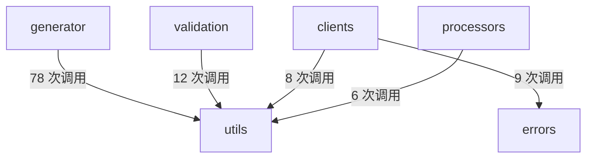

# clients · errors · utils 跨模块协作

<details>
<summary>Relevant source files</summary>

- src/clients/base/BaseClient.ts
- src/clients/implementations/ApifoxClient.ts
- src/clients/implementations/SwaggerClient.ts
- src/errors/errorClasses.ts
- src/utils/progress.ts

</details>

本页描述的是贯穿 `src/clients`、`src/errors`、`src/utils` 三个模块的一条固定协作链：**客户端层负责发起数据获取（含重试、超时、URL 匹配），错误层提供统一的错误结构与格式化输出，工具层提供进度显示**。这条链路值得单独成页的原因是它构成了仓库运行时的"取数主干"——`BaseClient.fetch` 是公共入口，向下派生出 Swagger 与 Apifox 两套实现，横向依赖 `errors` 做错误包装，纵向依赖 `utils/progress` 做用户可见的进度反馈；同时 `utils` 还额外承接了 `generator`、`validation`、`processors` 三个模块的调用，是仓库内被复用最广的一层。理解这条链路的调用方向与边界耦合强度，是修改客户端行为或错误输出格式前的前置条件。

---

## 一、职责与范围

主题覆盖 5 个文件，按职责分为三层：

| 文件                                           | 主题内分工                                               | 关键锚点                                                                    |
| ---------------------------------------------- | -------------------------------------------------------- | --------------------------------------------------------------------------- |
| `src/errors/errorClasses.ts`                   | 定义错误解决方案结构与多个错误类的构造、格式化输出       | `src/errors/errorClasses.ts:8` 、`:60` 、`:84` 、`:151` 、`:179` 、`:207`   |
| `src/clients/base/BaseClient.ts`               | 客户端抽象基类，提供公共 `fetch`、重试执行、URL 模式匹配 | `src/clients/base/BaseClient.ts:1` 、`:100` 、`:137` 、`:219`               |
| `src/clients/implementations/SwaggerClient.ts` | Swagger/OpenAPI 客户端实现                               | `src/clients/implementations/SwaggerClient.ts:1` 、`:15` 、`:23` 、`:72`    |
| `src/clients/implementations/ApifoxClient.ts`  | Apifox 客户端实现                                        | `src/clients/implementations/ApifoxClient.ts:1` 、`:23` 、`:31` 、`:160`    |
| `src/utils/progress.ts`                        | 轻量级进度显示模块，承接步骤开始/完成/失败与时间格式化   | `src/utils/progress.ts:1` 、`:11` 、`:41` 、`:72` 、`:81` 、`:123` 、`:184` |

分工关系可概括为：`BaseClient` 定义**做什么**（公共接口与通用能力），两个 `*Client.ts` 定义**从哪里取**（Swagger 端点 / Apifox 平台），`errorClasses.ts` 定义**出错时怎么表达**，`progress.ts` 定义**过程中怎么反馈**。

---

## 二、关键符号

### 2.1 客户端公共能力（`src/clients/base/BaseClient.ts`）

基类的文件自述为"客户端抽象基类，为所有 API 客户端提供统一的接口和通用功能" ，其中三个符号构成本主题的核心：

```typescript
// src/clients/base/BaseClient.ts:100
fetch(config: ApiConfig)

// src/clients/base/BaseClient.ts:137
executeWithRetry<T>(fn: () => Promise<T>)

// src/clients/base/BaseClient.ts:219
matchUrlPatterns(url: string, patterns: RegExp[]): boolean
```

`fetch` 是公共数据获取接口，注释说明其"提供重试、超时、错误处理等通用功能" ，返回 `Promise<FetchResult>`；`FetchResult` 本身在 `src/clients/base/BaseClient.ts:12` 被注释为"API 数据获取结果" 。`executeWithRetry` 承担带重试机制的执行，接收一个返回 Promise 的异步函数 ，其重试节奏由内部调用的 `sleep`（`src/clients/base/BaseClient.ts:182`）实现 。`matchUrlPatterns` 用于验证 URL 是否匹配指定模式数组 ，是客户端选择逻辑的判断依据。

基类还定义了 `ClientOptions`（`:24`，"客户端配置选项" ）与 `ClientMetadata`（`:36`，"客户端元信息" ）两个契约，它们被两个实现类共用。

### 2.2 客户端实现（`SwaggerClient` / `ApifoxClient`）

两个实现类职责对称，各自提供元信息与内部取数实现：

| 符号                | 位置                                              | 角色                                                                                 |
| ------------------- | ------------------------------------------------- | ------------------------------------------------------------------------------------ |
| `SwaggerClient` 类  | `src/clients/implementations/SwaggerClient.ts:15` | 自述"从 Swagger 或 OpenAPI 端点获取 API 定义" ；文件自述"Swagger/OpenAPI 客户端实现" |
| `getMetadata`       | `src/clients/implementations/SwaggerClient.ts:23` | 获取客户端元信息                                                                     |
| `fetchDataInternal` | `src/clients/implementations/SwaggerClient.ts:72` | 内部数据获取实现 ，复杂度 1                                                          |
| `ApifoxClient` 类   | `src/clients/implementations/ApifoxClient.ts:23`  | 自述"从 Apifox 平台获取 OpenAPI 定义" ；文件自述"Apifox 客户端实现"                  |
| `getMetadata`       | `src/clients/implementations/ApifoxClient.ts:31`  | 获取客户端元信息                                                                     |
| `fetchDataInternal` | `src/clients/implementations/ApifoxClient.ts:160` | 内部数据获取实现 ，复杂度 11，明显高于 Swagger 侧同类方法                            |

两个模块各导出一个工厂函数（`createSwaggerClient` 位于 `src/clients/implementations/SwaggerClient.ts:15` ，`createApifoxClient` 位于 `src/clients/implementations/ApifoxClient.ts:23` ），作为实例化入口。

### 2.3 错误层（`src/errors/errorClasses.ts`）

`ErrorSolution` 接口位于 `src/errors/errorClasses.ts:8`，自述为"错误解决方案接口，定义错误解决方案的结构" 。它是错误层与客户端层之间的数据契约——四个构造函数签名中均出现 `solutions: ErrorSolution[]` 参数 。

四个构造函数的分工可由默认错误码区分：

| 位置                             | 签名要点                                                               | 默认错误码                |
| -------------------------------- | ---------------------------------------------------------------------- | ------------------------- |
| `src/errors/errorClasses.ts:60`  | `(code, message, solutions, originalError?)`，`code` 为必填首位参数    | 无默认值                  |
| `src/errors/errorClasses.ts:151` | `(message, solutions, originalError?, code = CONFIG_INVALID)`          | `CONFIG_INVALID`          |
| `src/errors/errorClasses.ts:179` | `(message, solutions, originalError?, code = FETCH_REQUEST_FAILED)`    | `FETCH_REQUEST_FAILED`    |
| `src/errors/errorClasses.ts:207` | `(message, solutions, originalError?, code = GENERATE_TEMPLATE_ERROR)` | `GENERATE_TEMPLATE_ERROR` |

注释明确指出后三者"推荐通过 ErrorFactory 工厂方法传入精确码" ，说明默认码是兜底值而非主路径。

```typescript
// src/errors/errorClasses.ts:84
format(verbose = false): string
```

`format` 将错误输出格式化为字符串，`verbose` 控制是否显示堆栈跟踪与原始错误 ，是错误信息面向用户的最终呈现出口。

### 2.4 进度工具（`src/utils/progress.ts`）

文件自述为"轻量级进度显示模块，基础进度（步骤开始/完成/标题）默认对用户可见，仅额外细节走 debug 日志" ，这一自述明确了可见性边界：基础进度对外，细节走日志。

| 符号                       | 位置                        | 角色                                                 |
| -------------------------- | --------------------------- | ---------------------------------------------------- |
| `SimpleProgressManager` 类 | `src/utils/progress.ts:184` | 自述"简单的进度管理器（替代复杂的 ProgressManager）" |
| `completeCurrentStep`      | `src/utils/progress.ts:41`  | 完成当前步骤，可选 `description` 参数                |
| `complete`                 | `src/utils/progress.ts:72`  | 完成所有步骤，可选 `message` 参数                    |
| `failCurrentStep`          | `src/utils/progress.ts:81`  | 当前步骤失败，接收 `Error \| string`                 |
| `formatTime`               | `src/utils/progress.ts:123` | 格式化时间显示，输入毫秒数                           |

此外，`SimpleProgress` 类（`src/utils/progress.ts:11`，自述"多步骤进度类" ）与便捷函数 `createMultiStepProgress`（`src/utils/progress.ts:106`，自述"便捷函数：创建并启动多步骤进度" ）构成多步骤进度的创建入口；工厂 `getProgressManager`（`src/utils/progress.ts:184`）负责产出 `SimpleProgressManager` 实例 。

---

## 三、协作方式

### 3.1 调用边

| 调用方                        | 被调用方                  | 位置                                              | 证据 |
| ----------------------------- | ------------------------- | ------------------------------------------------- | ---- |
| `fetch`                       | `executeWithRetry`        | `src/clients/base/BaseClient.ts:137`              |      |
| `fetch`                       | `wrapError`               | `src/clients/base/BaseClient.ts:164`              |      |
| `executeWithRetry`            | `sleep`                   | `src/clients/base/BaseClient.ts:182`              |      |
| `fetchDataInternal`           | `withTimeout`             | `src/clients/base/BaseClient.ts:192`              |      |
| `fetchDataInternal`（Apifox） | `fetchDataInternal`       | `src/clients/implementations/ApifoxClient.ts:160` |      |
| `fetch`（Swagger）            | `getMetadata`             | `src/clients/implementations/SwaggerClient.ts:23` |      |
| `fetch`（Swagger）            | `supports`                | `src/clients/implementations/SwaggerClient.ts:48` |      |
| `fetch`（Swagger）            | `normalize`               | `src/clients/implementations/SwaggerClient.ts:65` |      |
| `fetch`（Swagger）            | `fetchDataInternal`       | `src/clients/implementations/SwaggerClient.ts:72` |      |
| `fetchDataInternal`           | `makeRequestWithProgress` | `src/utils/progress.ts:146`                       |      |
| `complete`                    | `formatTime`              | `src/utils/progress.ts:123`                       |      |
| `makeRequestWithProgress`     | `formatTime`              | `src/utils/progress.ts:123`                       |      |
| `createSwaggerClient`         | `SwaggerClient`           | `src/clients/implementations/SwaggerClient.ts:15` |      |
| `createApifoxClient`          | `ApifoxClient`            | `src/clients/implementations/ApifoxClient.ts:23`  |      |
| `createMultiStepProgress`     | `SimpleProgress`          | `src/utils/progress.ts:11`                        |      |
| `getProgressManager`          | `SimpleProgressManager`   | `src/utils/progress.ts:184`                       |      |

### 3.2 协作方向解读

从边表可读出三条清晰的协作方向：

1. **基类内部的两条分支**：公共 `fetch` 向下分出"重试执行"（→ `executeWithRetry`，其内部再调 `sleep`）与"错误包装"（→ `wrapError`）两条路径 。
2. **实现类向基类的能力借用**：Swagger 与 Apifox 的 `fetchDataInternal` 都调用基类的 `withTimeout`（`src/clients/base/BaseClient.ts:192`），说明超时能力集中在基类。
3. **客户端向工具层的进度回馈**：两个 `fetchDataInternal` 都调用 `makeRequestWithProgress`（`src/utils/progress.ts:146`），取数过程中把进度信号交给 `progress.ts`；`progress.ts` 内部再由 `makeRequestWithProgress` 与 `complete` 调用 `formatTime` 做耗时格式化 。

Swagger 侧的 `fetch` 还额外串起 `getMetadata` → `supports` → `normalize` → `fetchDataInternal` 四个协作点 ，构成该实现内部的完整装配流程。

### 3.3 模块依赖图



图中 `clients→errors`（9 次） 与 `clients→utils`（8 次） 即本主题的两条横向边界；`generator→utils`（78 次）、`validation→utils`（12 次）、`processors→utils`（6 次） 则是主题之外的模块对同一工具层的复用。

---

## 四、跨模块边界

`utils`（本主题中的 `src/utils/progress.ts`）是被外部模块引用最密集的一层，累计外部调用量达 78 + 12 + 6 + 8 = 104 次：

| 边界方向               | 调用次数 | 强度解读                                                        | 证据 |
| ---------------------- | -------- | --------------------------------------------------------------- | ---- |
| `generator` → `utils`  | 78       | 绝对主力，`utils` 变更对生成流程影响面最大                      |      |
| `validation` → `utils` | 12       | 中等耦合                                                        |      |
| `clients` → `errors`   | 9        | 客户端异常路径全部经由此边界                                    |      |
| `clients` → `utils`    | 8        | 与主题内 `fetchDataInternal→makeRequestWithProgress` 调用链对应 |      |
| `processors` → `utils` | 6        | 较低耦合                                                        |      |

**修改代价评估：**

- 修改 `src/utils/progress.ts` 中 `formatTime`（`:123`）的签名或输出，会同时波及 `complete`（`:72`） 与 `makeRequestWithProgress`（`:146`） 两处调用点，并可能经 `generator→utils` 的 78 次调用放大到生成流程 。
- 修改 `src/clients/base/BaseClient.ts` 中 `fetch`（`:100`）的行为，会同时影响 `executeWithRetry`（`:137`）、`wrapError`（`:164`） 两条分支，并通过 `clients→errors` 边界 改变错误呈现。
- 修改 `src/errors/errorClasses.ts` 的 `ErrorSolution` 结构（`:8`） 代价最高——四个构造函数签名均以其为参数类型 ，是全主题共享度最高的契约。

---

## 五、设计动机

以下动机均取自源码注释原文。

**动机一：客户端要有统一接口。** `src/clients/base/BaseClient.ts:1` 文件头自述"客户端抽象基类，为所有 API 客户端提供统一的接口和通用功能" ；与此呼应，`fetch` 的注释写明"公共的数据获取接口，提供重试、超时、错误处理等通用功能"（`src/clients/base/BaseClient.ts:100`）。可据此判断：重试、超时、错误处理被刻意上提到基类而非留在各实现中，两个实现类的 `fetchDataInternal` 都调用基类的 `withTimeout` 正是这一设计的结果 。

**动机二：进度显示追求"轻"。** `SimpleProgressManager` 的类注释直接写明"简单的进度管理器（替代复杂的 ProgressManager）"（`src/utils/progress.ts:184`），这是一个明确的**替代式演进动机**，指向本主题之前存在过一个更复杂的实现。配套的可见性策略在文件头写明："基础进度（步骤开始/完成/标题）默认对用户可见，仅额外细节走 debug 日志"（`src/utils/progress.ts:1`）。该动机的证据链完整（类注释 + 文件头自述），无需推断。

**动机三：错误码需精确化，默认值只作兜底。** 三个子类构造函数的 JSDoc 都写明 `code` 参数"推荐通过 ErrorFactory 工厂方法传入精确码"（`src/errors/errorClasses.ts:151` 、`:179` 、`:207` ），并各自给出一个默认码：配置类默认 `CONFIG_INVALID`、取数类默认 `FETCH_REQUEST_FAILED`、模板生成类默认 `GENERATE_TEMPLATE_ERROR` 。与之对照，基类错误构造函数把 `code` 放在**必填首位**、不设默认值（`src/errors/errorClasses.ts:60`）。可据此判断：错误码的强约束落在基类，子类放宽为可选仅为降低调用方的书写负担。相关注释片段另见 `src/errors/errorClasses.ts:38` 与 `:144` 。

**动机四：进度创建要有一站式入口。** `createMultiStepProgress` 的注释为"便捷函数：创建并启动多步骤进度"（`src/utils/progress.ts:106`），其调用目标 `SimpleProgress` 的注释为"多步骤进度类"（`src/utils/progress.ts:11`），调用边为 `createMultiStepProgress → SimpleProgress`（`src/utils/progress.ts:11`）。二者配合把"创建"与"启动"合并为一次调用，与动机二中"轻量"的取向一致 。

**（推断）动机五：两个实现类共用同一套元信息与取数契约。** 依据是结构特征而非注释：`SwaggerClient` 与 `ApifoxClient` 各自都实现了同名的 `getMetadata`（`src/clients/implementations/SwaggerClient.ts:23` 、`src/clients/implementations/ApifoxClient.ts:31` ）与同签名的 `fetchDataInternal(config: ApiConfig)`（`:72` 、`:160` ），且两者都被各自的工厂函数实例化 。推断依据为命名与签名的对称性，而非源码中的显式声明。

---

## 六、取数链路的阶段推进

把上述调用边按方向串起来，可得到本主题的完整阶段序列：

| 阶段            | 动作                                   | 协作边（调用方 → 被调用方）                                                 | 证据 |
| --------------- | -------------------------------------- | --------------------------------------------------------------------------- | ---- |
| 1. 实例化       | 工厂产出具体客户端                     | `createSwaggerClient → SwaggerClient` / `createApifoxClient → ApifoxClient` |      |
| 2. 公共入口     | 由基类 `fetch` 接管                    | `fetch`（`src/clients/base/BaseClient.ts:100`）                             |      |
| 3. 重试分支     | 进入带重试执行                         | `fetch → executeWithRetry`，其内部 `executeWithRetry → sleep`               |      |
| 4. 错误分支     | 异常包装                               | `fetch → wrapError`                                                         |      |
| 5. 实现侧装配   | Swagger 侧依次取元信息、判支持、归一化 | `fetch → getMetadata` → `fetch → supports` → `fetch → normalize`            |      |
| 6. 进入内部取数 | 移交实现类                             | `fetch → fetchDataInternal`                                                 |      |
| 7. 超时约束     | 取数受基类超时控制                     | `fetchDataInternal → withTimeout`                                           |      |
| 8. 进度反馈     | 取数过程回报进度                       | `fetchDataInternal → makeRequestWithProgress`                               |      |
| 9. 耗时格式化   | 进度层格式化时间                       | `makeRequestWithProgress → formatTime`、`complete → formatTime`             |      |

需要单独说明的两点：

- Apifox 侧存在一条指向自身的调用边 `fetchDataInternal → fetchDataInternal`（`src/clients/implementations/ApifoxClient.ts:160`）；该实现的圈复杂度为 11，是主题内复杂度最高的符号 。其自我调用的具体触发条件，数据未给出。
- `withTimeout`（`src/clients/base/BaseClient.ts:192`）、`sleep`（`:182`）、`wrapError`（`:164`）、`supports`（`src/clients/implementations/SwaggerClient.ts:48`）、`normalize`（`:65`）、`makeRequestWithProgress`（`src/utils/progress.ts:146`）在本主题数据中**仅作为调用边的端点出现**，未提供其定义处的锚点，因此本页只描述调用方向，不描述其内部行为 。

---

## 七、读者速查

| 想了解                   | 去哪里                                                                       |
| ------------------------ | ---------------------------------------------------------------------------- |
| 客户端公共入口与通用能力 | `src/clients/base/BaseClient.ts:100` 、`:137` 、`:219`                       |
| Swagger 取数实现         | `src/clients/implementations/SwaggerClient.ts:15` 、`:72`                    |
| Apifox 取数实现          | `src/clients/implementations/ApifoxClient.ts:23` 、`:160`                    |
| 错误结构契约             | `src/errors/errorClasses.ts:8`                                               |
| 错误输出格式             | `src/errors/errorClasses.ts:84`                                              |
| 进度显示与时间格式       | `src/utils/progress.ts:123` 、`:184`                                         |
| 谁在复用工具层           | `generator→utils` 78 次 、`validation→utils` 12 次 、`processors→utils` 6 次 |

---

## 待确认

1. **`wrapError`、`supports`、`normalize`、`withTimeout`、`sleep`、`makeRequestWithProgress` 的定义位置与签名**：本主题数据仅提供它们作为调用边端点出现的位置，缺少符号定义锚点，无法说明其实现细节 。
2. **`clients→errors` 边界中 9 次调用的具体落点**：已确认边界存在与调用量，但数据未给出这 9 次调用分别发生在哪些 `clients` 文件的哪些行 。
3. **`getProgressManager` 的调用方**：数据中有 `getProgressManager → SimpleProgressManager`（`src/utils/progress.ts:184`） 这一出边，但未提供谁调用 `getProgressManager`，因而无法判断进度管理器的实际装配位置。

## Related

- 同目录：[generator-utils.md](generator-utils.md) · [utils-generator-docs.md](utils-generator-docs.md) · [utils-validation-generator.md](utils-validation-generator.md)
- 共享 3 个源文件、共享 14 个符号：[modules.md](../02-architecture/modules.md)
- 共享 5 个源文件、共享 5 个符号：[classes.md](../07-reference/classes.md)
- 共享 9 个符号：[architecture.md](../02-architecture/architecture.md)
- 总入口：[README](../README.md)

<!-- wiki:source: llm -->
