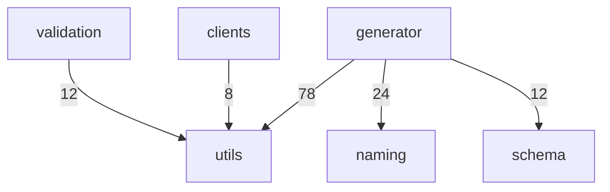

# generator · utils 跨模块协作

Relevant source files

- src/generator/template/zod/interfaces.ts
- src/generator/template/zod/types.ts
- src/utils/escape.ts

本页聚焦仓库中一条真实存在的协作缝：**Zod 生成器模板层（`src/generator/template/zod/`）如何在生成代码的过程中，把"远端自由文本"交给通用转义工具层（`src/utils/escape.ts`）处理**。它横跨 `generator` 与 `utils` 两个模块（边界统计中 `generator→utils` 共 78 次调用，是全部边界中调用量最大的一条 ），同时被 `validation→utils`（12 次 ）与 `clients→utils`（8 次 ）复用。单独成页的价值在于：这条缝同时承担**代码正确性**（生成合法的 Zod Schema 与 JSDoc/字符串字面量）与**代码注入防护**（转义远端 OpenAPI 文本）两项职责，任何一侧的签名或语义变更都会同时影响生成器、校验层与客户端三处调用方。

## 职责与范围

本主题覆盖 3 个生产文件，分工如下：

| 文件                                       | 模块归属  | 职责                                                                                                                | 锚点                                         |
| ------------------------------------------ | --------- | ------------------------------------------------------------------------------------------------------------------- | -------------------------------------------- |
| `src/utils/escape.ts`                      | utils     | 代码注入防护工具：对进入生成代码的远端自由文本做转义，覆盖 JSDoc 注释逃逸、字符串字面量逃逸、模板字符串逃逸三类风险 | `src/utils/escape.ts:1`                      |
| `src/generator/template/zod/types.ts`      | generator | Zod **类型**模板模块，处理 Zod 类型的模板生成；内含从 OpenAPI Schema 递归生成 Zod Schema 的表达逻辑                 | `src/generator/template/zod/types.ts:1`      |
| `src/generator/template/zod/interfaces.ts` | generator | Zod **接口**模板模块，处理 Zod 接口（含 Request/Response Schema）的模板生成                                         | `src/generator/template/zod/interfaces.ts:1` |

从职责切分看，`types.ts` 负责"类型/Schema 表达式"这一层，`interfaces.ts` 负责"一个 HTTP 接口对应的请求与响应"这一层，`escape.ts` 则是被前两者依赖的底层安全原语层。

## 关键符号

### 转义层（`src/utils/escape.ts`）

**`buildParamAccess(requestParamName, rawParamName)`** — `src/utils/escape.ts:97`
生成参数访问表达式：合法标识符用点访问（`params.code`），非法标识符用方括号访问（`params['user-id']`）。入参分别是请求参数变量名（如 `params`）与来自 `{paramName}` 占位符的原始路径参数名，返回安全的成员访问表达式。它是路径模板插值链路中把"远端参数名"转成"合法 TS 表达式"的最后一环。

**`escapeTemplateLiteralStatic(text)`** — `src/utils/escape.ts:76`
转义模板字符串字面量的静态文本部分：转义反斜杠、反引号与 `${` 序列，防止破坏模板字符串边界后注入代码。入参是来自远端 OpenAPI 路径的原始静态文本，返回可安全嵌入反引号模板字符串的文本。它处理的是"路径里非参数的那一段"。

此外，协作链路上还出现两个未被符号表收录、但由调用边与注释证实存在的转义函数：`escapeJsDocComment`（`src/utils/escape.ts:26`，被生成器两处调用 ，注释示例说明"闭合序列被转义，无法逃逸 JSDoc" ）与 `escapeStringLiteral`（`src/utils/escape.ts:43`，被 `interpolatePathParams` 调用 ，注释示例演示 `"'); require('fs')"` 被转义后失去破坏字符串边界的能力 ）。

### Zod 类型模板层（`src/generator/template/zod/types.ts`）

**`generateZodSchemaFromOpenApiSchema(schema, depth = 0, guard = new CircularRefGuard())`** — `src/generator/template/zod/types.ts:183`
从单个 OpenAPI Schema 递归生成 Zod Schema，签名中的 `depth` 与 `guard`（循环引用守卫）表明它是递归下降的入口。它是本主题中复杂度最高的符号之一（复杂度 9），同时被接口层与类型层调用 。

**`getZodTypeTemplateWithComment()` / `getZodTypeTemplateWithoutComment()`** — `src/generator/template/zod/types.ts:30` / `src/generator/template/zod/types.ts:51`
一对返回模板字符串的无参函数，分别对应"带注释"与"不带注释"两种 Zod 类型模板 。二者由 `getZodTypeTemplateByConfig` 按配置选择其一 ，构成"注释开关"这一配置维度的落点。

### Zod 接口模板层（`src/generator/template/zod/interfaces.ts`）

**`generateZodSchemaFromOperation(operation, type: 'request' | 'response', processedData?)`** — `src/generator/template/zod/interfaces.ts:138`
按操作对象与 `request`/`response` 方向生成 Schema，是本主题接口侧的分发中枢：向下调用 `generateMergedRequestSchema` 、`generateZodSchemaFromOpenApiSchema` 与 `openApiPropertyToZodType` ，向上被 `generateZodInterfaceSchemaFile` 调用 。

**`generateMergedRequestSchema(operation, processedData)`** — `src/generator/template/zod/interfaces.ts:209`
合并 `body` / `path` / `query` 三类字段生成请求 Schema，返回 Zod Schema 生成结果 。它是请求侧的"字段汇聚点"，其内部再委托给 `openApiPropertyToZodType` 做单属性到 Zod 类型的转换 。

**`getZodInterfaceSchemaTemplateWithComment()` / `getZodInterfaceSchemaTemplateWithoutComment()`** — `src/generator/template/zod/interfaces.ts:20` / `src/generator/template/zod/interfaces.ts:50`
接口 Schema 模板字符串的两种形态（带注释 / 不带注释），由 `getZodInterfaceSchemaTemplateByConfig(comment)` 依据"是否包含注释"选择 。

## 协作方式

三条协作链共同构成"远端 OpenAPI → 可写入文件的 TS 代码文本"的路径。以下为全部调用边（R2：静态可达性以表格呈现）。

| 调用方                                  | 被调用方                                      | 锚点                                           | 证据 |
| --------------------------------------- | --------------------------------------------- | ---------------------------------------------- | ---- |
| `generateZodInterfaceSchemaFile`        | `getZodInterfaceSchemaTemplateByConfig`       | `src/generator/template/zod/interfaces.ts:71`  |      |
| `generateZodInterfaceSchemaFile`        | `generateZodSchemaFromOperation`              | `src/generator/template/zod/interfaces.ts:138` |      |
| `generateZodInterfaceSchemaFile`        | `escapeJsDocComment`                          | `src/utils/escape.ts:26`                       |      |
| `generateZodSchemaFromOperation`        | `generateMergedRequestSchema`                 | `src/generator/template/zod/interfaces.ts:209` |      |
| `generateZodSchemaFromOperation`        | `generateZodSchemaFromOpenApiSchema`          | `src/generator/template/zod/types.ts:183`      |      |
| `generateZodSchemaFromOperation`        | `openApiPropertyToZodType`                    | `src/generator/template/zod/types.ts:251`      |      |
| `generateMergedRequestSchema`           | `openApiPropertyToZodType`                    | `src/generator/template/zod/types.ts:251`      |      |
| `generateZodSchemaFromOpenApiSchema`    | `openApiPropertyToZodType`                    | `src/generator/template/zod/types.ts:251`      |      |
| `generateZodTypeSchema`                 | `generateZodSchemaFromOpenApiSchema`          | `src/generator/template/zod/types.ts:183`      |      |
| `generateZodTypeSchema`                 | `getZodTypeTemplateByConfig`                  | `src/generator/template/zod/types.ts:68`       |      |
| `generateZodTypeSchema`                 | `escapeJsDocComment`                          | `src/utils/escape.ts:26`                       |      |
| `getZodInterfaceSchemaTemplateByConfig` | `getZodInterfaceSchemaTemplateWithComment`    | `src/generator/template/zod/interfaces.ts:20`  |      |
| `getZodInterfaceSchemaTemplateByConfig` | `getZodInterfaceSchemaTemplateWithoutComment` | `src/generator/template/zod/interfaces.ts:50`  |      |
| `getZodTypeTemplateByConfig`            | `getZodTypeTemplateWithComment`               | `src/generator/template/zod/types.ts:30`       |      |
| `getZodTypeTemplateByConfig`            | `getZodTypeTemplateWithoutComment`            | `src/generator/template/zod/types.ts:51`       |      |
| `interpolatePathParams`                 | `escapeStringLiteral`                         | `src/utils/escape.ts:43`                       |      |
| `interpolatePathParams`                 | `escapeTemplateLiteralStatic`                 | `src/utils/escape.ts:76`                       |      |
| `interpolatePathParams`                 | `buildParamAccess`                            | `src/utils/escape.ts:97`                       |      |

**三条链路的分工：**

1. **接口装配链**：`generateZodInterfaceSchemaFile` → 模板选择（`getZodInterfaceSchemaTemplateByConfig` 分流到带/不带注释两模板），同时 → `generateZodSchemaFromOperation` 取得请求/响应 Schema 文本 。
2. **Schema 递归链**：`generateZodSchemaFromOperation` → `generateMergedRequestSchema`（请求字段合并） → `generateZodSchemaFromOpenApiSchema`（递归下降） → `openApiPropertyToZodType`（单属性转换）。
3. **路径参数插值链**：`interpolatePathParams` 同时调用三个转义原语 —— `escapeStringLiteral` 、`escapeTemplateLiteralStatic` 、`buildParamAccess` ，分别处理单引号字面量、模板字符串静态段与参数访问表达式。

**数据流方向**：远端 OpenAPI 文本 → 生成器模板层（`interfaces.ts` / `types.ts`）产生候选代码文本 → 经过 `escape.ts` 的转义原语（`escapeJsDocComment` / `escapeStringLiteral` / `escapeTemplateLiteralStatic` / `buildParamAccess`）后写入最终文件。即 `utils` 处于数据流的下游末段，但在地理上被两处生成器代码直接调用 。

模块级调用规模（与文件级链路互补）：

## 跨模块边界

| 源模块       | 目标模块 | 调用次数 | 证据 | 对本主题的含义                                                                                                         |
| ------------ | -------- | -------- | ---- | ---------------------------------------------------------------------------------------------------------------------- |
| `generator`  | `utils`  | 78       |      | 本主题主边界。生成器对 `utils` 的依赖量远超其它方向，`escape.ts` 的任何签名/语义变更都会在生成器侧产生最大面积的回归面 |
| `generator`  | `naming` | 24       |      | 生成器还有一条与命名相关的独立依赖，不经过本主题的文件，但共用同一批生成入口                                           |
| `generator`  | `schema` | 12       |      | 生成器与 schema 模块的第二条依赖面                                                                                     |
| `validation` | `utils`  | 12       |      | `utils` 的转义/工具能力被校验模块复用，说明 `escape.ts` 是共享底层而非生成器私有                                       |
| `clients`    | `utils`  | 8        |      | 同上，客户端模块也复用 `utils`                                                                                         |

**修改代价判断：** `utils` 有三个上游消费模块（`generator` 78 次、`validation` 12 次、`clients` 8 次），因此 `escape.ts` 属于**高扇入的共享底层**，改动其导出签名需要同时核验三条边界；相对地，`generator/template/zod/` 下的两个文件在本主题内只被生成器自身的装配链（`generateZodInterfaceSchemaFile`、`generateZodTypeSchema`）调用，扇入更窄。

## 设计动机

**注入防护是 `escape.ts` 的显式立项目标。** 文件头自述为"代码注入防护工具：对进入生成代码的远端自由文本进行转义"，并逐条列出要防的三类逃逸 —— JSDoc 注释逃逸（注释闭合序列闭合注释后注入可执行代码）、字符串字面量逃逸（单引号/反斜杠破坏字符串边界后注入代码）、模板字符串逃逸（反引号/`${}` 破坏模板字符串边界后注入代码）。这一自述与本主题观察到的三个调用点（`escapeJsDocComment` 、`escapeStringLiteral` 、`escapeTemplateLiteralStatic` ）以及 `buildParamAccess` 的合法/非法标识符分流 完全对应：**三类逃逸面各有一个专用转义函数，且都在生成路径上被真实调用。**

**该文件的首个提交即是一组安全修复：** `fix: 修复 pathPrefix 正则注入、远端数据 DoS、代码注入与路径遍历等安全问题`（commit:6b1aec06，2026-06-23）。这说明 `escape.ts` 并非预先设计的抽象层，而是在修复真实注入风险时抽出的防护层。

**符号级注释给出了行为承诺（可用作回归测试用例）：**

- `escapeJsDocComment`：`escapeJsDocComment(malicious); // 闭合序列被转义，无法逃逸 JSDoc`（`src/utils/escape.ts:26`）
- `escapeStringLiteral`：`escapeStringLiteral("'); require('fs')"); // → "\\'); require(\\'fs\\')"`（`src/utils/escape.ts:43`）

**生成器模板层按"注释开/关"做二元分叉，是显式的配置化设计。** `getZodInterfaceSchemaTemplateByConfig` 的注释写明 `@param comment 是否包含注释 @returns 模板字符串`（`src/generator/template/zod/interfaces.ts:71`），并据此在 `WithComment` / `WithoutComment` 两个模板函数间二选一 ；`types.ts` 侧是同一模式的平行结构 。两个模板模块的文件头也各自声明了职责边界（"处理 Zod 类型的模板生成" / "处理 Zod 接口（包含 Request/Response Schema）的模板生成" ）。

**拆分时机：** `src/generator/template/zod/types.ts` 的首个提交是 `refactor: 重构客户端架构并拆分生成器模块`（commit:f9369dc3，2026-06-22）。即类型模板与接口模板的分离来自一次生成器模块拆分，而非独立演进。其中 `interfaces.ts` 的文件头使用"接口（包含 Request/Response Schema）"的措辞 ，与 `generateZodSchemaFromOperation` 的 `type: 'request' | 'response'` 参数 一致 —— **推断**：接口层之所以独立于类型层，是因为它需要按请求/响应方向做分发，而类型层只需处理单个 Schema；此推断依据为两文件的文件头自述差异与 `generateZodSchemaFromOperation` 的方向参数签名。

## 待确认

1. **`interpolatePathParams`、`openApiPropertyToZodType`、`escapeJsDocComment`、`escapeStringLiteral`、`generateZodTypeSchema` 等中间符号的定义锚点与签名未在数据中给出** —— 本页只能依据调用边确认它们的被调用位置，无法描述其参数与返回值形态。
2. **`getZodInterfaceSchemaTemplateByConfig` / `getZodTypeTemplateByConfig` 的"配置"来源未提供证据** —— 注释只说明入参 `comment` 的语义 ，未说明该布尔值由哪一层、哪个配置项决定。
3. **`generateZodSchemaFromOpenApiSchema` 的循环引用守卫实现未提供细节** —— 签名中出现 `CircularRefGuard` 与 `depth` 参数 ，但守卫类的定义与超限行为无锚点可依。
4. **`client→utils`、`validation→utils` 边界的具体调用点未提供** —— 仅有调用次数 ，无法判断它们是否复用同一批 `escape` 函数。

## Related

- 同目录：[clients-errors-utils.md](clients-errors-utils.md) · [utils-generator-docs.md](utils-generator-docs.md) · [utils-validation-generator.md](utils-validation-generator.md)
- 共享 15 个符号：[architecture.md](../02-architecture/architecture.md)
- 共享 8 个符号：[modules.md](../02-architecture/modules.md)
- 共享 6 个符号：[glossary.md](../07-reference/glossary.md)
- 总入口：[README](../README.md)

<!-- wiki:source: llm -->
