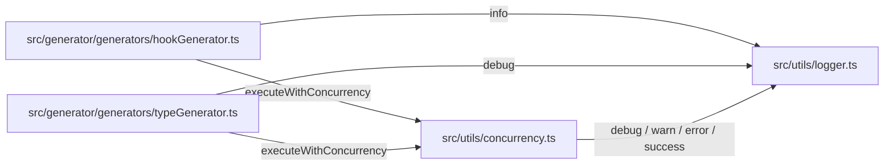

# utils · generator · docs 跨模块协作

<details>
<summary>Relevant source files</summary>

- src/generator/generators/hookGenerator.ts
- src/generator/generators/typeGenerator.ts
- src/utils/concurrency.ts
- src/utils/logger.ts

</details>

本页描述一个横跨「生成器层」「工具层」「文档层」的协作面：`src/generator/generators/` 下的 Hook 生成器与类型生成器，在批量写文件时统一依赖 `src/utils/` 的日志与并发控制设施，而 `docs/getting-started/` 承载面向使用者的入门文档。它值得单独成页，是因为这条链路把「代码生成」与「运行时开关/并发调度」两类关注点绑在一起：生成器 78 次调用落在工具层 ，`utils` 的任何接口变化都会同时波及 generator、validation、clients 三个调用方向 ；同时 `docs/getting-started/index.md` 出现在同一文件清单中，是这条链路的对外说明面。理解这条横向协作面，比逐文件阅读更能回答「生成器如何被并发驱动、日志开关为何要做成运行时的」。

---

## 职责与范围

本主题覆盖 5 个文件，分工如下：

| 文件                                        | 角色                                                                                                                                     | 本主题内关键符号                                                                           | 证据                                   |
| ------------------------------------------- | ---------------------------------------------------------------------------------------------------------------------------------------- | ------------------------------------------------------------------------------------------ | -------------------------------------- |
| `src/generator/generators/hookGenerator.ts` | Hook 文件生成器（库无关）：在已生成的 API 请求函数之上生成 Hook 包装，GET/HEAD 生成 query hook，POST/PUT/PATCH/DELETE 生成 mutation hook | `generateHookFiles`、`generateHookFileForTag`、`buildCommonImports`、`getHookNamingResult` |                                        |
| `src/generator/generators/typeGenerator.ts` | 类型文件生成器：负责生成 TypeScript 类型定义文件                                                                                         | `generateTypeFiles`、`generateTypeFile`、`generateTypesIndexFile`、`getTypeFileName`       |                                        |
| `src/utils/concurrency.ts`                  | 并发执行工具：提供带并发控制和错误处理的批量执行功能                                                                                     | `executeWithConcurrency`                                                                   |                                        |
| `src/utils/logger.ts`                       | 统一日志模块：基于 consola 封装，提供运行时 debug 开关                                                                                   | `debug`、`info`、`error`（以及调用边中出现的 `warn`、`success`）                           |                                        |
| `docs/getting-started/index.md`             | 文件清单内的文档侧入口                                                                                                                   | 无                                                                                         | 该文件无符号、无调用边、无动机条目数据 |

三个层级的职责切分是清晰的：生成器只负责「产出什么代码」，不负责「什么时候打印什么日志、怎么限制并发」——后者全部下沉到 `src/utils/`。这种下沉在调用边数据里表现为两条固定路径：`generateHookFiles → executeWithConcurrency` 与 `generateTypeFiles → executeWithConcurrency` 。

---

## 关键符号

### Hook 生成器侧（`src/generator/generators/hookGenerator.ts`）

**`generateHookFileForTag`**（`src/generator/generators/hookGenerator.ts:91`）

为指定标签生成 hooks 文件，是整个 Hook 生成链路的单标签执行单元。它接收接口数组、API 配置、Hook 库适配器、标签目录路径以及可选的命令行钩子函数，并向下串起两个依赖：调用 `getHookNamingResult` 拿到含 `hookName` 的命名结果 ，调用 `buildCommonImports` 组装文件头部的 import 段 。也就是说，命名与 import 组装这两个最容易产生「各写各的」的分叉点，被收敛到它一个调用点上。

```ts
(
  interfaces: ApiInterface[],
  config: ApiConfig,
  adapter: ReturnType<typeof getHookLibraryAdapter>,
  dirPath: string,
  cliHooks?: CliHooks,
)
```

**`buildCommonImports`**（`src/generator/generators/hookGenerator.ts:187`）

按注释自述，其职责是「组装库无关的 import 段（API 函数 + 类型模块 + 响应校验 Schema）」：把引用的 API 函数名集合、类型名集合、需要值导入的响应 Schema 名集合（zod 校验开启时）拼成一段 import 代码字符串返回。

```ts
(
  isJS: boolean,
  importedFunctions: Set<string>,
  importedTypes: Set<string>,
  importedSchemas: Set<string>,
  config: ApiConfig,
  dirPath: string,
)
```

**`getHookNamingResult`**（`src/generator/generators/hookGenerator.ts:226`）

按注释自述，它「复用全局命名策略（含 hookName）」，输入 API 路径、HTTP 方法与 operation 对象，返回带 `hookName` 的命名结果对象——这是 hook 文件名/函数名一致性的来源。它对 generator 模块边界外有依赖：`generator → naming` 方向的 24 次调用 是该命名策略的落地痕迹。

```ts
(
  path: string,
  method: string,
  operation: OpenApiOperation,
  config: ApiConfig,
)
```

### 类型生成器侧（`src/generator/generators/typeGenerator.ts`）

**`generateTypeFile`**（`src/generator/generators/typeGenerator.ts:92`）

生成单个类型文件，即为指定的类型生成 TypeScript 类型定义文件。它是批量流程的「单件」单元，被 `generateTypeFiles` 调用 ，同时自己调用 `getTypeFileName` 计算落盘文件名 。

```ts
(
  type: ApiTypeDefinition,
  processedData: ProcessedApiData,
  config: ApiConfig,
  typesDir: string,
  hooks?: CliHooks,
)
```

**`generateTypesIndexFile`**（`src/generator/generators/typeGenerator.ts:171`）

生成类型索引文件，导出所有类型定义，属于批量流程的收尾步骤（`generateTypeFiles → generateTypesIndexFile` ）。它与 `generateTypeFile` 共享同一个文件名规则函数 ，这是本主题内最典型的一处「共识收敛」。

```ts
(
  processedData: ProcessedApiData,
  config: ApiConfig,
  hooks?: CliHooks,
)
```

**`getTypeFileName`**（`src/generator/generators/typeGenerator.ts:79`）

计算类型名对应的文件名（非法字符替换为下划线）。注释显式给出了存在理由：「类型文件命名与桶索引引用必须使用同一规则，抽为公共函数防止漂移」——这正是它被 `generateTypeFile` 与 `generateTypesIndexFile` 双向调用的原因。

```ts
(typeName: string)
```

### 工具层（`src/utils/`）

**`info`**（`src/utils/logger.ts:83`） —— 输出 info 级别日志，按注释语义「始终输出」。它是生成器进入批量流程前的进度播报点：`generateHookFiles → info` 。

**`debug`**（`src/utils/logger.ts:73`） —— 输出 debug 级别日志，**受运行时开关控制**，这是本主题与 `setDebugEnabled`/`isDebugEnabled` 相关时序设计的接口面。它被三个方向调用：`executeWithConcurrency → debug` 、`generateTypeFiles → debug` 、`generateTypesIndexFile → debug` 。

**`error`**（`src/utils/logger.ts:107`） —— 输出 error 级别日志，按注释语义「始终输出」，是并发执行失败路径的落点：`executeWithConcurrency → error` 。

**`executeWithConcurrency`**（`src/utils/concurrency.ts:26`） —— 提供带并发控制和错误处理的批量执行功能 。它同时是「被生成器调用」和「调用日志」的枢纽：向上被 `generateHookFiles` 、`generateTypeFiles` 调用，向下调用 `debug` 、`warn` 、`error` 、`success` 四个日志出口。

```ts
// 签名与参数在提供的数据中未给出
```

> 待确认：`executeWithConcurrency` 的完整签名（并发度参数、任务数组形态、返回值）在数据中缺失，仅有锚点 `src/utils/concurrency.ts:26` 。

---

## 协作方式

### 调用边表

下表为本主题内全部静态调用关系（方向：调用方 → 被调用方；证据锚点为被调用方位置）：

| 调用方                   | 被调用方                 | 证据锚点                                        | 证据 |
| ------------------------ | ------------------------ | ----------------------------------------------- | ---- |
| `generateHookFiles`      | `info`                   | `src/utils/logger.ts:83`                        |      |
| `generateHookFiles`      | `executeWithConcurrency` | `src/utils/concurrency.ts:26`                   |      |
| `generateHookFiles`      | `generateHookFileForTag` | `src/generator/generators/hookGenerator.ts:91`  |      |
| `generateHookFileForTag` | `getHookNamingResult`    | `src/generator/generators/hookGenerator.ts:226` |      |
| `generateHookFileForTag` | `buildCommonImports`     | `src/generator/generators/hookGenerator.ts:187` |      |
| `generateTypeFiles`      | `debug`                  | `src/utils/logger.ts:73`                        |      |
| `generateTypeFiles`      | `executeWithConcurrency` | `src/utils/concurrency.ts:26`                   |      |
| `generateTypeFiles`      | `generateTypeFile`       | `src/generator/generators/typeGenerator.ts:92`  |      |
| `generateTypeFiles`      | `generateTypesIndexFile` | `src/generator/generators/typeGenerator.ts:171` |      |
| `generateTypeFile`       | `getTypeFileName`        | `src/generator/generators/typeGenerator.ts:79`  |      |
| `generateTypesIndexFile` | `getTypeFileName`        | `src/generator/generators/typeGenerator.ts:79`  |      |
| `generateTypesIndexFile` | `debug`                  | `src/utils/logger.ts:73`                        |      |
| `executeWithConcurrency` | `debug`                  | `src/utils/logger.ts:73`                        |      |
| `executeWithConcurrency` | `warn`                   | `src/utils/logger.ts:99`                        |      |
| `executeWithConcurrency` | `error`                  | `src/utils/logger.ts:107`                       |      |
| `executeWithConcurrency` | `success`                | `src/utils/logger.ts:91`                        |      |

### 文件级依赖形态



图中每条边对应上表锚点：`HG→LG(info)` 、`HG→CC` 、`TG→LG(debug)` 、`TG→CC` 、`CC→LG` 。注意 `src/utils/logger.ts` 与 `src/utils/concurrency.ts` 之间没有直接调用边——两者只通过「生成器同时依赖它们」发生关联，属于并列依赖而非层次依赖。

### 数据流阶段

| 阶段        | 动作                                        | 证据 |
| ----------- | ------------------------------------------- | ---- |
| 1. 批量入队 | 生成器入口播报信息（`info`）并进入并发执行  |      |
| 2. 单件生成 | 按标签/按类型逐件生成文件；类型侧先算文件名 |      |
| 3. 内部拼装 | Hook 侧取命名结果、组装 import 段           |      |
| 4. 索引收尾 | 类型侧生成索引文件，复用同一文件名规则      |      |
| 5. 过程记录 | 并发执行与索引生成过程按级别输出日志        |      |

---

## 运行机制

**日志的运行时开关时序**：注释给出了明确的设计因果——consola 在模块导入时根据 `process.env.DEBUG` 固化日志级别，而 CLI 的 debug 命令在 action 中才设置该变量，导致 consola 内置级别检测失效；本模块通过运行时布尔开关解决该时序问题，debug 命令调用 `setDebugEnabled(true)` 即可 。开关变量「初始化时读取环境变量作为默认值」，示例用法中调用 `setDebugEnabled(false)` 关闭 debug 日志 ，并配有查询入口「查询当前是否启用 debug 日志」。`debug()` 的「受运行时开关控制」语义 与 `info`/`error` 的「始终输出」语义 共同构成该机制的行为契约：开关只影响 debug 级别，不影响 info/error。

**并发执行的错误语义**：`executeWithConcurrency` 在批量执行中同时输出四种级别日志——成功用 `success` 、可恢复问题用 `warn` 、失败用 `error` 、过程细节用 `debug` ，说明它把单件失败与整体流程的反馈都收拢在调度器内部，而不是让每个生成器各自处理。这解释了两侧生成器为何只调用调度器一次即可 。

> 推断：`generateTypeFiles` 在调用 `generateTypeFile` 之后调用 `generateTypesIndexFile` ，从「桶索引需要引用全部类型文件名」 的注释与共同依赖 `getTypeFileName` 的结构特征看，索引生成应发生在单件落盘之后；但数据中未给出顺序保证的直接证据。

---

## 跨模块边界

| 调用方向           | 调用次数 | 证据 |
| ------------------ | -------- | ---- |
| generator → utils  | 78       |      |
| generator → naming | 24       |      |
| generator → schema | 12       |      |
| validation → utils | 12       |      |
| clients → utils    | 8        |      |

**耦合点解读与修改代价**：

1. `utils` 是本主题的公共底座。它被三个方向消费——generator（78 次）、validation（12 次）、clients（8 次），合计 98 次跨模块调用。因此修改 `src/utils/logger.ts` 的导出形态或 `src/utils/concurrency.ts` 的调用契约，代价不止落在生成器上，还会波及验证与客户端两个与本主题不在同一文件集内的模块。
2. `generator` 自身的出边是最密集的：除 utils 外还有 naming（24 次） 与 schema（12 次）。`getHookNamingResult` 的「复用全局命名策略」 正对应 naming 这条边；`buildCommonImports` 中「响应校验 Schema」 的组装对应 schema 这条边。
3. 本主题内部的两个生成器之间**没有**调用边（hookGenerator 与 typeGenerator 的边均在各自文件内或指向 utils），说明二者是并列的消费者关系，改动其一的生成逻辑不会直接穿透到另一方。
4. `docs/getting-started/index.md` 在边界数据中没有出现任何调用方向，属于无耦合边记录的文档文件。

> 待确认：naming、schema、validation、clients 四个模块的调用点文件与符号在数据中未给出，仅有调用次数，无法进一步定位具体耦合函数。

---

## 设计动机

以下动机均引用数据中的原文自述：

**为什么 Hook 生成器要「库无关」**：文件头自述「Hook 文件生成器（库无关）——在已生成的 API 请求函数之上生成 Hook 包装：GET/HEAD 生成 query hook，POST/PUT/PATCH/DELETE 生成 mutation hook；具体库语法由 hookLibraryRegistry 的适配器提供」。这与 `generateHookFileForTag` 签名中的 `adapter: ReturnType<typeof getHookLibraryAdapter>` 参数形态一致 。

**为什么类型文件名要抽公共函数**：`getTypeFileName` 注释原文「类型文件命名与桶索引引用必须使用同一规则，抽为公共函数防止漂移」，直接解释了两条调用边同时指向同一函数 的原因。

**为什么日志需要运行时开关**：logger 文件头原文说明了完整因果链（consola 在导入期固化级别 vs CLI 在 action 中才设置环境变量），结论是「本模块通过运行时布尔开关解决该时序问题」，配套的开关变量注释 、使用示例 、查询接口注释 构成完整证据链。

**并发执行工具的存在理由**：文件头自述「并发执行工具——提供带并发控制和错误处理的批量执行功能」，注释锚点位于 `src/utils/concurrency.ts:26` 。

**类型生成器的定位**：文件头自述「类型文件生成器——负责生成 TypeScript 类型定义文件」。

---

## 待确认

1. **`docs/getting-started/index.md` 的内容与角色**：该文件仅出现在文件清单中，无符号、无调用边、无动机条目；其章节结构、是否引用生成器产物（如 `tag2/hooks.ts` 、`Product.ts` 这类示例输出）均无证据支撑。
2. **`executeWithConcurrency` 的接口契约**：并发度、任务签名、返回值与错误传播策略在数据中缺失 ，仅知其「带并发控制和错误处理」。
3. **`warn` 与 `success` 两个日志出口的符号定义**：它们仅作为调用边目标出现（`src/utils/logger.ts:99`、`src/utils/logger.ts:91`），未进入符号清单，其文档语义与 debug 开关的关系无从判断。
4. **naming / schema / validation / clients 的具体耦合符号**：边界数据只提供调用次数（24 / 12 / 12 / 8），无法定位到具体函数。

## Related

- 同目录：[generator-utils.md](generator-utils.md) · [clients-errors-utils.md](clients-errors-utils.md) · [utils-validation-generator.md](utils-validation-generator.md)
- 共享 1 个源文件、共享 12 个符号：[chapter:output-pipeline/templates-and-index.md](../09-chapters/output-pipeline/templates-and-index.md)
- 共享 7 个符号：[overview.md](../01-overview/overview.md)
- 共享 7 个符号：[architecture.md](../02-architecture/architecture.md)
- 总入口：[README](../README.md)

<!-- wiki:source: llm -->
