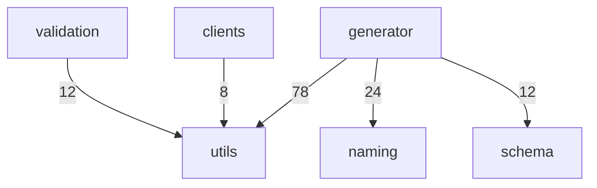

# utils · validation · generator 跨模块协作

Relevant source files

- src/generator/codegen.ts
- src/utils/logger.ts
- src/utils/progress.ts
- src/validation/reporter.ts

本页描述一个横跨 `src/utils`（日志与进度）、`src/validation`（验证报告输出）与 `src/generator`（代码生成协调）三个模块的协作面。它之所以值得单独成页，是因为这三处代码并不构成一个独立的业务功能，而是仓库中所有对外“说话”的通道：验证器把结果交给报告器 ，报告器与代码生成器又都把输出落到同一套日志接口上（），进度模块则在同一批日志接口上叠加步骤语义（）。换言之，**`src/utils/logger.ts` 是这条协作面的汇聚点**，理解它就理解了验证与生成两条主线如何把状态传达给用户。

---

## 职责与范围

该协作面覆盖 4 个生产文件，分工如下：

| 文件                         | 职责                                                                                                                  | 证据 |
| ---------------------------- | --------------------------------------------------------------------------------------------------------------------- | ---- |
| `src/utils/logger.ts`        | 统一日志模块：基于 consola 封装，提供运行时 debug 开关，输出 `debug` / `info` / `warn` / `error` / `success` 五档日志 |      |
| `src/utils/progress.ts`      | 轻量级进度显示模块：步骤开始/完成/标题默认对用户可见，额外细节走 debug 日志                                           |      |
| `src/validation/reporter.ts` | 验证结果报告器：格式化并输出验证报告（错误、警告、建议）                                                              |      |
| `src/generator/codegen.ts`   | 代码生成协调器：按处理后的接口数据与配置产出文件                                                                      |      |

从依赖方向看，`src/validation/reporter.ts` 与 `src/generator/codegen.ts` 都是**消费者**，`src/utils/logger.ts` 与 `src/utils/progress.ts` 是**被依赖方**；`progress.ts` 本身又调用 `logger.ts`，形成「生成/验证 → 进度 → 日志」的两级链路 。

---

## 关键符号

### 日志出口：`src/utils/logger.ts`

**`info(...args: any[])`** —— `src/utils/logger.ts:83`。info 级别日志，文件自述为「始终输出」。它是本协作面中被调用最频繁的出口：reporter 的四个格式化函数、progress 的多步进度创建、codegen 的 `generateFiles` 都会调它（）。此外它还出现在 `info → info` 的自引用边上（`src/utils/logger.ts:83`），说明该符号内部有再包装/转发层次的实现（具体包装逻辑数据未展开，见「待确认」）。

**`error(...args: any[])`** —— `src/utils/logger.ts:107`。error 级别日志，文件自述为「始终输出」。它是与 info 并列的第二个汇聚点，被 reporter 的错误/摘要/总入口、progress 的 `failCurrentStep`、codegen 的 `generateFiles` 共同调用（），同样存在 `error → error` 自引用边 。

**`debug(...args: any[])`** —— `src/utils/logger.ts:73`。debug 级别日志，注释明确「受运行时开关控制」。它只被两类"细节"路径调用：`completeCurrentStep` 的额外细节（，`src/utils/progress.ts:41`）和 `makeRequestWithProgress` 的请求过程（），与 `src/utils/progress.ts:1` 中「仅额外细节走 debug 日志」的自述 相互印证。

> 说明：边表中还出现了 `success` 与 `warn` 两个被调用目标，锚点分别在 `src/utils/logger.ts:91` 与 `src/utils/logger.ts:99`（）。它们不在本页列出的核心符号清单中，因此本文只按调用关系呈现，不展开其实现。

### 进度表达：`src/utils/progress.ts`

**`completeCurrentStep(description?: string)`** —— `src/utils/progress.ts:41`。完成当前步骤，文件注释为「完成当前步骤」。它同时调用 `success`（`src/utils/logger.ts:91`）与 `debug`（`src/utils/logger.ts:73`）（），即"步骤完成"这一事件在用户可见通道与调试通道各留一份记录。该符号在提供的数据中复杂度为 3，说明存在分支判断（具体分支条件未给出，见「待确认」）。

**`complete(message?: string)`** —— `src/utils/progress.ts:72`。完成所有步骤 。它调用 `success`（）与同文件的 `formatTime`（，`src/utils/progress.ts:123`），因此"全部完成"的消息里包含耗时格式化结果。

**`failCurrentStep(error: Error | string)`** —— `src/utils/progress.ts:81`。当前步骤失败 ，调用 `error`（，`src/utils/logger.ts:107`），是把失败转成用户可见输出的入口。

**`formatTime(ms: number)`** —— `src/utils/progress.ts:123`。格式化时间显示 。它被 `complete`（）和 `makeRequestWithProgress`（）调用，是进度模块内唯一的纯格式化工具；复杂度 3，说明含单位/进位分支。

**`SimpleProgressManager`（class）** —— `src/utils/progress.ts:184`。文件注释为「简单的进度管理器（替代复杂的 ProgressManager）」。它由 `getProgressManager` 构造（，`src/utils/progress.ts:184`），是进度能力的**入口单例来源**。被"替代"的 `ProgressManager` 本身不在本主题文件清单中，此处仅引用注释原文，不做扩展。

### 验证结果呈现：`src/validation/reporter.ts`

**`displaySummary(report: ValidationReport)`** —— `src/validation/reporter.ts:61`。显示验证报告的摘要统计，符号注释给出的输出样例为「验证完成：发现 3 个错误，5 个警告，2 个建议」。它按结果分级调用 `error`（）、`warn`（，`src/utils/logger.ts:99`）与 `info`（），是"汇总分流"的关键节点。

**`displayError(error: ValidationError, index: number)`** —— `src/validation/reporter.ts:87`。格式化并输出单条错误，样例输出「1. source: source 是必需的」。它同时调用 `error`（）与 `info`（），即单条错误的信息量与序号展示会拆到不同级别通道。

**`displayWarning(warning: ValidationError, index: number)`** —— `src/validation/reporter.ts:116`。格式化并输出单条警告，样例「1. source: 配置项不应该以 / 开头」。调用 `warn`（）与 `info`（）。

**`displayInfo(info: ValidationError, index: number)`** —— `src/validation/reporter.ts:145`。格式化并输出单条信息级条目，样例「1. requestMethodStyle: 建议使用默认值」。调用 `info`（，`src/utils/logger.ts:83`）。

### 生成侧入口：`src/generator/codegen.ts`

**`generateFiles(processedData: ProcessedApiData, config: ApiConfig)`** —— `src/generator/codegen.ts:35`。签名接收「处理后的接口数据」与「配置」两个参数 ，是代码生成协调器的对外入口（文件自述见 ）。它在本协作面上的输出行为只有两条：调用 `info`（）与调用 `error`（）。该函数复杂度为 9，是本主题中复杂度最高的符号，说明内部分支较多，但**数据未提供其内部流程细节**（见「待确认」）。

---

## 协作方式

上一节的符号并非孤立，它们通过明确的调用边耦合。下表按调用方归类列出全部调用关系（R2：静态可达性以边表表达）。

### A. 验证报告内部的分发链路（`src/validation/reporter.ts` → 同文件）

| 调用方                     | 被调用方         | 位置                             | 证据 |
| -------------------------- | ---------------- | -------------------------------- | ---- |
| `displayValidationResults` | `displaySummary` | `src/validation/reporter.ts:61`  |      |
| `displayValidationResults` | `displayError`   | `src/validation/reporter.ts:87`  |      |
| `displayValidationResults` | `displayWarning` | `src/validation/reporter.ts:116` |      |
| `displayValidationResults` | `displayInfo`    | `src/validation/reporter.ts:145` |      |

`displayValidationResults` 是报告器的总入口（注释：「输出验证结果，包括错误、警告和建议」，`src/validation/reporter.ts:20`），它按摘要 → 错误 → 警告 → 建议的顺序向下分发，四个被调用目标各有独立锚点。

### B. 报告器 → 日志（`src/validation/reporter.ts` → `src/utils/logger.ts`）

| 调用方                     | 被调用方  | 位置                      | 证据 |
| -------------------------- | --------- | ------------------------- | ---- |
| `displaySummary`           | `error`   | `src/utils/logger.ts:107` |      |
| `displaySummary`           | `warn`    | `src/utils/logger.ts:99`  |      |
| `displaySummary`           | `info`    | `src/utils/logger.ts:83`  |      |
| `displayError`             | `error`   | `src/utils/logger.ts:107` |      |
| `displayError`             | `info`    | `src/utils/logger.ts:83`  |      |
| `displayWarning`           | `warn`    | `src/utils/logger.ts:99`  |      |
| `displayWarning`           | `info`    | `src/utils/logger.ts:83`  |      |
| `displayInfo`              | `info`    | `src/utils/logger.ts:83`  |      |
| `displayValidationResults` | `success` | `src/utils/logger.ts:91`  |      |
| `displayValidationResults` | `error`   | `src/utils/logger.ts:107` |      |
| `displayValidationResults` | `warn`    | `src/utils/logger.ts:99`  |      |
| `displayValidationResults` | `info`    | `src/utils/logger.ts:83`  |      |

可见报告器遵循「按严重级别选通道」的约定：错误走 `error`，警告走 `warn`，其余走 `info`；总入口额外用 `success` 表示整体通过 。

### C. 进度模块 → 日志与内部工具（`src/utils/progress.ts`）

| 调用方                    | 被调用方                | 位置                        | 证据 |
| ------------------------- | ----------------------- | --------------------------- | ---- |
| `completeCurrentStep`     | `success`               | `src/utils/logger.ts:91`    |      |
| `completeCurrentStep`     | `debug`                 | `src/utils/logger.ts:73`    |      |
| `complete`                | `success`               | `src/utils/logger.ts:91`    |      |
| `failCurrentStep`         | `error`                 | `src/utils/logger.ts:107`   |      |
| `createMultiStepProgress` | `info`                  | `src/utils/logger.ts:83`    |      |
| `makeRequestWithProgress` | `debug`                 | `src/utils/logger.ts:73`    |      |
| `complete`                | `formatTime`            | `src/utils/progress.ts:123` |      |
| `makeRequestWithProgress` | `formatTime`            | `src/utils/progress.ts:123` |      |
| `createMultiStepProgress` | `SimpleProgress`        | `src/utils/progress.ts:11`  |      |
| `getProgressManager`      | `SimpleProgressManager` | `src/utils/progress.ts:184` |      |

该组边刻画了进度的**语义分工**：步骤完成/整体完成走 `success`，步骤失败走 `error`，步骤细节与请求过程走 `debug`（与 的模块自述一致）。

### D. 生成器 → 日志（`src/generator/codegen.ts` → `src/utils/logger.ts`）

| 调用方          | 被调用方 | 位置                      | 证据 |
| --------------- | -------- | ------------------------- | ---- |
| `generateFiles` | `info`   | `src/utils/logger.ts:83`  |      |
| `generateFiles` | `error`  | `src/utils/logger.ts:107` |      |

生成侧与本协作面的接触点仅此两条：正常进展报 `info`，异常报 `error` 。

### 数据流总览

把上述 A–D 串起来，本协作面的单向数据流为：

| 阶段            | 输入                      | 处理                                                   | 输出通道                      | 证据 |
| --------------- | ------------------------- | ------------------------------------------------------ | ----------------------------- | ---- |
| 1. 验证结果汇聚 | 验证报告对象              | `displaySummary(report)`                               | `error` / `warn` / `info`     |      |
| 2. 逐条展开     | 单条错误/警告/建议 + 序号 | `displayError` / `displayWarning` / `displayInfo`      | `error` / `warn` / `info`     |      |
| 3. 生成进度播报 | 处理后的接口数据 + 配置   | `generateFiles(processedData, config)`                 | `info` / `error`              |      |
| 4. 步骤状态     | 步骤描述 / 失败原因       | `completeCurrentStep` / `complete` / `failCurrentStep` | `success` / `debug` / `error` |      |
| 5. 耗时呈现     | 毫秒值                    | `formatTime(ms)`                                       | 供阶段 4 拼装消息             |      |

---

## 跨模块边界

本主题的外部耦合集中体现在跨模块调用量上：

| 调用方向           | 调用次数 | 证据 |
| ------------------ | -------- | ---- |
| generator → utils  | 78       |      |
| generator → naming | 24       |      |
| generator → schema | 12       |      |
| validation → utils | 12       |      |
| clients → utils    | 8        |      |

上图中节点与数值均取自跨模块调用统计（）。

**耦合判读：**

- **`utils` 是全局公共底座**。三个不同模块都指向它（generator 78 次、validation 12 次、clients 8 次）。这意味着 `src/utils/logger.ts` 的接口签名（如 `info(...args: any[])` 、`error(...args: any[])` ）属于高扇入接口，**任何破坏性改动的影响面覆盖生成、验证、客户端三条线**。
- **`generator` 自身是最大的消费方**。它同时依赖 utils、naming、schema 三个模块 ，其中对 utils 的 78 次调用远超其余两项之和，说明生成器把大量状态输出都委托给了本协作面的日志层 。
- **验证侧的耦合相对轻**。validation → utils 仅 12 次 ，且从边表看全部集中在 reporter 的格式化函数上（），因此替换验证输出策略的代价局限在 `src/validation/reporter.ts` 一个文件内。
- **修改代价提示**：由于 `debug` 受运行时开关控制 ，而进度模块的细节输出依赖它（），调整日志级别语义会同时改变"验证细节可见性"与"进度细节可见性"两条行为，需一并回归。

---

## 设计动机

数据中给出了多处文件头与符号注释，以下为原文引用（R7）。

**1）日志模块为何要自己维护一个运行时开关。** `src/utils/logger.ts:1` 的文件头明确写道：「统一日志模块 基于 consola 封装，提供运行时 debug 开关，消除全项目的 if(process.env.DEBUG) 手动守卫。设计要点：consola 在模块导入时根据 process.env.DEBUG 固化日志级别，但 CLI 的 debug 命令在 action 中才设置该变量，导致 consola 内置级别检测失效。本模块通过运行时布尔开关解决该时序问题，debug 命令调用 setDebugEnabled(true) 即可」。配套注释进一步说明 `debugEnabled`「初始化时读取环境变量作为默认值」、`setDebugEnabled` 支持显式关闭 、`isDebugEnabled` 用于查询当前状态 。**这是一条有时序证据支撑的动机链**，而非事后推测。

**2）输出静默度为何要分级。** `src/utils/progress.ts:1` 自述：「轻量级进度显示模块 基础进度（步骤开始/完成/标题）默认对用户可见，仅额外细节走 debug 日志」。该承诺在边表中成立：基础完成走 `success`（），细节走 `debug`（）。

**3）报告器的存在理由。** `src/validation/reporter.ts:1` 自述「验证结果报告器 负责格式化并输出验证报告」；`displayValidationResults` 的注释承诺覆盖「错误、警告和建议」三类 ，并在 `displaySummary` 处给出具体输出样例 ，在 `displayError` 处给出样例 。可据此判定报告器的职责边界是**格式化**而非校验本身。

**4）生成器的定位。** `src/generator/codegen.ts:1` 自述「代码生成协调器」，`generateFiles` 的注释提到产物包含「Schema 文件（如果 typesFormat: 'zod'）」，说明其职责是协调多类产物的产出。**注意：数据只给出这一句产物线索与函数签名 ，不足以还原完整的生成流程。**

**推断（依据：命名与协作模式）**：`SimpleProgressManager` 注释中的「替代复杂的 ProgressManager」 暗示进度模块经历过一次实现简化；由于被替代的类不在本主题文件清单内，此处仅作为命名线索记录，不展开演进叙述。

---

## 待确认

- **`info` / `error` 的自引用边含义**：边表存在 `info → info`（`src/utils/logger.ts:83`） 与 `error → error`（`src/utils/logger.ts:107`）。缺少函数体，无法确认是内部递归、二次包装还是转发到 consola 实例。
- **`generateFiles` 的内部流程**：仅提供签名 与产物提示 ，缺少文件头完整内容与调用图，无法描述其协调的具体步骤。
- **`SimpleProgressManager` 的成员与方法集**：仅提供类锚点 与构造边 ，缺少方法列表，无法说明其对外契约。
- **`success` / `warn` 的定义**：二者作为被调用方出现在多处边（），但未进入核心符号清单，缺少签名与注释。

## Related

- 同目录：[generator-utils.md](generator-utils.md) · [clients-errors-utils.md](clients-errors-utils.md) · [utils-generator-docs.md](utils-generator-docs.md)
- 共享 1 个源文件、共享 14 个符号：[chapter:config-validation/validation-rules-report.md](../09-chapters/config-validation/validation-rules-report.md)
- 共享 9 个符号：[modules.md](../02-architecture/modules.md)
- 共享 6 个符号：[overview.md](../01-overview/overview.md)
- 总入口：[README](../README.md)

<!-- wiki:source: llm -->
