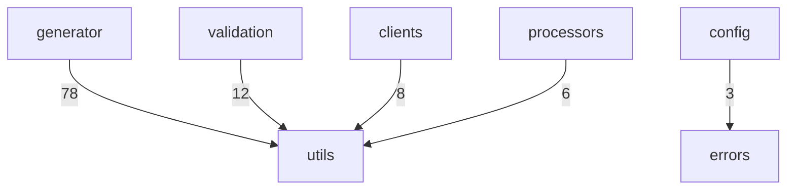

# 配置加载与缓存

<details>
<summary>Relevant source files</summary>

- src/config/index.ts
- src/config/loader.ts
- src/utils/config.ts

</details>

本页聚焦「配置解析与校验管线」章节中的加载与缓存环节：`src/config/loader.ts` 负责把配置文件加载为已处理的运行时配置并做缓存，`src/utils/config.ts` 提供配置相关的解析/校验工具，`src/config/index.ts` 是配置模块的导出入口。

> 说明：本页涉及文件为 `src/config/loader.ts`、`src/config/index.ts`、`src/utils/config.ts`；数据中**未出现** `configParseError` / `ConfigError` 符号的定义或抛出点，相关缺口集中列在文末「待确认」。

---

## 1. 符号清单（本页覆盖范围）

| 符号                        | 类型      | 位置                       | 数据中给出的说明                                                                                                |
| --------------------------- | --------- | -------------------------- | --------------------------------------------------------------------------------------------------------------- |
| `ConfigCacheManager`        | class     | `src/config/loader.ts:26`  | 配置缓存管理器（`src/config/loader.ts:26` 注释）                                                                |
| `ConfigCacheManager.get`    | method    | `src/config/loader.ts:36`  | 获取缓存的配置，`@param ttl 缓存有效期（毫秒）`，`@returns 缓存的配置或 null`（`src/config/loader.ts:36` 注释） |
| `ConfigCacheManager.delete` | method    | `src/config/loader.ts:68`  | 清除指定配置的缓存，`@param configPath 配置文件路径`（`src/config/loader.ts:68` 注释）                          |
| `ConfigCacheManager.clear`  | method    | `src/config/loader.ts:75`  | 清除所有缓存（`src/config/loader.ts:75` 注释）                                                                  |
| `isApiConfig`               | function  | `src/config/loader.ts:93`  | 检查单个配置对象是否为已处理的 `ApiConfig`（`src/config/loader.ts:93` 注释）                                    |
| `isProcessedConfig`         | function  | `src/config/loader.ts:108` | 检查配置是否已经被 `defineConfig` 处理过（即已是 `ApiConfig` 数组）（`src/config/loader.ts:108` 注释）          |
| `loadConfigImpl`            | function  | `src/config/loader.ts:126` | 加载配置文件的内部实现（`src/config/loader.ts:126` 注释）                                                       |
| `loadConfig`                | function  | `src/config/loader.ts:173` | 对外加载入口，签名 `/ (configPath: string, useCache = true, cacheTTL = 5000)`（`src/config/loader.ts:173`）     |
| `ConfigCacheEntry`          | 类型/接口 | `src/config/loader.ts:16`  | 配置缓存条目（`src/config/loader.ts:16` 注释）                                                                  |
| `configCache`               | 全局实例  | `src/config/loader.ts:88`  | 全局配置缓存实例（`src/config/loader.ts:88` 注释）                                                              |

文件级自述：

| 文件                   | 自述内容                                           | 锚点                     |
| ---------------------- | -------------------------------------------------- | ------------------------ |
| `src/config/loader.ts` | 配置文件加载器，**支持配置缓存以提高性能**         | `src/config/loader.ts:1` |
| `src/config/index.ts`  | 配置模块导出                                       | `src/config/index.ts:1`  |
| `src/utils/config.ts`  | 配置工具模块，提供**配置解析、验证和预设应用**功能 | `src/utils/config.ts:1`  |

---

## 2. 加载主链路与调用关系

`loadConfig`（`src/config/loader.ts:173`）是外部加载入口，它同时触达缓存读、缓存写与真正的加载实现。数据中给出的调用边如下：

| 调用方             | 被调用方                    | 位置                       |
| ------------------ | --------------------------- | -------------------------- |
| `loadConfig`       | `ConfigCacheManager.get`    | `src/config/loader.ts:36`  |
| `loadConfig`       | `loadConfigImpl`            | `src/config/loader.ts:126` |
| `loadConfig`       | `ConfigCacheManager.set`    | `src/config/loader.ts:57`  |
| `loadConfigImpl`   | `isProcessedConfig`         | `src/config/loader.ts:108` |
| `clearConfigCache` | `ConfigCacheManager.delete` | `src/config/loader.ts:68`  |
| `clearConfigCache` | `ConfigCacheManager.clear`  | `src/config/loader.ts:75`  |
| `isPostLikeMethod` | `isGetLikeMethod`           | `src/utils/config.ts:80`   |

从上表可确认的结构（均有调用边锚点）：

1. `loadConfig` 既读缓存（`get`，`src/config/loader.ts:36`）也写缓存（`set`，`src/config/loader.ts:57`），并调用 `loadConfigImpl` 完成实际加载（`src/config/loader.ts:126`）；
2. `loadConfigImpl` 在返回前经 `isProcessedConfig` 做类型守卫（`src/config/loader.ts:108`）；
3. 缓存清理被 `clearConfigCache` 统一收口，分别支持单条（`delete`，`src/config/loader.ts:68`）与全量（`clear`，`src/config/loader.ts:75`）两种粒度。

`loadConfig` 的对外签名与默认值：

```ts
// src/config/loader.ts:173
loadConfig(
  configPath: string,
  useCache = true,
  cacheTTL = 5000,
)
```

即默认开启缓存（`useCache = true`）、默认缓存有效期 5000 毫秒（`src/config/loader.ts:173`）。读缓存方法 `get` 自身也带默认有效期参数：

```ts
// src/config/loader.ts:36
get(configPath: string, ttl: number = this.defaultTTL)
```

> 「缓存命中即短路、未命中才走 `loadConfigImpl`」这一先后顺序，数据中只给出了三条并列调用边（`src/config/loader.ts:36`、`:126`、`:57`），未给出分支条件本身，属于**推断**（依据：`get` 的注释声明「获取缓存的配置…@returns 缓存的配置或 null」，配合 `loadConfig` 入参中同时存在 `useCache` 开关）。

---

## 3. 缓存层：`ConfigCacheManager`

### 3.1 方法与职责

| 方法     | 签名                                                  | 位置                      | 语义（来自注释）                                      |
| -------- | ----------------------------------------------------- | ------------------------- | ----------------------------------------------------- |
| `get`    | `(configPath: string, ttl: number = this.defaultTTL)` | `src/config/loader.ts:36` | 按路径取缓存，`ttl` 为毫秒级有效期，未命中返回 `null` |
| `delete` | `(configPath: string)`                                | `src/config/loader.ts:68` | 清除指定配置文件的缓存                                |
| `clear`  | `()`                                                  | `src/config/loader.ts:75` | 清除所有缓存                                          |

缓存写入方法 `set` 只在调用边中出现（`loadConfig → set`，`src/config/loader.ts:57`），其签名与实现未在本次符号数据中给出。

### 3.2 缓存条目与全局实例

| 元素                            | 位置                      | 注释原文         |
| ------------------------------- | ------------------------- | ---------------- |
| 缓存条目类型 `ConfigCacheEntry` | `src/config/loader.ts:16` | 配置缓存条目     |
| 全局缓存实例 `configCache`      | `src/config/loader.ts:88` | 全局配置缓存实例 |

结合文件头自述「配置文件加载器 **支持配置缓存以提高性能**」（`src/config/loader.ts:1`），缓存层的存在动机在源码注释中有直接证据，无需推断。

### 3.3 缓存失效入口

| 清理口径   | 调用方 → 被调用方             | 位置                      |
| ---------- | ----------------------------- | ------------------------- |
| 按路径失效 | `clearConfigCache` → `delete` | `src/config/loader.ts:68` |
| 全量失效   | `clearConfigCache` → `clear`  | `src/config/loader.ts:75` |

`clearConfigCache` 自身未在本次符号清单中给出签名，但其到 `delete` / `clear` 的两条调用边可确认它是缓存的对外清理入口。

---

## 4. `loadConfigImpl`：加载实现与类型守卫

`loadConfigImpl`（`src/config/loader.ts:126`）的注释明确了职责边界与防御设计，原文引用如下（锚点 `src/config/loader.ts:126`）：

> 加载配置文件的内部实现。
> 配置文件约定为 `export default defineConfig({...})`，导出的已是经校验+合并处理的 ApiConfig[]。
> loader 只负责加载文件，不重复调用 `defineConfig` / `validateConfiguration`；
> `isProcessedConfig` 在此作为类型守卫，防御配置文件未用 `defineConfig` 包裹等误用情形。
> `@param absolutePath 配置文件的绝对路径`
> `@returns 多服务运行时配置数组`
> `@throws {BaseError} …`（注释在数据中于此截断）

由此可确认的事实：

| 事实                                                                                          | 证据                               |
| --------------------------------------------------------------------------------------------- | ---------------------------------- |
| 入参为配置文件的**绝对路径**（对外 `loadConfig` 传的是 `configPath`，内部实现按绝对路径处理） | `src/config/loader.ts:126`         |
| 返回值为多服务运行时配置数组                                                                  | `src/config/loader.ts:126`         |
| loader 不重复执行 `defineConfig` / `validateConfiguration`，校验+合并由配置文件侧完成         | `src/config/loader.ts:126`         |
| `isProcessedConfig` 作为类型守卫被 `loadConfigImpl` 调用                                      | 调用边，`src/config/loader.ts:108` |

两个类型守卫的分工：

| 守卫                | 位置                       | 判定目标                                                          |
| ------------------- | -------------------------- | ----------------------------------------------------------------- |
| `isApiConfig`       | `src/config/loader.ts:93`  | 检查单个配置对象是否为已处理的 `ApiConfig`                        |
| `isProcessedConfig` | `src/config/loader.ts:108` | 检查配置是否已被 `defineConfig` 处理过（即已是 `ApiConfig` 数组） |

`isProcessedConfig` 通过 `loadConfigImpl` 参与运行时路径（`src/config/loader.ts:108`）；`isApiConfig` 在本次数据中只给出定义与注释，未给出调用边。

---

## 5. `src/utils/config.ts`：配置工具与 HTTP 方法判定

该文件自述为「配置工具模块，提供配置解析、验证和预设应用功能」（`src/utils/config.ts:1`）。本次数据覆盖到的符号：

| 符号                | 类型     | 位置                                                                       | 注释原文                                            |
| ------------------- | -------- | -------------------------------------------------------------------------- | --------------------------------------------------- |
| `HTTP_METHODS`      | 常量     | `src/utils/config.ts:56`                                                   | HTTP 方法映射                                       |
| `assertValidMethod` | function | `src/utils/config.ts:69`                                                   | 验证 HTTP 方法有效性                                |
| `isGetLikeMethod`   | function | `src/utils/config.ts:80`                                                   | `@param method 请求方式 @returns 是否为 GET 类请求` |
| `isPostLikeMethod`  | function | 数据给出其调用边（`src/utils/config.ts:80`），符号定义行未在本次清单中单列 | —                                                   |

工具内部的复用关系：

| 调用方             | 被调用方          | 位置                     |
| ------------------ | ----------------- | ------------------------ |
| `isPostLikeMethod` | `isGetLikeMethod` | `src/utils/config.ts:80` |

即「POST 类方法」的判定复用了「GET 类方法」的判定结果（`src/utils/config.ts:80`）；`HTTP_METHODS` 与方法校验函数 `assertValidMethod` 构成该工具模块的方法名口径来源（`src/utils/config.ts:56`、`src/utils/config.ts:69`）。

---

## 6. `src/config/index.ts`：导出入口

该文件自述为「配置模块导出」（`src/config/index.ts:1`），是 `src/config` 目录对外的聚合出口。本次数据未列出它具体再导出的符号清单。

---

## 7. 模块级边界

配置与工具模块在更大范围内的被依赖情况（数据给出的跨模块调用计数）：



| 调用方模块   | 被调用方模块 | 调用次数 | 佐证         |
| ------------ | ------------ | -------- | ------------ |
| `generator`  | `utils`      | 78       | 模块边界数据 |
| `validation` | `utils`      | 12       | 模块边界数据 |
| `clients`    | `utils`      | 8        | 模块边界数据 |
| `processors` | `utils`      | 6        | 模块边界数据 |
| `config`     | `errors`     | 3        | 模块边界数据 |

两点可读结论：

1. `utils`（含 `src/utils/config.ts`）是被上层模块广泛复用的公共层，其中 `generator` 的依赖最重（78 次调用）；
2. `config` 模块向下依赖 `errors` 模块（3 次调用），说明配置链路的错误处理由 `errors` 模块承载——但本页文件数据中未出现具体的错误符号，见「待确认」。

---

## 8. 演进记录（首次提交）

| 文件                   | 首次提交                        | 提交说明                                                                                                               |
| ---------------------- | ------------------------------- | ---------------------------------------------------------------------------------------------------------------------- |
| `src/config/loader.ts` | `commit:4388e7de`（2025-09-29） | `refactor: 重组项目结构和代码架构`                                                                                     |
| `src/utils/config.ts`  | `commit:75c5dd40`（2025-08-13） | `feat: 文件结构以及代码重构、按模块生成代码、去掉requestConfig以及mockUrl、删除vtils/haoma等依赖、使用changeset发布包` |

从提交说明可读出的演进线索：`src/utils/config.ts` 在 2025-08-13 的提交中随「按模块生成代码、去掉 requestConfig 以及 mockUrl」的重构一并落地（`commit:75c5dd40`）；`src/config/loader.ts` 则晚一个多月随「重组项目结构和代码架构」进入仓库（`commit:4388e7de`，2025-09-29）。这与其文件头自述的定位（加载 + 缓存，`src/config/loader.ts:1`）相互印证。

---

## 9. 待确认

| 缺口                                    | 缺失的证据                                                                                                                                                                                                                           |
| --------------------------------------- | ------------------------------------------------------------------------------------------------------------------------------------------------------------------------------------------------------------------------------------ |
| 配置解析失败的错误类型                  | 写作简报提及 `configParseError`、`ConfigError`，但本页文件与符号数据中均未出现其定义或抛出点；仅有 `loadConfigImpl` 注释中 `@throws {BaseError} …`（`src/config/loader.ts:126`）且内容被截断，以及 `config → errors` 的 3 次模块调用 |
| 缓存写入的触发条件与 `set` 的形态       | 仅有 `loadConfig → set` 调用边（`src/config/loader.ts:57`），无签名、无返回值与写入策略                                                                                                                                              |
| 缓存条目的字段构成与 TTL 判定方式       | 仅有 `ConfigCacheEntry` 注释「配置缓存条目」（`src/config/loader.ts:16`）与 `get` 的 `ttl` 入参（`src/config/loader.ts:36`），无字段列表                                                                                             |
| `loadConfigImpl` 读取配置文件的具体手段 | 注释给出入参为绝对路径（`src/config/loader.ts:126`），但未说明使用何种加载方式                                                                                                                                                       |
| `src/config/index.ts` 的导出面          | 仅有文件自述「配置模块导出」（`src/config/index.ts:1`），未列出导出符号                                                                                                                                                              |

## Related

- 同目录：[multi-service-resolution.md](multi-service-resolution.md) · [validation-rules-report.md](validation-rules-report.md)
- 共享 2 个源文件、共享 24 个符号：[architecture.md](../02-architecture/architecture.md)
- 共享 15 个符号：[modules.md](../02-architecture/modules.md)
- 共享 2 个源文件、共享 4 个符号：[decisions.md](../04-design/decisions.md)
- 总入口：[README](../README.md)

<!-- wiki:source: llm -->
