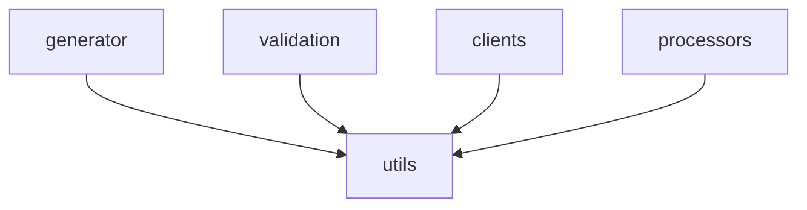

# 多服务解析与输出目录计算

<details>
<summary>Relevant source files</summary>

- src/types/config.ts
- src/utils/multiService.ts
- src/utils/pathSafety.ts
- src/validation/validators/serviceDirs.ts

</details>

本页属于「配置解析与校验管线」章节，聚焦共享公共配置下**每个服务的输出目录如何被计算、隔离校验与路径安全约束**：从多服务配置解析（`src/utils/multiService.ts`）、输出目录隔离验证（`src/validation/validators/serviceDirs.ts`），到配置类型（`src/types/config.ts`）与路径逃逸防护（`src/utils/pathSafety.ts`）。

## 1. 参与文件与职责

| 文件                                       | 在管线中的角色                                                                                          | 证据                                         |
| ------------------------------------------ | ------------------------------------------------------------------------------------------------------- | -------------------------------------------- |
| `src/utils/multiService.ts`                | 多服务配置解析模块：将多服务用户配置（`MultiServiceConfig`）解析为单服务运行时配置数组（`ApiConfig[]`） | `src/utils/multiService.ts:1`                |
| `src/validation/validators/serviceDirs.ts` | 服务输出目录隔离验证器：校验各服务计算后的 `outputDir` 不相同、不嵌套                                   | `src/validation/validators/serviceDirs.ts:1` |
| `src/types/config.ts`                      | 配置相关类型定义                                                                                        | `src/types/config.ts:1`                      |
| `src/utils/pathSafety.ts`                  | 路径安全工具：防御路径遍历攻击                                                                          | `src/utils/pathSafety.ts:1`                  |

## 2. 多服务解析流程（`src/utils/multiService.ts`）

文件头对整体流程的自述原文（锚点 `src/utils/multiService.ts:1`）：

> 多服务配置解析模块。将多服务用户配置（`MultiServiceConfig`）解析为单服务运行时配置数组（`ApiConfig[]`）。
> 流程：先校验原始配置（`validateConfiguration`），再合并处理（应用 preset、计算 outputDir、规范化 transformPath）。

按该自述拆出的阶段：

| 阶段 | 动作                                    | 证据                          |
| ---- | --------------------------------------- | ----------------------------- |
| 1    | 校验原始配置（`validateConfiguration`） | `src/utils/multiService.ts:1` |
| 2    | 合并处理：应用 preset                   | `src/utils/multiService.ts:1` |
| 3    | 合并处理：计算 outputDir                | `src/utils/multiService.ts:1` |
| 4    | 合并处理：规范化 transformPath          | `src/utils/multiService.ts:1` |

解析结果的形态在该模块的符号注释中给出了示例：`configs[1].outputDir === 'src/api/trade/order'`（锚点 `src/utils/multiService.ts:40`，对应符号 `resolveServiceConfigs`）。即多服务配置解析后，每个服务各自持有一个具体的 `outputDir`，而非共用同一个目录。

### 公共根输出目录默认值

| 常量                      | 注释原文                                                        | 位置                                          |
| ------------------------- | --------------------------------------------------------------- | --------------------------------------------- |
| `DEFAULT_BASE_OUTPUT_DIR` | 公共根输出目录默认值                                            | `src/utils/multiService.ts:14`                |
| `DEFAULT_BASE_OUTPUT_DIR` | 公共根输出目录默认值（与 `src/utils/multiService.ts` 保持一致） | `src/validation/validators/serviceDirs.ts:11` |

该默认值在两个模块中各自定义，其中验证器一侧的注释明确要求与解析模块保持一致（`src/validation/validators/serviceDirs.ts:11`）。也就是说，"基础输出目录"是输出目录计算的共同起点，两处必须同源。

## 3. 单服务输出目录计算：`computeOutputDir`

签名（`src/validation/validators/serviceDirs.ts:27`）：

```ts
computeOutputDir(svc: ServiceConfig, baseOutputDir: string)
```

计算规则的注释原文（`src/validation/validators/serviceDirs.ts:27`）：

> 计算单个服务的 `outputDir`（`join(baseOutputDir, folder ?? name)`）

由此可读出两条事实：

| 规则             | 说明                                               | 证据                                          |
| ---------------- | -------------------------------------------------- | --------------------------------------------- |
| 以基础目录为根   | 结果由 `baseOutputDir` 与服务的子目录拼接而成      | `src/validation/validators/serviceDirs.ts:27` |
| 子目录名取值顺序 | 优先取服务配置的 `folder`，缺省时回退到服务 `name` | `src/validation/validators/serviceDirs.ts:27` |

参数类型为 `ServiceConfig`（`src/validation/validators/serviceDirs.ts:27`）。在"共享公共配置 + 每个服务一个子目录"的多服务场景下，`folder ?? name` 这一回退顺序保证了：即使服务未显式声明输出子目录，也能按服务名得到彼此区分的目录。

## 4. 输出目录隔离校验：`isNestedOrSame`

验证器文件头说明了要防的问题（锚点 `src/validation/validators/serviceDirs.ts:1`）：

> 服务输出目录隔离验证器。校验各服务计算后的 `outputDir` 不相同、不嵌套，避免生成时 `cleanOutputDir` 相互清理覆盖。

即：多服务共享公共配置后，输出目录计算得到的结果必须两两"不相同、不嵌套"，否则某个服务的清理动作会清掉另一个服务的产物。这是本节所有约束的动机来源。

| 符号               | 签名                                          | 职责（注释原文）                                                                                                                    | 位置                                          |
| ------------------ | --------------------------------------------- | ----------------------------------------------------------------------------------------------------------------------------------- | --------------------------------------------- |
| `isNestedOrSame`   | `(a: string, b: string)`                      | 计算两个路径是否存在祖先-后代关系（相同或嵌套）。通过 `path.relative` 判断：若任一方向的相对路径不含 `'..'`，则一方是另一方的祖先。 | `src/validation/validators/serviceDirs.ts:17` |
| `computeOutputDir` | `(svc: ServiceConfig, baseOutputDir: string)` | 计算单个服务的 `outputDir`（`join(baseOutputDir, folder ?? name)`）                                                                 | `src/validation/validators/serviceDirs.ts:27` |

两者的分工：`computeOutputDir` 产出待校验的路径，`isNestedOrSame` 提供两两比较所需的"祖先-后代/相同"判定原语（`src/validation/validators/serviceDirs.ts:17`、`src/validation/validators/serviceDirs.ts:27`）。比较算法基于 `path.relative` 的返回值中是否含 `..`，因此判定是纯路径字符串层面的，不依赖文件系统实际存在性（依据：注释中描述的判断方式，`src/validation/validators/serviceDirs.ts:17`）。

## 5. 路径安全约束（`src/utils/pathSafety.ts`）

文件头自述（锚点 `src/utils/pathSafety.ts:1`）：

> 路径安全工具。防御路径遍历攻击：确保 `outputDir`、`requestFunctionFilePath` 等用户可配置的路径不会逃逸到项目根目录（`process.cwd()`）之外，避免 `cleanOutputDir` 的递归删除造成误删。

与本节相关的两个符号：

| 符号              | 行为/示例                                                                               | 位置                         |
| ----------------- | --------------------------------------------------------------------------------------- | ---------------------------- |
| `isWithinCwd`     | 布尔判定，示例注释给出 `isWithinCwd('/etc'); // false`                                  | `src/utils/pathSafety.ts:22` |
| `assertWithinCwd` | 断言式校验，示例注释给出 `assertWithinCwd(requestFilePath, 'requestFunctionFilePath');` | `src/utils/pathSafety.ts:45` |

即：`isWithinCwd` 提供"是否落在 `process.cwd()` 之内"的判定，`assertWithinCwd` 接收被校验路径与一个用于报错的路径名标签（示例中为 `'requestFunctionFilePath'`）并执行断言（`src/utils/pathSafety.ts:22`、`src/utils/pathSafety.ts:45`）。

### 调用关系

| 调用方            | 被调用方      | 位置                         |
| ----------------- | ------------- | ---------------------------- |
| `assertWithinCwd` | `isWithinCwd` | `src/utils/pathSafety.ts:22` |

`assertWithinCwd` 通过调用 `isWithinCwd` 完成判定（`src/utils/pathSafety.ts:22`），因此路径是否越界的判断逻辑只有一处实现，断言接口只是其上层封装。

约束叠加后的效果：输出目录既要通过隔离校验（不相同、不嵌套，`src/validation/validators/serviceDirs.ts:1`），又要通过路径安全校验（不逃逸出 `process.cwd()`，`src/utils/pathSafety.ts:1`）。这两道约束共同保护后续 `cleanOutputDir` 的递归删除不会误伤。

## 6. 配置类型基础（`src/types/config.ts`）

该文件为配置相关类型定义（`src/types/config.ts:1`）。与配置解析相关的枚举/上下文符号：

| 符号            | 取值与语义（注释原文）                                                                                                | 位置                     |
| --------------- | --------------------------------------------------------------------------------------------------------------------- | ------------------------ |
| `TypesFormat`   | `typescript`：生成 TypeScript 类型定义（编译时类型检查）；`zod`：生成 Zod Schema（运行时验证）                        | `src/types/config.ts:19` |
| `HookLibrary`   | `react-query`：`@tanstack/react-query` v5（当前版本已实现）；`swr` / `ahooks` / `vue-query`：预留枚举，当前版本未实现 | `src/types/config.ts:26` |
| `NamingContext` | 命名上下文，提供命名策略所需的上下文信息                                                                              | `src/types/config.ts:31` |

## 7. 跨模块调用关系

`generator`、`validation`、`clients`、`processors` 四类调用方对 `utils` 的调用次数：

| 调用方模块   | 被调用方模块 | 调用次数 |
| ------------ | ------------ | -------- |
| `generator`  | `utils`      | 78       |
| `validation` | `utils`      | 12       |
| `clients`    | `utils`      | 8        |
| `processors` | `utils`      | 6        |



其中 `generator` 是对 `utils`（含上述输出目录与路径安全工具所在目录）调用最密集的一侧，`validation` 次之；与本节直接相关的输出目录隔离校验逻辑位于 `src/validation/validators/serviceDirs.ts:1`，属于 `validation` 侧对 `utils` 的消费方。

## 8. 待确认

1. 写作简报点名的 `validateServiceOutputDirs` 未出现在本次数据提供的符号清单中（本次仅给出同文件内的 `isNestedOrSame`、`computeOutputDir` 与 `DEFAULT_BASE_OUTPUT_DIR`），其确切入口名、签名与调用点无法给出。缺证据：该符号的 file:line 与签名。
2. `resolveServiceConfigs` 仅有位置 `src/utils/multiService.ts:40` 与一段结果示例注释，完整签名、参数与它到 `computeOutputDir` 的调用边未提供。缺证据：函数级调用边。
3. `multiService.ts` 文件头提到的 `validateConfiguration`、preset 应用与 `transformPath` 规范化三个步骤，其定义位置与实现文件未提供，解析流程目前只能停留在文件头自述的阶段粒度。缺证据：这些步骤对应符号的 file:line。
4. `ServiceConfig` 仅作为 `computeOutputDir` 的形参类型出现（`src/validation/validators/serviceDirs.ts:27`），其字段（含 `folder`、`name`、`outputDir`）的定义位置未在数据中列出。缺证据：`ServiceConfig` 的类型定义锚点。

## Related

- 同目录：[config-loading-cache.md](config-loading-cache.md) · [validation-rules-report.md](validation-rules-report.md)
- 共享 11 个符号：[modules.md](../02-architecture/modules.md)
- 共享 10 个符号：[architecture.md](../02-architecture/architecture.md)
- 共享 9 个符号：[conventions.md](../06-constraints/conventions.md)
- 总入口：[README](../README.md)

<!-- wiki:source: llm -->
