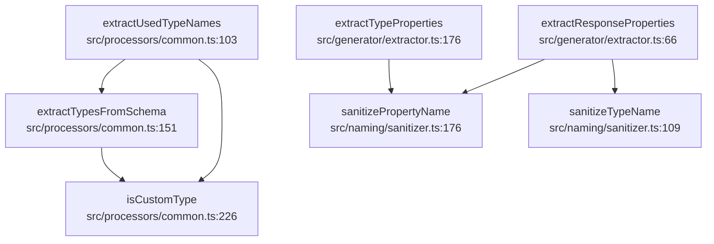

# 标识符净化与类型名提取

<details>
<summary>Relevant source files</summary>

- src/generator/extractor.ts
- src/naming/sanitizer.ts
- src/processors/common.ts

</details>

本页属于「命名策略与标识符净化」章节，聚焦两件在代码里彼此独立、在生成流程里被接在一起的事：一是从 OpenAPI Schema 递归提取被引用的自定义类型名（`src/processors/common.ts`），二是把类型名/属性名规范化为合法 TypeScript 标识符（`src/naming/sanitizer.ts`）；`src/generator/extractor.ts` 是两侧的缝合点。下文所有事实以调用边、源码文档注释与提交记录为锚点。

---

## 1. 参与文件与自述

| 文件                         | 文件头自述                                                                                                                                                                                                                                       | 首次提交证据                                                                                               |
| ---------------------------- | ------------------------------------------------------------------------------------------------------------------------------------------------------------------------------------------------------------------------------------------------ | ---------------------------------------------------------------------------------------------------------- |
| `src/naming/sanitizer.ts`    | 「名称清理模块 提供标识符名称清理和规范化功能 确保生成的代码符合 TypeScript 标识符命名规则」（src/naming/sanitizer.ts:1）                                                                                                                        | commit:f9369dc3（2026-06-22，refactor: 重构客户端架构并拆分生成器模块）                                    |
| `src/generator/extractor.ts` | 「数据提取模块 从 OpenAPI 操作中提取响应和路径参数；请求参数提取已下沉至 requestParameters.ts（含 body/query/path 分组与 @ParameterObject 展开），此处 re-export 以保持既有 `from '../extractor'` 的导入兼容性」（src/generator/extractor.ts:1） | commit:4388e7de（2025-09-29，refactor: 重组项目结构和代码架构）                                            |
| `src/processors/common.ts`   | 「公共处理模块 提供数据处理相关的公共函数」（src/processors/common.ts:1）                                                                                                                                                                        | commit:5f59251c（2026-01-18，refactor: 提取公共逻辑到 processors/common.ts，删除接口按标签分组的重复代码） |

按 extractor.ts 的自述（src/generator/extractor.ts:1），该文件的请求参数提取职责已迁出至 requestParameters.ts，本页只涉及仍留在 `src/generator/extractor.ts` 内的**响应提取**与**类型属性提取**。

---

## 2. 类型名提取侧（src/processors/common.ts）

### 2.1 符号一览

| 符号                     | 位置                         | 圈复杂度 | 数据中给出的说明                                                                                               |
| ------------------------ | ---------------------------- | -------- | -------------------------------------------------------------------------------------------------------------- |
| `extractUsedTypeNames`   | src/processors/common.ts:103 | 7        | 无 docstring；注释给出示例输出 `usedTypes = Set(['User', 'Product', 'Order'])`（src/processors/common.ts:103） |
| `extractTypesFromSchema` | src/processors/common.ts:151 | 13       | 带完整 docstring，见下节                                                                                       |
| `isCustomType`           | src/processors/common.ts:226 | 2        | 「检查是否为自定义类型」                                                                                       |

### 2.2 `extractTypesFromSchema`：递归提取主体

文档注释（src/processors/common.ts:151）：

> @description 从 Schema 中提取类型名称
> 递归解析 Schema 提取所有引用的自定义类型
> @param schema OpenAPI Schema 对象
> @param processedData 处理后的 API 数据
> @param depth 当前递归深度（内部使用，防 DoS）
> @param guard 循环引用检测器（内部使用）
> @returns 类型名称数组

签名形态（src/processors/common.ts:151）：

```ts
extractTypesFromSchema(
  schema: any,
  processedData: ProcessedApiData,
  depth = 0,
  guard: CircularRefGuard = new CircularRefGuard(),
)
```

可由签名与 docstring 直接读出的事实：

- 默认值语义：`depth = 0` 与 `guard: CircularRefGuard = new CircularRefGuard()`，docstring 明言 depth 为「当前递归深度（内部使用，防 DoS）」，guard 为「循环引用检测器（内部使用）」（src/processors/common.ts:151）。即递归的两个防护参数都在签名层给了默认值，调用方只需传 schema 与 processedData 两个业务参数。
- 返回语义：docstring 声明「@returns 类型名称数组」，主体行为为「递归解析 Schema 提取所有引用的自定义类型」（src/processors/common.ts:151）。

该函数判定「是否自定义类型」这一步并非自行实现，而是调用 `isCustomType`（调用边定位 src/processors/common.ts:226），本函数复杂度 13，是本节三个符号中最高的一个。

### 2.3 `isCustomType`：自定义类型的唯一判据

签名与说明（src/processors/common.ts:226）：

```ts
isCustomType(typeName: string, processedData: ProcessedApiData)
```

> @description 检查是否为自定义类型
> @param typeName 类型名称
> @param processedData 处理后的 API 数据
> @returns 是否为自定义类型

其复杂度为 2，是三个符号中最小者；在数据中它没有下游调用边，只作为被调方出现（src/processors/common.ts:226）。它同时被 `extractTypesFromSchema`（src/processors/common.ts:151）与 `extractUsedTypeNames`（src/processors/common.ts:103）调用，是「类型名提取」这条链上被复用的判据点。

### 2.4 `extractUsedTypeNames`：按接口批量收集

签名与示例注释（src/processors/common.ts:103）：

```ts
extractUsedTypeNames(
  interfaces: ApiInterface[],
  processedData: ProcessedApiData,
)
```

意图注释给出的输出形态为 `usedTypes = Set(['User', 'Product', 'Order'])`（src/processors/common.ts:103），即产出的是「被使用的类型名集合」这一聚合结果，而非单个 Schema 的局部结果。该函数入参为接口数组，因此在链路中扮演「批处理入口」的角色：先对每个接口取 Schema，再下沉到单个 Schema 的递归提取。

其内部同时调用 `extractTypesFromSchema`（定位 src/processors/common.ts:151）与 `isCustomType`（定位 src/processors/common.ts:226），复杂度 7。

### 2.5 相邻符号：`collectUsedTypesFromProperties`

`src/processors/common.ts:72` 处存在 `collectUsedTypesFromProperties`，其注释示例为 `used = Set(['UserPreferences'])`（src/processors/common.ts:72）。它与 `extractUsedTypeNames`（src/processors/common.ts:103）同处一个收集序列，但数据中未提供二者之间的调用边，故本页只记录其存在与输出形态，不描述其与上述符号的调用先后关系。

模块动机方面，本文件的首次提交信息为「refactor: 提取公共逻辑到 processors/common.ts，删除接口按标签分组的重复代码」（commit:5f59251c，2026-01-18），据此可以锚定：这些类型收集/判定函数被集中到 `common.ts` 的动因是消除按标签分组产生的重复代码，而非新增业务能力。

---

## 3. 标识符净化侧（src/naming/sanitizer.ts）

### 3.1 符号与锚点

| 符号                   | 位置                        | 数据中给出的说明文本                                                                  |
| ---------------------- | --------------------------- | ------------------------------------------------------------------------------------- |
| `SanitizeOptions`      | src/naming/sanitizer.ts:8   | 「sanitizeIdentifier 的配置选项」（src/naming/sanitizer.ts:8）                        |
| `sanitizeIdentifier`   | src/naming/sanitizer.ts:24  | 「@param options 清理选项 @returns 清理后的名称」（src/naming/sanitizer.ts:24）       |
| `sanitizeTypeName`     | src/naming/sanitizer.ts:109 | 示例「sanitizeTypeName('ValidType') // → 'ValidType'」（src/naming/sanitizer.ts:109） |
| `sanitizePropertyName` | src/naming/sanitizer.ts:176 | 无说明文本，仅作为被调方出现在调用边中（src/naming/sanitizer.ts:176）                 |

### 3.2 分层结构

从锚点顺序与说明文本可以读出该模块的三层形态：

1. **选项层**：`SanitizeOptions` 被自述为 `sanitizeIdentifier` 的配置选项（src/naming/sanitizer.ts:8），即净化行为的开关/参数集中在这一类型上。
2. **通用层**：`sanitizeIdentifier` 接收 options、返回清理后的名称（src/naming/sanitizer.ts:24），是签名中唯一暴露选项的入口。
3. **专用层**：`sanitizeTypeName`（src/naming/sanitizer.ts:109）与 `sanitizePropertyName`（src/naming/sanitizer.ts:176）是按「类型名 / 属性名」两个用途分开的两个函数，本页只关心它们被生成侧调用的位置。

`sanitizeTypeName` 的注释示例为 `sanitizeTypeName('ValidType') // → 'ValidType'`（src/naming/sanitizer.ts:109），说明对已合法的标识符其行为是保持原样；文件头自述其目标是「确保生成的代码符合 TypeScript 标识符命名规则」（src/naming/sanitizer.ts:1）。

该模块的首次提交信息为「refactor: 重构客户端架构并拆分生成器模块」（commit:f9369dc3，2026-06-22），据此可锚定：净化能力是随生成器模块拆分而独立成 `src/naming/` 目录的，而非与生成逻辑混写。

---

## 4. 缝合点（src/generator/extractor.ts）

extractor.ts 的文件头自述了两件事：本文件负责「从 OpenAPI 操作中提取响应和路径参数」；请求参数提取已下沉至 `requestParameters.ts`，此处仅 re-export 以保持既有 `from '../extractor'` 的导入兼容性（src/generator/extractor.ts:1）。后者是本文件保留转发层的原因，属于有锚点的动机陈述。

本页涉及的两个函数及其两侧调用：

| 函数                        | 位置                           | 复杂度 | 签名形态                                                                                | 向外调用                                                                                                 |
| --------------------------- | ------------------------------ | ------ | --------------------------------------------------------------------------------------- | -------------------------------------------------------------------------------------------------------- |
| `extractResponseProperties` | src/generator/extractor.ts:66  | 10     | `(\n  responses: OpenApiOperation['responses'],\n  processedData: ProcessedApiData,\n)` | `sanitizeTypeName`（src/naming/sanitizer.ts:109）、`sanitizePropertyName`（src/naming/sanitizer.ts:176） |
| `extractTypeProperties`     | src/generator/extractor.ts:176 | —      | 仅有注释片段 `); ``` `（src/generator/extractor.ts:176），完整签名数据中缺失            | `sanitizePropertyName`（src/naming/sanitizer.ts:176）                                                    |

由此可确认一件事：**类型名净化与属性名净化在调用侧是分开引入的**——`extractTypeProperties` 只依赖 `sanitizePropertyName`，而 `extractResponseProperties` 同时依赖 `sanitizeTypeName` 与 `sanitizePropertyName`（src/naming/sanitizer.ts:109、src/naming/sanitizer.ts:176）。

同文件另有 `extractPathParameterNames`，其注释示例为 `extractPathParameterNames(operation); // → ['userId', 'postId']`（src/generator/extractor.ts:46）。它处理的是路径参数名而非类型名，与本节主题仅共享「命名」这一层面，本页不展开。

---

## 5. 调用关系（静态可达性）

下表左列为调用方，中列为被调用方，「定位」列按数据给出的被调方定义位置记录。全部六条边如下：

| 调用方                      | 被调用方                 | 定位                         |
| --------------------------- | ------------------------ | ---------------------------- |
| `extractResponseProperties` | `sanitizeTypeName`       | src/naming/sanitizer.ts:109  |
| `extractResponseProperties` | `sanitizePropertyName`   | src/naming/sanitizer.ts:176  |
| `extractTypeProperties`     | `sanitizePropertyName`   | src/naming/sanitizer.ts:176  |
| `extractTypesFromSchema`    | `isCustomType`           | src/processors/common.ts:226 |
| `extractUsedTypeNames`      | `isCustomType`           | src/processors/common.ts:226 |
| `extractUsedTypeNames`      | `extractTypesFromSchema` | src/processors/common.ts:151 |

对应的可达性图（节点均为数据中的真实符号与其所在文件行号）：



图与表反映的是同一组六条边。需要指出的是：数据中**不存在** `extractResponseProperties` ↔ `extractTypesFromSchema` / `extractUsedTypeNames` 之间的调用边，因此不能声称「响应提取会去调用类型收集函数」——两条链在数据中是彼此独立成立的（src/generator/extractor.ts:66、src/processors/common.ts:103）。

两条链的内部层级可概括为：

| 链         | 入口                                                                                         | 中间层                                                   | 判定/落点                                                                                                |
| ---------- | -------------------------------------------------------------------------------------------- | -------------------------------------------------------- | -------------------------------------------------------------------------------------------------------- |
| 类型名提取 | `extractUsedTypeNames`（src/processors/common.ts:103）                                       | `extractTypesFromSchema`（src/processors/common.ts:151） | `isCustomType`（src/processors/common.ts:226）                                                           |
| 名净化     | `extractResponseProperties` / `extractTypeProperties`（src/generator/extractor.ts:66、:176） | —                                                        | `sanitizeTypeName`（src/naming/sanitizer.ts:109）、`sanitizePropertyName`（src/naming/sanitizer.ts:176） |

---

## 6. 模块级调用规模

数据给出的跨模块调用次数，反映的是各目录之间的耦合量级：

| 调用方向               | 调用次数 |
| ---------------------- | -------- |
| generator → utils      | 78       |
| generator → naming     | 24       |
| generator → schema     | 12       |
| generator → processors | 6        |
| processors → schema    | 6        |

可读出的事实：与本页相关的两条方向中，generator 向 naming 的调用（24 次）明显高于 generator 向 processors 的调用（6 次）（对比上表两行）。同时也存在 processors → schema 的 6 次调用，说明提取链本身也依赖 schema 侧定义。

---

## 7. 职责边界小结

把两件事分开看，边界是清晰的：

- **提取侧重「找出哪些名字是自定义类型」**。判据集中在 `isCustomType`（src/processors/common.ts:226），递归遍历由 `extractTypesFromSchema`（src/processors/common.ts:151）承担，批处理由 `extractUsedTypeNames`（src/processors/common.ts:103）承担，输出为类型名数组/集合（src/processors/common.ts:103、src/processors/common.ts:151）。
- **净化侧重「把名字改写成合法 TypeScript 标识符」**。模块自述即为此目标（src/naming/sanitizer.ts:1），按用途分为 `sanitizeTypeName`（src/naming/sanitizer.ts:109）与 `sanitizePropertyName`（src/naming/sanitizer.ts:176），并由 `sanitizeIdentifier` 承载选项（src/naming/sanitizer.ts:8、:24）。
- **改写对象是生成结果，不是 Schema**：两条链都不修改 Schema 本身 —— 提取链只读取 schema 与 processedData 并返回名称（src/processors/common.ts:151），净化链只接收/返回名称字符串（src/naming/sanitizer.ts:24、:109）。
- **两条链在数据中不互相调用**：调用边只存在于「提取链内部」与「提取器 → 净化器」两个方向，不存在净化器回填提取链的边（第 5 节表）。

因此，`extractResponseProperties`（src/generator/extractor.ts:66）是本页中唯一一处同时触达「类型名净化」与「属性名净化」的符号，可视为两个关注点的交界处；`extractTypeProperties`（src/generator/extractor.ts:176）则只触达属性名净化。

---

## 8. 待确认

| 缺口                                     | 缺什么证据                                                                                                                                                                                                                                                                 |
| ---------------------------------------- | -------------------------------------------------------------------------------------------------------------------------------------------------------------------------------------------------------------------------------------------------------------------------- |
| 净化规则的具体内容                       | 数据未提供 `sanitizeIdentifier` / `sanitizeTypeName` / `sanitizePropertyName` 的函数体，无法描述非法字符替换表、保留字处理等具体规则；仅有「符合 TypeScript 标识符命名规则」这一目标自述（src/naming/sanitizer.ts:1）与一处保持原样的示例（src/naming/sanitizer.ts:109）。 |
| `CircularRefGuard` 的实现                | 仅作为 `extractTypesFromSchema` 的默认参数类型出现（src/processors/common.ts:151），其定义位置与循环引用判定方式在数据中缺失。                                                                                                                                             |
| 提取结果的下游消费方                     | 数据中没有指向 `extractUsedTypeNames`（src/processors/common.ts:103）的入边，无法确定谁调用它、返回的类型名集合被用于何处。                                                                                                                                                |
| `ProcessedApiData` 的结构                | 它是多个符号的共同入参（src/processors/common.ts:151、:226、src/generator/extractor.ts:66），但字段构成在数据中未给出，因此「哪些名字算自定义类型」的判据细节无法还原。                                                                                                    |
| `extractTypeProperties` 的完整签名与归属 | 仅得注释片段与调用边（src/generator/extractor.ts:176），其参数、返回值与是否属于符号清单中的独立函数无法确认。                                                                                                                                                             |

## Related

- 同目录：[path-info-and-strategy.md](path-info-and-strategy.md)
- 共享 1 个源文件、共享 8 个符号：[chapter:zod-schema-generation/recursive-and-freeform.md](../09-chapters/zod-schema-generation/recursive-and-freeform.md)
- 共享 2 个源文件、共享 6 个符号：[architecture.md](../02-architecture/architecture.md)
- 共享 2 个源文件、共享 6 个符号：[constraints.md](../06-constraints/constraints.md)
- 总入口：[README](../README.md)

<!-- wiki:source: llm -->
