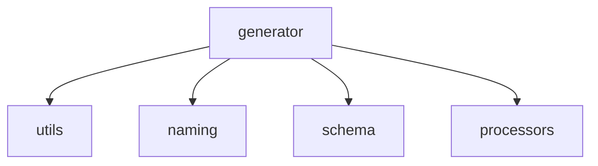

# 路径解析与命名策略应用

<details>
<summary>Relevant source files</summary>

- src/generator/extractor.ts
- src/naming/index.ts
- src/naming/strategy.ts

</details>

本页属于「命名策略与标识符净化」章节，聚焦 `src/naming/index.ts`、`src/naming/strategy.ts` 与 `src/generator/extractor.ts` 三个文件，说明原始路径如何被解析为结构化信息、该结构信息如何被命名策略消费，以及接口名与函数名两类命名结果各自的来源链路。

---

## 一、参与文件与自述职责

| 文件                         | 文件头自述职责                                                                             | 证据锚点                     |
| ---------------------------- | ------------------------------------------------------------------------------------------ | ---------------------------- |
| `src/naming/index.ts`        | 命名策略模块，提供统一的命名策略和名称清理功能                                             | src/naming/index.ts:1        |
| `src/naming/strategy.ts`     | 命名策略模块，提供灵活的命名策略接口和默认实现，用于统一管理接口、函数、类型名称的生成逻辑 | src/naming/strategy.ts:1     |
| `src/generator/extractor.ts` | 数据提取模块，从 OpenAPI 操作中提取响应和路径参数                                          | src/generator/extractor.ts:1 |

`src/generator/extractor.ts` 的文件头同时交代了一次职责迁移与兼容性安排（原文引用）：

> 「请求参数提取已下沉至 requestParameters.ts（含 body/query/path 分组与 @ParameterObject 展开），此处 re-export 以保持既有 `from '../extractor'` 的导入兼容性。」
> —— src/generator/extractor.ts:1

也就是说，本文件当前保留的是「响应 + 路径参数」两类提取职责，请求参数提取已迁出，仅通过 re-export 维持既有导入路径可用。这是一条有明确注释锚点的重构动机，不是推断。

---

## 二、路径解析：`extractPathInfo`

路径解析的入口是 `extractPathInfo`，其注释直接说明了它在整条命名链路上的分工位置。

```typescript
// src/naming/strategy.ts:58
function extractPathInfo(path: string);
```

原文注释（src/naming/strategy.ts:58）：

> 「路径信息提取器。将原始路径解析为结构化信息，供命名策略使用。」

返回值形态由同一条注释中的示例给出（src/naming/strategy.ts:58）：输入 `'/users/{id}'` 时得到形如 `pascalCasePathName: 'Users'`、`paramsPart: 'ById'`、`paramMatches: ['{id}']` 的结构化结果。该结构对应的类型接口带注释「路径处理结果接口」（src/naming/strategy.ts:15，目标符号 `ProcessedPathInfo`）。

解析实现依赖一组预编译正则：`PATH_PATTERNS` 的注释为「预编译的正则表达式模式（性能优化）」（src/naming/strategy.ts:27）。这是数据中唯一明确写出解析性能动机的锚点。

`extractPathInfo` 在本页所列符号中结构最简单（复杂度指标 1）。

---

## 三、命名策略应用：`applyNamingStrategy`

命名策略的默认实现是 `defaultNamingStrategy`，其注释给出了设计动机（原文引用）：

> 「默认命名策略。提供标准的命名规则，确保生成的代码符合 TypeScript 命名规范。」
> —— src/naming/strategy.ts:103

`applyNamingStrategy` 是该策略的执行入口，它按顺序把命名工作委派给五类名称生成函数：

| 被调用方           | 说明           | 锚点                       |
| ------------------ | -------------- | -------------------------- |
| `interfaceName`    | 生成接口名     | src/naming/strategy.ts:109 |
| `functionName`     | 生成函数名     | src/naming/strategy.ts:127 |
| `requestTypeName`  | 生成请求类型名 | src/naming/strategy.ts:144 |
| `responseTypeName` | 生成响应类型名 | src/naming/strategy.ts:154 |
| `hookName`         | 生成 Hook 名   | src/naming/strategy.ts:164 |

这五条委派关系共同构成「一份操作定义 → 接口名 / 函数名 / 请求类型名 / 响应类型名 / Hook 名」的命名产出面，与 `strategy.ts` 文件头自述的「统一管理接口、函数、类型名称的生成逻辑」相吻合（src/naming/strategy.ts:1）。

---

## 四、接口名与函数名的来源链路

简报关注的两类命名结果——接口名与函数名——都在数据中留下了到路径解析的调用边，即二者共享同一个结构化路径信息来源：

- `interfaceName` → `extractPathInfo`，锚点 src/naming/strategy.ts:58
- `functionName` → `extractPathInfo`，锚点 src/naming/strategy.ts:58
- `hookName` → `functionName`，锚点 src/naming/strategy.ts:127

由此可确认两条事实：

1. 接口名与函数名并非各自独立解析路径，二者都以 `extractPathInfo` 的输出为输入（上述前两条调用边）。
2. Hook 名不直接走路径解析，而是复用函数名的生成结果（第三条调用边），形成 `hookName → functionName → extractPathInfo` 的两级复用。

`requestTypeName`、`responseTypeName` 在本页数据中只出现于 `applyNamingStrategy` 的委派边（src/naming/strategy.ts:144、src/naming/strategy.ts:154），未出现其上游调用边，因此本页不对二者的输入来源作进一步描述。

---

## 五、调用关系总表

| 调用方                | 被调用方           | 锚点                       |
| --------------------- | ------------------ | -------------------------- |
| `applyNamingStrategy` | `interfaceName`    | src/naming/strategy.ts:109 |
| `applyNamingStrategy` | `functionName`     | src/naming/strategy.ts:127 |
| `applyNamingStrategy` | `requestTypeName`  | src/naming/strategy.ts:144 |
| `applyNamingStrategy` | `responseTypeName` | src/naming/strategy.ts:154 |
| `applyNamingStrategy` | `hookName`         | src/naming/strategy.ts:164 |
| `functionName`        | `extractPathInfo`  | src/naming/strategy.ts:58  |
| `hookName`            | `functionName`     | src/naming/strategy.ts:127 |
| `interfaceName`       | `extractPathInfo`  | src/naming/strategy.ts:58  |

从调用拓扑看，`applyNamingStrategy` 是唯一的汇聚点，`extractPathInfo` 是唯一被两个不同路径（接口名、函数名）复用的底层解析点，而命名模块自身没有出现反向调用其他模块的边——本页数据范围内的调用方向是单向的：策略层 → 名称生成层 → 路径解析层。

---

## 六、命名模块与其他模块的边界

在生成器模块的对外调用分布中，命名模块是第二大的被调用目标：



| 调用方向               | 跨模块调用处数 |
| ---------------------- | -------------- |
| generator → utils      | 78             |
| generator → naming     | 24             |
| generator → schema     | 12             |
| generator → processors | 6              |

这表明命名能力被生成器在生成期高频调用（24 处），仅次于通用工具模块（78 处），与「命名策略在生成期统一产出各类名称」的定位一致（src/naming/strategy.ts:1）。

---

## 七、相邻职责：`src/generator/extractor.ts`

除路径解析链路外，本页涉及的文件还有一处类型/响应提取符号：

```typescript
// src/generator/extractor.ts:66
function extractResponseProperties(
  responses: OpenApiOperation['responses'],
  processedData: ProcessedApiData,
);
```

该符号用于处理 OpenAPI 的 `responses` 与处理后的 API 数据，复杂度指标为 10，是本页所列符号中结构最复杂的一个。

同文件内还有两处带注释的符号锚点：`extractPathParameterNames`（示例注释片段位于 src/generator/extractor.ts:46）与 `extractTypeProperties`（注释位于 src/generator/extractor.ts:176）。该文件首次提交对应提交信息「refactor: 重组项目结构和代码架构」（commit:4388e7de, 2025-09-29）；命名模块入口的首次提交对应「refactor: 重构客户端架构并拆分生成器模块」（commit:f9369dc3, 2026-06-22）——两处提交信息均可佐证命名与提取能力是随生成器模块拆分而独立出来的。

---

## 八、待确认

1. **命名函数的签名与定义位置**：`applyNamingStrategy`、`interfaceName`、`functionName`、`hookName`、`requestTypeName`、`responseTypeName` 仅出现在调用关系中，数据未提供各自的定义位置、签名与实现，故本页只能描述调用拓扑，无法描述其内部命名规则。
2. **`src/naming/index.ts` 与 `src/naming/strategy.ts` 的导出关系**：前者自述为「统一的命名策略和名称清理功能」（src/naming/index.ts:1），但数据未提供两者的导出/重导出边，无法确认 `index.ts` 是聚合导出还是另有实现。
3. **generator → naming 的 24 处调用点清单**：模块边界只给出调用计数，未给出具体调用点，本页的命名调用链仅覆盖 `src/naming/strategy.ts` 内部可见的边，无法确认生成器侧的全部消费入口。

## Related

- 同目录：[identifier-sanitizing.md](identifier-sanitizing.md)
- 共享 2 个源文件、共享 3 个符号：[architecture.md](../02-architecture/architecture.md)
- 共享 4 个符号：[modules.md](../02-architecture/modules.md)
- 共享 1 个源文件、共享 2 个符号：[decisions.md](../04-design/decisions.md)
- 总入口：[README](../README.md)

<!-- wiki:source: llm -->
