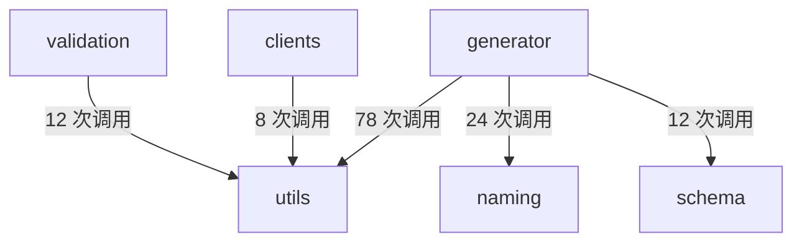

# 生成编排与目录清理

<details>
<summary>Relevant source files</summary>

- src/generator/codegen.ts
- src/generator/fileGenerator.ts
- src/utils/file.ts

</details>

> 本页属章节「产物落盘与文件编排」，聚焦一次代码生成中"从入口协调到文件落盘、以及落盘前对输出目录的清理"这一链路。覆盖 `src/generator/codegen.ts`（代码生成协调器）、`src/generator/fileGenerator.ts`（文件生成器协调器）与 `src/utils/file.ts`（文件操作工具函数）三个文件中与生成编排、目录清理直接相关的符号与调用关系。

---

## 1. 本页涉及的三个文件及其自述职责

| 文件                             | 自述职责（文件头原文）                                                                           | 锚点                               |
| -------------------------------- | ------------------------------------------------------------------------------------------------ | ---------------------------------- |
| `src/generator/codegen.ts`       | "代码生成协调器"                                                                                 | `src/generator/codegen.ts:1`       |
| `src/generator/fileGenerator.ts` | "文件生成器协调器 —— 统一协调各类文件的生成工作，包括请求函数、接口文件、类型文件和 Schema 文件" | `src/generator/fileGenerator.ts:1` |
| `src/utils/file.ts`              | "文件操作工具函数"                                                                               | `src/utils/file.ts:1`              |

三者构成一条自上而下的职责分层：`codegen.ts` 负责整体编排，`fileGenerator.ts` 负责具体文件类别的生成，`utils/file.ts` 提供目录与文件级操作原语。

---

## 2. 生成编排入口：`generateFiles`

定义位置：`src/generator/codegen.ts:35`，所属文件自述为"代码生成协调器"（`src/generator/codegen.ts:1`）。

签名：

```ts
(
  processedData: ProcessedApiData,
  config: ApiConfig,
)
```

该符号的注释片段中出现"Schema 文件（如果 typesFormat: 'zod'）"（`src/generator/codegen.ts:35`），说明该入口的产出范围包含 Schema 文件，且其产出受 `typesFormat` 配置项条件控制。代码复杂度记录为 9（`src/generator/codegen.ts:35`），为本页涉及的两个显式符号中较高者，与"协调器"承担多路分支编排的定位一致。

### 2.1 一次生成中的文件产出阶段（静态可达）

下表列出的每一行都是一条数据中存在的调用边，**不代表执行先后顺序**（顺序信息见 §2.2）。

| 阶段                       | 发起方                | 落点                  | 证据锚点                            |
| -------------------------- | --------------------- | --------------------- | ----------------------------------- |
| 清理输出目录               | `generateFiles`       | `cleanOutputDir`      | `src/utils/file.ts:96`              |
| 生成请求文件               | `generateFiles`       | `generateRequestFile` | `src/generator/fileGenerator.ts:32` |
| 写入并格式化请求文件       | `generateRequestFile` | `writeFormattedFile`  | `src/utils/file.ts:39`              |
| 写入前判断目标文件是否存在 | `generateRequestFile` | `fileExists`          | `src/utils/file.ts:82`              |
| 清理过程中判断文件是否存在 | `cleanOutputDir`      | `fileExists`          | `src/utils/file.ts:82`              |

要点：

- `generateFiles` 是"清理"与"生成"两条支路的共同起点：它既可达目录清理（`src/utils/file.ts:96`），也可达请求文件生成（`src/generator/fileGenerator.ts:32`）。
- 两条支路最终都收敛到 `fileExists`（`src/utils/file.ts:82`），即"文件是否已存在"是清理与写入共用的判断点。
- `generateFiles` 的产出并非只有请求文件：`fileGenerator.ts` 的文件头自述其协调范围包括"请求函数、接口文件、类型文件和 Schema 文件"（`src/generator/fileGenerator.ts:1`），而 `generateFiles` 自身注释片段也提到 Schema 文件（`src/generator/codegen.ts:35`）。

### 2.2 执行顺序

数据中的调用边只表达静态可达性，未携带先后顺序信息。**推断**：`cleanOutputDir` 先于 `generateRequestFile` 执行，依据是 `generateFiles` 同时可达二者（`src/utils/file.ts:96`、`src/generator/fileGenerator.ts:32`）以及"清理—生成"的常见命名与结构特征；此推断无数据中的顺序证据支撑。

---

## 3. 请求文件生成：`generateRequestFile`

定义位置：`src/generator/fileGenerator.ts:32`。

符号注释原文："生成 request.ts 文件，包含 request 函数和 requestMethods 对象"（`src/generator/fileGenerator.ts:32`）。

该符号的两条调用边：

| 被调用方             | 用途线索                     | 证据锚点               |
| -------------------- | ---------------------------- | ---------------------- |
| `fileExists`         | 写入前判断目标文件是否已存在 | `src/utils/file.ts:82` |
| `writeFormattedFile` | 以格式化方式写入文件内容     | `src/utils/file.ts:39` |

调用形态上，`generateRequestFile` 同时依赖"存在性判断 + 格式化写入"两个 `utils/file.ts` 原语，形成"先判断、后写入"的组合。

> 数据未给出 `generateRequestFile` 的完整签名与参数列表，本页不展开其参数结构。

---

## 4. 目录清理：`cleanOutputDir`

定义位置：`src/utils/file.ts:96`，位于自述为"文件操作工具函数"的文件中（`src/utils/file.ts:1`）。

签名：

```ts
(dirPath: string, excludeFiles: string[] = [])
```

代码复杂度记录为 7（`src/utils/file.ts:96`）。

调用边：

| 调用方           | 被调用方     | 证据锚点               |
| ---------------- | ------------ | ---------------------- |
| `cleanOutputDir` | `fileExists` | `src/utils/file.ts:82` |

现有数据仅能确认：清理过程内部会触达 `fileExists`（`src/utils/file.ts:82`）。至于它在遍历目录时如何使用该判断（跳过已不存在项、还是用于 `excludeFiles` 比对），数据未提供进一步调用边或源码语义，不在此展开。

关于第二个参数 `excludeFiles`：**推断**其语义为"清理时需要排除、不被删除的文件名集合"，依据是参数命名与默认空数组的签名形态（`src/utils/file.ts:96`）；数据中没有任何调用点向该参数传值的证据，也无注释说明，故仅为命名层面推断。

---

## 5. `utils/file.ts` 中的其它文件操作原语

以下符号在本页数据中以注释或调用边形式出现，是生成链路的支撑层：

| 符号                 | 锚点                   | 数据中可确认的信息                                                                                                                                           |
| -------------------- | ---------------------- | ------------------------------------------------------------------------------------------------------------------------------------------------------------ |
| `ensureDir`          | `src/utils/file.ts:23` | 注释原文"确保输出目录存在"；本页数据未给出其调用方                                                                                                           |
| `writeFormattedFile` | `src/utils/file.ts:39` | 符号注释含示例用法 `await writeFormattedFile('./src/api/user.ts', 'export const api = {};')`，即按"路径 + 内容字符串"异步写入；由 `generateRequestFile` 调用 |
| `fileExists`         | `src/utils/file.ts:82` | 注释片段"true 或 false"，即返回布尔结果；被 `cleanOutputDir` 与 `generateRequestFile` 调用                                                                   |

`ensureDir` 的"确保输出目录存在"（`src/utils/file.ts:23`）与 `cleanOutputDir` 的"清理输出目录"在职责上互补，但**本页数据中没有出现 `ensureDir` 的任何调用边**，因此不能断言它被生成编排何时调用。

---

## 6. 调用关系总表

以下为本页文件中出现的全部调用边（调用方 → 被调用方）：

| 调用方                | 被调用方              | 证据锚点                            |
| --------------------- | --------------------- | ----------------------------------- |
| `cleanOutputDir`      | `fileExists`          | `src/utils/file.ts:82`              |
| `generateFiles`       | `cleanOutputDir`      | `src/utils/file.ts:96`              |
| `generateFiles`       | `generateRequestFile` | `src/generator/fileGenerator.ts:32` |
| `generateRequestFile` | `fileExists`          | `src/utils/file.ts:82`              |
| `generateRequestFile` | `writeFormattedFile`  | `src/utils/file.ts:39`              |

据此可读出两条落盘路径：

1. **清理路径**：`generateFiles` → `cleanOutputDir` → `fileExists`
2. **写入路径**：`generateFiles` → `generateRequestFile` → `fileExists` / `writeFormattedFile`

两条路径在 `fileExists` 处交汇，说明"目标文件是否已存在"是清理与写入两个环节共用的前置判断。

---

## 7. 模块边界方向

`generator` 模块对外依赖的方向与强度（调用次数）：



| 来源模块     | 目标模块 | 调用次数 |
| ------------ | -------- | -------- |
| `generator`  | `utils`  | 78       |
| `generator`  | `naming` | 24       |
| `generator`  | `schema` | 12       |
| `validation` | `utils`  | 12       |
| `clients`    | `utils`  | 8        |

本页两条落盘路径（`generateFiles` → `cleanOutputDir`、`generateRequestFile` → `writeFormattedFile` / `fileExists`）均属于 `generator` → `utils` 方向，是该方向 78 次调用的一部分（该方向中本页链路的占比，数据未给出）。

---

## 8. 演进与动机证据

| 事实                                      | 证据原文                                                                                                               | 锚点                           |
| ----------------------------------------- | ---------------------------------------------------------------------------------------------------------------------- | ------------------------------ |
| `src/generator/fileGenerator.ts` 首次提交 | "refactor: 重组项目结构和代码架构"                                                                                     | `commit:4388e7de (2025-09-29)` |
| `src/utils/file.ts` 首次提交              | "feat: 文件结构以及代码重构、按模块生成代码、去掉requestConfig以及mockUrl、删除vtils/haoma等依赖、使用changeset发布包" | `commit:75c5dd40 (2025-08-13)` |

从提交信息可确认的演进线索：

- `utils/file.ts` 早于 `fileGenerator.ts` 进入仓库（2025-08-13 对 2025-09-29），文件操作原语层先于生成协调层建立。
- `utils/file.ts` 的首个提交信息中提到"按模块生成代码""去掉 requestConfig 以及 mockUrl""删除 vtils/haoma 等依赖"（`commit:75c5dd40 (2025-08-13)`），说明该文件所在的改造与"按模块生成代码"这一生成模式调整同期发生。
- `fileGenerator.ts` 的首个提交为"重组项目结构和代码架构"（`commit:4388e7de (2025-09-29)`），即该协调器是在一次结构性重构中定型的。

> 上述提交信息仅说明变更范围与背景，数据未提供这些提交的具体改动内容与本页函数的对应关系。

---

## 9. 待确认

| #   | 缺口                                            | 缺什么证据                                                                                                                                                                                                    |
| --- | ----------------------------------------------- | ------------------------------------------------------------------------------------------------------------------------------------------------------------------------------------------------------------- |
| 1   | `checkGeneratedFiles` 未出现在本页数据中        | 写作简报提到该符号，但数据中无其定义位置、签名或调用边；无法描述既有产物的检查机制                                                                                                                            |
| 2   | `cleanOutputDir` 内部如何使用 `fileExists` 结果 | 仅有 `cleanOutputDir` → `fileExists` 一条边（`src/utils/file.ts:82`），无遍历/分支逻辑证据                                                                                                                    |
| 3   | `excludeFiles` 参数的实际语义与调用方           | 仅有签名（`src/utils/file.ts:96`），无任何传值调用点或注释                                                                                                                                                    |
| 4   | 接口文件、类型文件、Schema 文件的生成落点       | `fileGenerator.ts` 文件头自述覆盖这些类别（`src/generator/fileGenerator.ts:1`），`generateFiles` 注释提到 Schema 文件（`src/generator/codegen.ts:35`），但数据中只有 `generateRequestFile` 一个具体生成器符号 |

`generateRequestFile` 的完整签名数据中未提供，属次要缺口，不单列。

## Related

- 同目录：[write-and-format.md](write-and-format.md) · [templates-and-index.md](templates-and-index.md)
- 共享 11 个符号：[architecture.md](../02-architecture/architecture.md)
- 共享 10 个符号：[modules.md](../02-architecture/modules.md)
- 共享 3 个源文件、共享 5 个符号：[decisions.md](../04-design/decisions.md)
- 总入口：[README](../README.md)

<!-- wiki:source: llm -->
