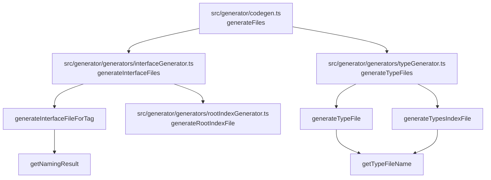
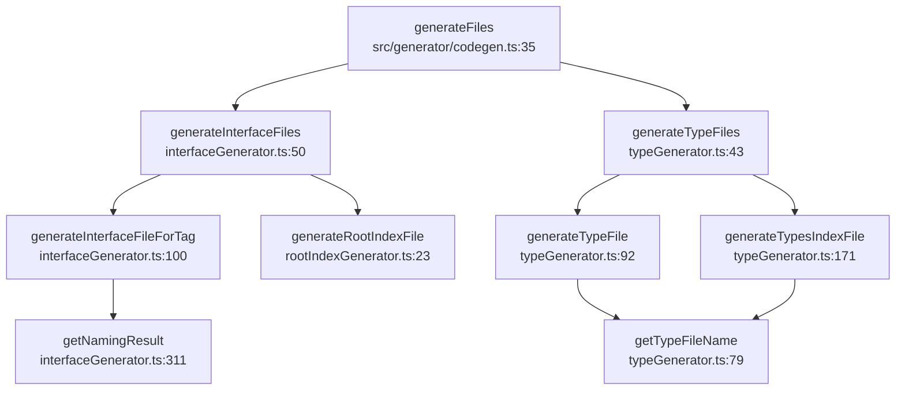

# 模板装配与入口聚合

<details>
<summary>Relevant source files</summary>

- src/generator/codegen.ts
- src/generator/generators/interfaceGenerator.ts
- src/generator/generators/rootIndexGenerator.ts
- src/generator/generators/typeGenerator.ts

</details>

本页属于「产物落盘与文件编排」章节，聚焦生成阶段的**文件装配与入口聚合**：即 `src/generator/codegen.ts` 如何编排接口文件、类型文件与两类索引（桶）文件的产出，以及各生成器内部如何组装单个文件、如何统一命名、如何汇总入口。所有结论均以源码锚点为依据。

---

## 一、覆盖文件与自述职责

四个文件在数据中均带文件头自述，可直接认定为各自的职责边界：

| 文件                                             | 自述职责（原文）                                                                    | 锚点                                               |
| ------------------------------------------------ | ----------------------------------------------------------------------------------- | -------------------------------------------------- |
| `src/generator/codegen.ts`                       | 「代码生成协调器」                                                                  | `src/generator/codegen.ts:1`                       |
| `src/generator/generators/interfaceGenerator.ts` | 「接口文件生成器 负责生成 API 接口相关的文件」                                      | `src/generator/generators/interfaceGenerator.ts:1` |
| `src/generator/generators/typeGenerator.ts`      | 「类型文件生成器 负责生成 TypeScript 类型定义文件」                                 | `src/generator/generators/typeGenerator.ts:1`      |
| `src/generator/generators/rootIndexGenerator.ts` | 「根索引文件生成器 从 interfaceGenerator.ts 拆分而来，负责生成 outputDir/index.ts」 | `src/generator/generators/rootIndexGenerator.ts:1` |

从职责看，四个文件构成两级结构：`codegen.ts` 做总协调，三个 `generators/*` 分别负责接口、类型、根索引入口的落盘。

---

## 二、符号清单与签名

本页涉及的符号、签名与复杂度如下（签名按数据原样）：

| 符号                          | 位置                                                 | 复杂度 | 签名                                                        |
| ----------------------------- | ---------------------------------------------------- | ------ | ----------------------------------------------------------- |
| `generateFiles`               | `src/generator/codegen.ts:35`                        | 9      | `(processedData: ProcessedApiData, config: ApiConfig)`      |
| `generateInterfaceFileForTag` | `src/generator/generators/interfaceGenerator.ts:100` | 15     | `(tag, interfaces, processedData, config, dirPath, hooks?)` |
| `generateRootIndexFile`       | `src/generator/generators/rootIndexGenerator.ts:23`  | 7      | `(processedData, config, hooks?)`                           |
| `generateTypeFile`            | `src/generator/generators/typeGenerator.ts:92`       | 3      | `(type, processedData, config, typesDir, hooks?)`           |
| `generateTypesIndexFile`      | `src/generator/generators/typeGenerator.ts:171`      | 1      | `(processedData, config, hooks?)`                           |
| `getNamingResult`             | `src/generator/generators/interfaceGenerator.ts:311` | 0      | `(path, method, operation, config)`                         |
| `getTypeFileName`             | `src/generator/generators/typeGenerator.ts:79`       | 0      | `(typeName: string)`                                        |

完整签名（含类型）：

```ts
// src/generator/codegen.ts:35
generateFiles(
  processedData: ProcessedApiData,
  config: ApiConfig,
)

// src/generator/generators/interfaceGenerator.ts:100
generateInterfaceFileForTag(
  tag: string,
  interfaces: ApiInterface[],
  processedData: ProcessedApiData,
  config: ApiConfig,
  dirPath: string,
  hooks?: CliHooks,
)

// src/generator/generators/rootIndexGenerator.ts:23
generateRootIndexFile(
  processedData: ProcessedApiData,
  config: ApiConfig,
  hooks?: CliHooks,
)

// src/generator/generators/typeGenerator.ts:92
generateTypeFile(
  type: ApiTypeDefinition,
  processedData: ProcessedApiData,
  config: ApiConfig,
  typesDir: string,
  hooks?: CliHooks,
)

// src/generator/generators/typeGenerator.ts:171
generateTypesIndexFile(
  processedData: ProcessedApiData,
  config: ApiConfig,
  hooks?: CliHooks,
)

// src/generator/generators/interfaceGenerator.ts:311
getNamingResult(
  path: string,
  method: string,
  operation: OpenApiOperation,
  config: ApiConfig,
)

// src/generator/generators/typeGenerator.ts:79
getTypeFileName(typeName: string)
```

要点：

- 三个带 `hooks?: CliHooks` 的函数（`generateTypeFile`、`generateTypesIndexFile`、`generateRootIndexFile`）与 `generateInterfaceFileForTag`（`src/generator/generators/interfaceGenerator.ts:100`）共享同一可选钩子参数形态，说明钩子是逐文件写盘粒度上可介入的扩展点；其具体触发时机在本次数据中未给出（见第八节）。
- 复杂度最高的是 `generateInterfaceFileForTag`（15，`src/generator/generators/interfaceGenerator.ts:100`），它是本页的逻辑重心；`generateFiles` 次之（9，`src/generator/codegen.ts:35`）。
- 命名类工具函数复杂度为 0：`getNamingResult`（`src/generator/generators/interfaceGenerator.ts:311`）、`getTypeFileName`（`src/generator/generators/typeGenerator.ts:79`）。

---

## 三、调用关系（静态可达性）

以下调用关系来自数据中的调用边，全部为静态事实：

| 调用方                        | 被调用方                      | 调用点锚点                                           |
| ----------------------------- | ----------------------------- | ---------------------------------------------------- |
| `generateFiles`               | `generateInterfaceFiles`      | `src/generator/generators/interfaceGenerator.ts:50`  |
| `generateFiles`               | `generateTypeFiles`           | `src/generator/generators/typeGenerator.ts:43`       |
| `generateInterfaceFiles`      | `generateInterfaceFileForTag` | `src/generator/generators/interfaceGenerator.ts:100` |
| `generateInterfaceFiles`      | `generateRootIndexFile`       | `src/generator/generators/rootIndexGenerator.ts:23`  |
| `generateInterfaceFileForTag` | `getNamingResult`             | `src/generator/generators/interfaceGenerator.ts:311` |
| `generateTypeFiles`           | `generateTypeFile`            | `src/generator/generators/typeGenerator.ts:92`       |
| `generateTypeFiles`           | `generateTypesIndexFile`      | `src/generator/generators/typeGenerator.ts:171`      |
| `generateTypeFile`            | `getTypeFileName`             | `src/generator/generators/typeGenerator.ts:79`       |
| `generateTypesIndexFile`      | `getTypeFileName`             | `src/generator/generators/typeGenerator.ts:79`       |

由表可得两条清晰主干：

- **接口主干**：`generateFiles` → `generateInterfaceFiles` → {`generateInterfaceFileForTag`, `generateRootIndexFile`}；命名由 `generateInterfaceFileForTag` → `getNamingResult` 提供。
- **类型主干**：`generateFiles` → `generateTypeFiles` → {`generateTypeFile`, `generateTypesIndexFile`}；两者共享 `getTypeFileName`。

文件级依赖（节点均为数据中出现的真实文件与符号）：



---

## 四、编排入口：`src/generator/codegen.ts`

`generateFiles`（`src/generator/codegen.ts:35`）是数据中**唯一同时调用接口主线与类型主线**的函数，因此它是产物生成的编排入口。

其符号注释片段列出了产物清单中的一项：「- Schema 文件（如果 typesFormat: 'zod'）」（`src/generator/codegen.ts:35`）。这说明生成结果中包含 Schema 文件，且其出现以 `typesFormat: 'zod'` 为条件——即产物集合随配置变化。除此之外，该注释片段还给出清单形式的产物描述（同一锚点）。

配套证据：跨模块调用面中，`generator` 模块对 `schema` 模块有 12 次调用、对 `processors` 模块有 6 次调用，与 Schema 产物属于同一生成体系（见第六节）。

> **推断（1）**：`generateFiles` 是生成流程的顶层编排入口。依据：`src/generator/codegen.ts:1` 自述「代码生成协调器」，其签名接收已处理的 API 数据与配置 `(processedData: ProcessedApiData, config: ApiConfig)`，且它是数据中唯一同时连向 `generateInterfaceFiles`（`src/generator/generators/interfaceGenerator.ts:50`）与 `generateTypeFiles`（`src/generator/generators/typeGenerator.ts:43`）的调用方。

---

## 五、接口文件装配：`interfaceGenerator.ts`

### 5.1 `generateInterfaceFiles`（`src/generator/generators/interfaceGenerator.ts:50`）

- 被 `generateFiles` 调用（`src/generator/generators/interfaceGenerator.ts:50`）。
- 向下调用 `generateInterfaceFileForTag`（`src/generator/generators/interfaceGenerator.ts:100`）与 `generateRootIndexFile`（`src/generator/generators/rootIndexGenerator.ts:23`）。
- 符号注释片段出现目录形态示例「tag2/index.ts」（`src/generator/generators/interfaceGenerator.ts:50`），指向接口产物按 tag 目录组织、目录内以 `index.ts` 作为该 tag 的聚合入口。

> **推断（2）**：`generateInterfaceFiles` 按 tag 逐个产出子目录的 `index.ts`。依据：其注释示例为 `tag2/index.ts`（`src/generator/generators/interfaceGenerator.ts:50`），且其下游函数 `generateInterfaceFileForTag` 的签名为 `(tag, interfaces, processedData, config, dirPath, hooks?)`、示例调用传入目录 `/output/user`（`src/generator/generators/interfaceGenerator.ts:100`）。数据未给出 tag 列表的枚举来源。

### 5.2 `generateInterfaceFileForTag`（`src/generator/generators/interfaceGenerator.ts:100`）

- 签名含 `dirPath: string`，即输出目录由调用方逐 tag 传入。
- 注释示例展示调用形态：`await generateInterfaceFileForTag('user', interfaces, processedData, config, '/output/user');`（`src/generator/generators/interfaceGenerator.ts:100`）——一次性传入该 tag 下的全部 `interfaces`。
- 向下调用 `getNamingResult`（`src/generator/generators/interfaceGenerator.ts:311`）。
- 复杂度 15，为本页符号中最高，属于装配环节的主要分支点。

### 5.3 `getNamingResult`（`src/generator/generators/interfaceGenerator.ts:311`）

其符号注释明确了职责与产出：

其符号注释明确了职责与产出：「使用命名策略生成接口名称、函数名称、请求类型名称、响应类型名称」，并「@returns 命名结果对象」（`src/generator/generators/interfaceGenerator.ts:311`）。即同一个 API 操作经该函数一次性派生出四类命名：接口名、函数名、请求类型名、响应类型名，由 `generateInterfaceFileForTag` 在装配文件时消费（调用边锚点 `src/generator/generators/interfaceGenerator.ts:311`）。

小结（接口主线）：

| 环节            | 承担符号                                  | 锚点                                                 |
| --------------- | ----------------------------------------- | ---------------------------------------------------- |
| 逐 tag 遍历产出 | `generateInterfaceFiles`                  | `src/generator/generators/interfaceGenerator.ts:50`  |
| 单 tag 文件装配 | `generateInterfaceFileForTag`             | `src/generator/generators/interfaceGenerator.ts:100` |
| 命名派生        | `getNamingResult`                         | `src/generator/generators/interfaceGenerator.ts:311` |
| 根入口汇总      | `generateRootIndexFile`（由接口主线调用） | `src/generator/generators/rootIndexGenerator.ts:23`  |

---

## 六、类型文件装配：`typeGenerator.ts`

### 6.1 `generateTypeFiles`（`src/generator/generators/typeGenerator.ts:43`）

- 被 `generateFiles` 调用（`src/generator/generators/typeGenerator.ts:43`）。
- 向下调用 `generateTypeFile`（`src/generator/generators/typeGenerator.ts:92`）与 `generateTypesIndexFile`（`src/generator/generators/typeGenerator.ts:171`），即「逐类型产出单文件」+「产出类型桶索引」两步。
- 符号注释中的示例为「Product.ts」（`src/generator/generators/typeGenerator.ts:43`），指向单个类型对应单个 `.ts` 文件的产物形态。

### 6.2 `generateTypeFile`（`src/generator/generators/typeGenerator.ts:92`）

符号注释原文：「生成单个类型文件 为指定的类型生成 TypeScript 类型定义文件」，参数含 `type`、`processedData`、`config`、`typesDir`、`hooks`（`src/generator/generators/typeGenerator.ts:92`）。即类型文件的输出目录由 `typesDir` 逐类型传入，与本页其他生成器「目录由调用方传入」的形态一致。

其唯一下游调用为 `getTypeFileName`（调用边锚点 `src/generator/generators/typeGenerator.ts:79`），复杂度为 3（`src/generator/generators/typeGenerator.ts:92`）。

### 6.3 `getTypeFileName`（`src/generator/generators/typeGenerator.ts:79`）

该函数带完整的动机自述，是本页**命名一致性**设计的关键证据，原文如下：

> 「计算类型名对应的文件名（非法字符替换为下划线）类型文件命名与桶索引引用必须使用同一规则，抽为公共函数防止漂移」
> —— `src/generator/generators/typeGenerator.ts:79`

由此可确认两点事实，且均有调用点佐证：

1. **规则内容**：文件名 = 类型名 + 非法字符替换为下划线（`src/generator/generators/typeGenerator.ts:79`）。
2. **抽取动机**：类型文件命名与桶索引引用必须使用同一规则，抽为公共函数以防止两者漂移（`src/generator/generators/typeGenerator.ts:79`）。其佐证是该函数被两处调用——`generateTypeFile`（`src/generator/generators/typeGenerator.ts:79`）与 `generateTypesIndexFile`（`src/generator/generators/typeGenerator.ts:79`）；两处均指向同一锚点，正对应「文件命名方」与「索引引用方」两个消费点。

### 6.4 `generateTypesIndexFile`（`src/generator/generators/typeGenerator.ts:171`）

- 符号注释原文：「生成类型索引文件 导出所有类型定义」（`src/generator/generators/typeGenerator.ts:171`）。
- 被 `generateTypeFiles` 调用（`src/generator/generators/typeGenerator.ts:171`）。
- 向下调用 `getTypeFileName`（`src/generator/generators/typeGenerator.ts:79`），即索引中的引用路径沿用与单文件相同的命名规则。
- 复杂度为 1（`src/generator/generators/typeGenerator.ts:171`），结构上以遍历+拼接为主。

---

## 七、根入口聚合：`rootIndexGenerator.ts`

`generateRootIndexFile`（`src/generator/generators/rootIndexGenerator.ts:23`）的职责由文件头自述直接给出：

> 「根索引文件生成器 从 interfaceGenerator.ts 拆分而来，负责生成 outputDir/index.ts」
> —— `src/generator/generators/rootIndexGenerator.ts:1`

可确认的事实：

- **产物位置与形态**：`outputDir/index.ts`，即输出根目录下的入口文件（`src/generator/generators/rootIndexGenerator.ts:1`）。
- **来源关系**：该文件是从 `interfaceGenerator.ts` 拆分而来（`src/generator/generators/rootIndexGenerator.ts:1`）。

拆分动机有提交信息佐证：`src/generator/generators/rootIndexGenerator.ts` 的首次提交为 **commit:f9369dc3（2026-06-22）**，信息为「refactor: 重构客户端架构并拆分生成器模块」（`commit:f9369dc3 (2026-06-22)`）。该信息与文件头「从 interfaceGenerator.ts 拆分而来」互为印证。

与之对照，`src/generator/generators/interfaceGenerator.ts` 的首次提交为 **commit:642c071c（2026-01-18）**，信息为「refactor: 重构代码结构，拆分大文件并优化模块组织」（`commit:642c071c (2026-01-18)`）。两笔提交显示：接口生成器先经历「拆分大文件」的结构整理，根索引生成器后经历「拆分生成器模块」的独立化，根索引入口最终由独立文件承担。

调用位置：`generateRootIndexFile` 由 `generateInterfaceFiles` 调用（`src/generator/generators/rootIndexGenerator.ts:23`）——即根入口的汇总发生在接口文件全部装配完成之后的同一条调用链上。

---

## 八、钩子扩展点与命名一致性

### 8.1 钩子参数面

数据中带 `hooks?: CliHooks` 可选项的函数共三个，均为逐文件落盘粒度：

| 函数                          | 锚点                                                 | 钩子参数           |
| ----------------------------- | ---------------------------------------------------- | ------------------ |
| `generateInterfaceFileForTag` | `src/generator/generators/interfaceGenerator.ts:100` | `hooks?: CliHooks` |
| `generateTypeFile`            | `src/generator/generators/typeGenerator.ts:92`       | `hooks?: CliHooks` |
| `generateTypesIndexFile`      | `src/generator/generators/typeGenerator.ts:171`      | `hooks?: CliHooks` |
| `generateRootIndexFile`       | `src/generator/generators/rootIndexGenerator.ts:23`  | `hooks?: CliHooks` |

这些钩子均为可选（`hooks?`），说明装配流程在无钩子时照常完成落盘（`src/generator/generators/interfaceGenerator.ts:100`、`src/generator/generators/typeGenerator.ts:92`、`src/generator/generators/typeGenerator.ts:171`、`src/generator/generators/rootIndexGenerator.ts:23`）。**钩子在文件写入前后具体触发哪些回调、回调的调用时机与等待语义，本次数据未提供**，见第十一节。

### 8.2 命名规则的统一性

命名一致性由两条线索共同支撑：

| 维度                 | 证据                                                                                                       |
| -------------------- | ---------------------------------------------------------------------------------------------------------- |
| 接口侧命名集中派生   | `getNamingResult` 统一产出四类命名（`src/generator/generators/interfaceGenerator.ts:311`）                 |
| 类型侧文件名集中派生 | `getTypeFileName` 被「文件命名」与「桶索引引用」两处共用（`src/generator/generators/typeGenerator.ts:79`） |
| 类型侧防漂移动机     | 「必须使用同一规则，抽为公共函数防止漂移」（`src/generator/generators/typeGenerator.ts:79`）               |

因此，本页所覆盖的装配环节并不在各自生成器内部重复实现命名逻辑：接口命名收敛到 `getNamingResult`，类型文件名收敛到 `getTypeFileName`，索引文件与实体文件共享同一命名入口。

---

## 九、跨模块依赖面

`generator` 模块对外部的依赖调用面如下（节点为数据给出的模块边界）：

| 依赖方向                   | 调用次数 |
| -------------------------- | -------- |
| `generator` → `utils`      | 78       |
| `generator` → `naming`     | 24       |
| `generator` → `schema`     | 12       |
| `generator` → `processors` | 6        |

可读出的关联：

- 对 `naming` 的 24 次调用与接口侧 `getNamingResult`「使用命名策略生成接口名称…」（`src/generator/generators/interfaceGenerator.ts:311`）方向一致，命名策略由独立模块提供。
- 对 `schema` 的 12 次调用与 `codegen.ts:35` 所列产物「Schema 文件（如果 typesFormat: 'zod'）」呼应（`src/generator/codegen.ts:35`）。
- 对 `utils` 的 78 次调用为最大依赖面，涵盖文件写入与路径处理类共性能力（该模块边界的具体成员未在本次数据中给出）。

---

## 十、装配与聚合全景

综合第一节至第九节，本页覆盖的产物装配链路可归纳为：

| 层级     | 产物                                             | 承担符号                                                 | 锚点                                                                                                      |
| -------- | ------------------------------------------------ | -------------------------------------------------------- | --------------------------------------------------------------------------------------------------------- |
| 编排     | 全部产物调度                                     | `generateFiles`                                          | `src/generator/codegen.ts:35`                                                                             |
| 接口     | 各 tag 目录的 `index.ts`（示例 `tag2/index.ts`） | `generateInterfaceFiles` / `generateInterfaceFileForTag` | `src/generator/generators/interfaceGenerator.ts:50`、`src/generator/generators/interfaceGenerator.ts:100` |
| 接口     | 根入口 `outputDir/index.ts`                      | `generateRootIndexFile`                                  | `src/generator/generators/rootIndexGenerator.ts:23`、`src/generator/generators/rootIndexGenerator.ts:1`   |
| 类型     | 单类型文件（示例 `Product.ts`）                  | `generateTypeFiles` / `generateTypeFile`                 | `src/generator/generators/typeGenerator.ts:43`、`src/generator/generators/typeGenerator.ts:92`            |
| 类型     | 类型索引（导出所有类型定义）                     | `generateTypesIndexFile`                                 | `src/generator/generators/typeGenerator.ts:171`                                                           |
| 条件产物 | Schema 文件（`typesFormat: 'zod'` 时）           | 由 `generateFiles` 清单所列                              | `src/generator/codegen.ts:35`                                                                             |

链路形态图（节点标签均取自数据中的真实文件与符号）：



---

## 十一、待确认

1. **import 段组装的具体规则**：写作简报点名 `buildCommonImports`，但本次数据中未出现该符号的定义、签名或任何调用边，因此无法描述其组装规则与参与时机。需要补充该符号所在文件与调用点锚点。
2. **`getApiOnlyTemplateByConfig` 的行为**：简报点名该符号，数据中同样无定义与调用证据，无法说明其模板选择条件。需要补充其定义位置与调用方。
3. **钩子的触发时机与语义**：`hooks?: CliHooks` 出现在四处符号签名中（`src/generator/generators/interfaceGenerator.ts:100`、`src/generator/generators/typeGenerator.ts:92`、`src/generator/generators/typeGenerator.ts:171`、`src/generator/generators/rootIndexGenerator.ts:23`），但数据未给出钩子的回调阶段（写入前/写入后）与等待关系，无法确认其调用时机。
4. **tag 枚举来源**：`generateInterfaceFileForTag` 以 `tag: string` 为入参（`src/generator/generators/interfaceGenerator.ts:100`），但数据未给出 tag 列表由何处解析与分组，无法确认遍历来源。

---

**本页锚点自检**：全文事实声明均带 `file:line`、函数名或 commit 锚点；两处无直接证据的判断已在正文中以「推断」标注并写明依据（`src/generator/codegen.ts:35`、`src/generator/generators/interfaceGenerator.ts:50`）；未出现的模块、服务与功能一律未纳入描述。

## Related

- 同目录：[generate-orchestration.md](generate-orchestration.md) · [write-and-format.md](write-and-format.md)
- 共享 1 个源文件、共享 12 个符号：[topic:utils-generator-docs.md](../08-topics/utils-generator-docs.md)
- 共享 9 个符号：[architecture.md](../02-architecture/architecture.md)
- 共享 8 个符号：[modules.md](../02-architecture/modules.md)
- 总入口：[README](../README.md)

<!-- wiki:source: llm -->
