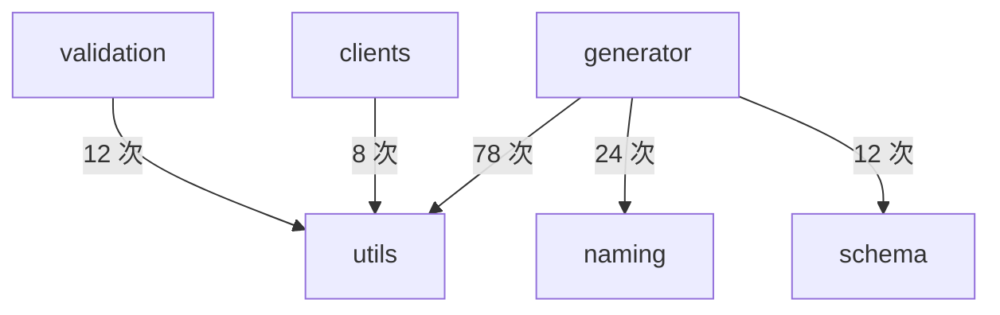

# 格式化写入

<details>
<summary>Relevant source files</summary>

- src/generator/fileWriter.ts
- src/utils/file.ts
- src/utils/formatter.ts

</details>

本页聚焦「产物落盘与文件编排」章节中的写入环节：生成内容在写入磁盘前如何被格式化，以及 `src/generator/fileWriter.ts`、`src/utils/formatter.ts`、`src/utils/file.ts` 三个文件在「格式化—写入—目录准备」这条链路上的分工。

## 1. 三个文件的职责边界

三份文件的自述头部注释直接界定了各自边界：

| 文件                          | 自述职责（原文）                                                                                                                                | 锚点                          |
| ----------------------------- | ----------------------------------------------------------------------------------------------------------------------------------------------- | ----------------------------- |
| `src/generator/fileWriter.ts` | 「文件写入工具 封装生成器中重复的「格式化 + 写入 + 调试日志」三连操作，消除 interfaceGenerator / typeGenerator / schemaGenerator 中的样板代码」 | src/generator/fileWriter.ts:1 |
| `src/utils/formatter.ts`      | 「代码格式化工具 使用 Prettier 格式化生成的代码」                                                                                               | src/utils/formatter.ts:1      |
| `src/utils/file.ts`           | 「文件操作工具函数」                                                                                                                            | src/utils/file.ts:1           |

由此可以确认的层次关系是：**格式化能力集中在 `formatter`，具体文件系统操作集中在 `file`，而 `fileWriter` 是把两者串起来、供各生成器复用的门面层**。其中 `fileWriter` 的自述明确点名了三个消费方——`interfaceGenerator`、`typeGenerator`、`schemaGenerator`（src/generator/fileWriter.ts:1），说明它是为消除生成器中的重复样板而抽出的。

## 2. 符号清单与可确认信息

| 符号                 | 所在文件                      | 数据中可确认的信息                                                                                                                                  | 锚点                           |
| -------------------- | ----------------------------- | --------------------------------------------------------------------------------------------------------------------------------------------------- | ------------------------------ |
| `writeGeneratedFile` | `src/generator/fileWriter.ts` | 是 `fileWriter` 模块中被注释标注的符号之一，处于「格式化 + 写入 + 调试日志」这条封装链上                                                            | src/generator/fileWriter.ts:33 |
| `formatCode`         | `src/utils/formatter.ts`      | 被注释标注，示例形态为 `formatted = 'const x = 1;'`，即返回格式化后的代码字符串                                                                     | src/utils/formatter.ts:23      |
| `ensureDir`          | `src/utils/file.ts`           | 注释原文「确保输出目录存在」                                                                                                                        | src/utils/file.ts:23           |
| `writeFormattedFile` | `src/utils/file.ts`           | 注释给出调用示例 `await writeFormattedFile('./src/api/user.ts', 'export const api = {};')`——它接收目标路径与代码内容两个参数，并以 `await` 方式调用 | src/utils/file.ts:39           |
| `fileExists`         | `src/utils/file.ts`           | 注释说明返回「true 或 false」                                                                                                                       | src/utils/file.ts:82           |
| `cleanOutputDir`     | `src/utils/file.ts`           | 已被调用边引用；圈复杂度 7                                                                                                                          | src/utils/file.ts:96           |

`cleanOutputDir` 是数据中唯一给出完整签名的符号：

```ts
cleanOutputDir(dirPath: string, excludeFiles: string[] = [])
```

其参数为输出目录路径 `dirPath` 与可选的排除文件列表 `excludeFiles`（默认空数组），锚点 src/utils/file.ts:96。从「排除列表」这一参数形态看，它的职责是清理输出目录时保留指定文件；不过排除项的具体匹配规则在数据中无进一步证据，见第 6 节。

> 推断：`writeFormattedFile` 的命名与 `src/utils/formatter.ts` 自述的「使用 Prettier 格式化生成的代码」（src/utils/formatter.ts:1）共同指向「先格式化、再写入」的语义；但这属于命名与注释推断，数据中没有该函数的调用边或实现体作为直接佐证。

## 3. 调用关系

数据中给出的调用边只有一条：

| 调用方           | 被调用方     | 锚点                 |
| ---------------- | ------------ | -------------------- |
| `cleanOutputDir` | `fileExists` | src/utils/file.ts:82 |

`cleanOutputDir` 在清理过程中会判断文件是否存在，即目录清理依赖 `fileExists` 的存在性判断能力（src/utils/file.ts:82、src/utils/file.ts:96）。除这条边之外，`writeFormattedFile`、`writeGeneratedFile`、`formatCode`、`ensureDir` 之间的相互调用关系在数据中未给出，不做推断。

## 4. 写入链路的分工

按三份文件的自述注释，这条链路可以拆成三段职责：

| 阶段               | 承担者                                                                                          | 依据                                                          |
| ------------------ | ----------------------------------------------------------------------------------------------- | ------------------------------------------------------------- |
| 格式化             | `src/utils/formatter.ts` 中的 `formatCode`，使用 Prettier 处理生成代码                          | src/utils/formatter.ts:1、src/utils/formatter.ts:23           |
| 目录准备与文件落地 | `src/utils/file.ts` 中的 `ensureDir`（确保输出目录存在）与 `writeFormattedFile`                 | src/utils/file.ts:23、src/utils/file.ts:39                    |
| 生成器统一入口     | `src/generator/fileWriter.ts` 中的 `writeGeneratedFile`，把「格式化 + 写入 + 调试日志」三连收口 | src/generator/fileWriter.ts:1、src/generator/fileWriter.ts:33 |

这里值得注意的一点是：`fileWriter` 自述的「三连操作」中包含**调试日志**（src/generator/fileWriter.ts:1），也就是说日志输出与格式化、写入被放在同一层封装中，各生成器无需再各自重复这段逻辑。日志的具体实现落点在数据中无锚点，见第 6 节。

## 5. 在模块边界中的位置

本页涉及的 `writeFormattedFile`、`cleanOutputDir` 位于 `src/utils/` 下（src/utils/file.ts:39、src/utils/file.ts:96），而模块间调用统计显示 `utils` 是被多方复用的下游：

| 调用方向           | 调用量 |
| ------------------ | ------ |
| generator → utils  | 78     |
| generator → naming | 24     |
| generator → schema | 12     |
| validation → utils | 12     |
| clients → utils    | 8      |



`generator` 对 `utils` 的调用量在全部边界中最高，`validation` 与 `clients` 也各自向 `utils` 发起调用；这意味着 `utils/file.ts` 中的写入与清理工具处于被多个上层模块共享的位置，任何写入行为的调整都会横向影响到这些调用方。

## 6. 演进沿革

三个文件的引入时间与提交信息如下，可用于判断模块拆分的顺序：

| 文件                          | 首次提交               | 提交信息                                                                                                                  | 锚点                         |
| ----------------------------- | ---------------------- | ------------------------------------------------------------------------------------------------------------------------- | ---------------------------- |
| `src/utils/file.ts`           | 75c5dd40（2025-08-13） | 「文件结构以及代码重构、按模块生成代码、去掉 requestConfig 以及 mockUrl、删除 vtils/haoma 等依赖、使用 changeset 发布包」 | commit:75c5dd40 (2025-08-13) |
| `src/utils/formatter.ts`      | 4388e7de（2025-09-29） | 「重组项目结构和代码架构」                                                                                                | commit:4388e7de (2025-09-29) |
| `src/generator/fileWriter.ts` | f9369dc3（2026-06-22） | 「重构客户端架构并拆分生成器模块」                                                                                        | commit:f9369dc3 (2026-06-22) |

从时间线上看，`file.ts` 的文件操作能力最先出现（2025-08-13），格式化工具随后随项目结构重组加入（2025-09-29），而专用于收口生成器写入样板代码的 `fileWriter.ts` 最晚出现（2026-06-22），且其首次提交信息为「拆分生成器模块」（commit:f9369dc3 (2026-06-22)）——这与该文件头注释中「消除 interfaceGenerator / typeGenerator / schemaGenerator 中的样板代码」的表述（src/generator/fileWriter.ts:1）互相印证：`fileWriter` 是在生成器拆分过程中为消除重复代码而抽出的门面层。

## 7. 待确认

- **其余符号的签名与返回值**：数据中只有 `cleanOutputDir` 给出了参数签名（src/utils/file.ts:96），`writeFormattedFile`、`writeGeneratedFile`、`formatCode`、`ensureDir`、`fileExists` 的参数列表、返回类型与是否异步均无数据支撑。
- **Prettier 的版本与配置来源**：`formatter.ts` 自述使用 Prettier（src/utils/formatter.ts:1），但配置文件路径、选项与解析器选择在数据中未出现，无法判断格式化结果受哪些配置影响。
- **调试日志的实现落点**：`fileWriter` 自述包含「调试日志」（src/generator/fileWriter.ts:1），但数据中没有任何日志函数或开关的锚点。
- **写入失败与格式化失败的处理策略**：数据中没有异常分支、重试或降级相关的调用边或符号，无法确认失败时的行为。
- **`cleanOutputDir` 的排除规则**：仅在签名中可见 `excludeFiles` 参数（src/utils/file.ts:96），其匹配方式（文件名、相对路径或 glob）无证据。

## Related

- 同目录：[generate-orchestration.md](generate-orchestration.md) · [templates-and-index.md](templates-and-index.md)
- 共享 7 个符号：[architecture.md](../02-architecture/architecture.md)
- 共享 7 个符号：[modules.md](../02-architecture/modules.md)
- 共享 5 个符号：[chapter:config-validation/multi-service-resolution.md](../09-chapters/config-validation/multi-service-resolution.md)
- 总入口：[README](../README.md)

<!-- wiki:source: llm -->
