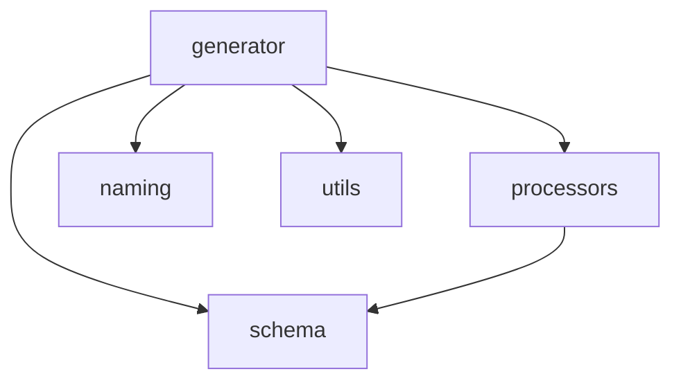

# Schema 遍历与 Zod 类型映射

<details>
<summary>Relevant source files</summary>

- src/generator/generators/schemaGenerator.ts
- src/generator/propertyType.ts
- src/schema/index.ts
- src/schema/operation.ts

</details>

本页属于「Zod Schema 生成与类型映射」章节，聚焦两类内容：一是 Schema 文件的遍历调度入口（`src/generator/generators/schemaGenerator.ts`），二是 OpenAPI 属性到类型表达式的映射实现（`src/generator/propertyType.ts`），以及二者共用的中立层工具（`src/schema/index.ts`、`src/schema/operation.ts`）。全页以「映射规则落在哪个文件、哪个符号」为叙述主线。

---

## 1. 涉及文件与自述职责

| 文件                                          | 头部自述（原文摘引）                                                                                                                                                                                                                                         | 锚点                                          |
| --------------------------------------------- | ------------------------------------------------------------------------------------------------------------------------------------------------------------------------------------------------------------------------------------------------------------ | --------------------------------------------- |
| `src/generator/generators/schemaGenerator.ts` | “Schema 文件生成器 负责生成 Zod Schema 验证文件”                                                                                                                                                                                                             | src/generator/generators/schemaGenerator.ts:1 |
| `src/generator/propertyType.ts`               | “属性类型映射模块 将 OpenAPI Schema 属性转换为 TypeScript 类型字符串，支持 nullable（3.0 / 3.1 双版本）、oneOf/anyOf（union）、allOf（属性级简单 intersection）。从 extractor.ts 抽出以控制文件行数（AGENTS.md 约束 < 360 行）。”                            | src/generator/propertyType.ts:1               |
| `src/schema/index.ts`                         | “Schema 中立层 提供与生成无关的 OpenAPI schema 分析/提取工具，供 processors 与 generator 共用，避免两包相互依赖形成环。”                                                                                                                                     | src/schema/index.ts:1                         |
| `src/schema/operation.ts`                     | “OpenAPI 操作内容（content）提取工具 … 从单个 OpenApiOperation 中按 content-type 优先级提取请求体/响应的 schema 及内容类型信息。纯函数、无副作用。本模块属于中立层（`src/schema/`）：processors 与 generator 共用，避免 processors → generator 的反向依赖。” | src/schema/operation.ts:1                     |

职责边界可以从自述归纳为三层：

- **遍历/调度层**：`src/generator/generators/schemaGenerator.ts`，负责按类型、按接口、按索引三类产物落盘（见第 3 节）。
- **属性映射层**：`src/generator/propertyType.ts`，把单个 OpenAPI 属性转换为类型字符串（见第 5 节）。
- **中立分析与提取层**：`src/schema/index.ts`、`src/schema/operation.ts`，不产出文件，只做 OpenAPI 结构分析（见第 6 节）。

---

## 2. 符号清单与签名

```ts
// src/generator/generators/schemaGenerator.ts:79
generateTypeSchemasFiles(
  processedData: ProcessedApiData,
  config: ApiConfig,
  schemasDir: string,
  generatedSchemas: string[],
  hooks?: CliHooks,
)

// src/generator/generators/schemaGenerator.ts:123
generateInterfaceSchemasFiles(
  processedData: ProcessedApiData,
  config: ApiConfig,
  schemasDir: string,
  generatedSchemas: string[],
  hooks?: CliHooks,
)

// src/generator/generators/schemaGenerator.ts:167
generateSchemaIndexFile(
  schemasDir: string,
  generatedSchemas: string[],
  hooks?: CliHooks,
)

// src/generator/generators/schemaGenerator.ts:189
getTypeName(
  path: string,
  method: string,
  operation: OpenApiOperation,
  config: ApiConfig,
  field: 'requestTypeName' | 'responseTypeName',
)

// src/generator/generators/schemaGenerator.ts:209
getRequestTypeName(path: string, method: string, operation: OpenApiOperation, config: ApiConfig)

// src/generator/generators/schemaGenerator.ts:219
getResponseTypeName(path: string, method: string, operation: OpenApiOperation, config: ApiConfig)

// src/generator/propertyType.ts:19
mapBasicType(type: string | undefined, property: OpenApiSchema)

// src/generator/propertyType.ts:76
getPropertyType(property: OpenApiSchema, depth = 0)

// src/schema/operation.ts:66
getResponseSchema(operation: OpenApiOperation)
```

| 符号                                         | 文件:行                                                | 备注（数据标注）                                                                                    |
| -------------------------------------------- | ------------------------------------------------------ | --------------------------------------------------------------------------------------------------- |
| `generateTypeSchemasFiles`                   | src/generator/generators/schemaGenerator.ts:79         | 入参 `generatedSchemas` 注释为“已生成的 Schema 名称数组（会追加）”                                  |
| `generateInterfaceSchemasFiles`              | src/generator/generators/schemaGenerator.ts:123        | 入参 `generatedSchemas` 注释为“已生成的 Schema 名称数组”                                            |
| `generateSchemaIndexFile`                    | src/generator/generators/schemaGenerator.ts:167        | 生成 Schema 索引文件，导出全部 Schema 定义                                                          |
| `getTypeName`                                | src/generator/generators/schemaGenerator.ts:189        | 通过 `field` 参数在 `'requestTypeName' \| 'responseTypeName'` 间选择                                |
| `getRequestTypeName` / `getResponseTypeName` | src/generator/generators/schemaGenerator.ts:209 / :219 | 均委托 `getTypeName`                                                                                |
| `getPropertyType`                            | src/generator/propertyType.ts:76                       | 带 `depth = 0` 参数；复杂度标注为 10                                                                |
| `mapBasicType`                               | src/generator/propertyType.ts:19                       | 注释：`@param property 含 format 等信息的 schema`、`@returns TypeScript 类型字符串`；复杂度标注为 8 |
| `getResponseSchema`                          | src/schema/operation.ts:66                             | 复杂度标注为 6；本次数据中无调用边                                                                  |

---

## 3. 遍历调度：`generateSchemaFiles` 的三条产出支线

生成器侧的遍历由一个调度入口 `generateSchemaFiles` 向下分发到三个子生成器：

| 调用方                | 被调用方                        | 位置锚点                                        |
| --------------------- | ------------------------------- | ----------------------------------------------- |
| `generateSchemaFiles` | `generateTypeSchemasFiles`      | src/generator/generators/schemaGenerator.ts:79  |
| `generateSchemaFiles` | `generateInterfaceSchemasFiles` | src/generator/generators/schemaGenerator.ts:123 |
| `generateSchemaFiles` | `generateSchemaIndexFile`       | src/generator/generators/schemaGenerator.ts:167 |

三条支线的产物语义（均为源码注释口径）：

- `generateTypeSchemasFiles` —— “为每个 OpenAPI 类型定义生成对应的 Zod Schema”（src/generator/generators/schemaGenerator.ts:79 上方注释）。
- `generateInterfaceSchemasFiles` —— “为每个接口生成请求和响应的 Zod Schema”（src/generator/generators/schemaGenerator.ts:123 上方注释）。
- `generateSchemaIndexFile` —— “生成 Schema 索引文件 导出所有 Schema 定义”（src/generator/generators/schemaGenerator.ts:167 上方注释）。

两个按条目遍历的子生成器都接收 `generatedSchemas: string[]` 作为累积容器，其中类型文件支线的注释明确标注该数组“会追加”（src/generator/generators/schemaGenerator.ts:79），索引文件支线随后以同一数组作为输入（src/generator/generators/schemaGenerator.ts:167）——即“先收集名称、再产出索引”的编排顺序在数据中由数组的传入/追加语义与调用时序共同体现。三条支线均接收可选 `hooks?: CliHooks`（src/generator/generators/schemaGenerator.ts:79、:123、:167）。

---

## 4. 类型名称解析链

请求/响应 Schema 的命名并非各自实现，而是收敛到同一个函数，由 `field` 参数区分：

| 调用方                | 被调用方      | 位置锚点                                        |
| --------------------- | ------------- | ----------------------------------------------- |
| `getRequestTypeName`  | `getTypeName` | src/generator/generators/schemaGenerator.ts:189 |
| `getResponseTypeName` | `getTypeName` | src/generator/generators/schemaGenerator.ts:189 |

`getTypeName` 的签名同时接收 `path`、`method`、`operation` 与 `config`，并额外接收 `field: 'requestTypeName' \| 'responseTypeName'`（src/generator/generators/schemaGenerator.ts:189），其注释说明用途为“获取命名结果中的指定类型名称 … @returns 类型名称”（src/generator/generators/schemaGenerator.ts:189）。`getRequestTypeName` 与 `getResponseTypeName` 各自只有一行注释“获取请求类型名称”/“获取响应类型名称”（src/generator/generators/schemaGenerator.ts:209 / :219），二者签名参数完全一致（src/generator/generators/schemaGenerator.ts:209 / :219），因此它们是同一命名规则在请求侧与响应侧的薄封装。

---

## 5. 属性到类型表达的映射：`getPropertyType`

映射规则的落点文件是 `src/generator/propertyType.ts`，其文件头把该模块定位为“属性类型映射模块”，并列出覆盖范围：nullable（3.0 / 3.1 双版本）、oneOf/anyOf（union）、allOf（属性级简单 intersection）（src/generator/propertyType.ts:1）。

| 调用方            | 被调用方       | 位置锚点                         |
| ----------------- | -------------- | -------------------------------- |
| `getPropertyType` | `mapBasicType` | src/generator/propertyType.ts:19 |
| `getPropertyType` | `wrapNullable` | src/generator/propertyType.ts:55 |

由此可以把单个属性的处理拆成两段职责：

1. **基础类型解析**由 `mapBasicType(type, property)` 承担（src/generator/propertyType.ts:19）。其注释表明第二个入参是“含 format 等信息的 schema”，返回值是“TypeScript 类型字符串”（src/generator/propertyType.ts:19），即该函数是读取 `format` 等修饰信息、产出基础类型表达的位置。
2. **可空包装**由 `wrapNullable` 承担（src/generator/propertyType.ts:55），其注释为“@param property OpenAPI schema 属性 @returns 包装后的类型字符串”（src/generator/propertyType.ts:55）。`getPropertyType` 调用它的位置在 src/generator/propertyType.ts:55。

`getPropertyType` 自身签名带 `depth = 0`（src/generator/propertyType.ts:76），并在文件中标注了最高的复杂度（10），是全模块解析分支最集中的函数。

同一文件中还存在 `isNullable(property)`，注释为“@param property OpenAPI schema 属性 @returns 是否可空”（src/generator/propertyType.ts:41），与 `wrapNullable`（src/generator/propertyType.ts:55）相邻，构成“判定可空—包装可空”的一对符号。需要说明的是：在本次数据提供的调用边中，`isNullable` 没有出现调用方或被调用方记录，因此其是否由 `getPropertyType` 或 `wrapNullable` 调用，**信息不足**，不做推断。

---

## 6. 中立层：`src/schema/operation.ts` 的内容提取与请求体分类

`src/schema/operation.ts` 的职责是“从单个 OpenApiOperation 中按 content-type 优先级提取请求体/响应的 schema 及内容类型信息”，并强调“纯函数、无副作用”（src/schema/operation.ts:1）。该文件中的请求体相关调用关系如下：

| 调用方                | 被调用方                | 位置锚点                    |
| --------------------- | ----------------------- | --------------------------- |
| `getRequestBodyKind`  | `getRequestContentType` | src/schema/operation.ts:103 |
| `getRequestBodyKind`  | `isBinaryRequestBody`   | src/schema/operation.ts:126 |
| `isBinaryRequestBody` | `getRequestContentType` | src/schema/operation.ts:103 |
| `isBinaryRequestBody` | `getRequestBodySchema`  | src/schema/operation.ts:22  |
| `isFormDataRequest`   | `getRequestContentType` | src/schema/operation.ts:103 |

配合符号注释可以看到分类的设计口径：

- `RequestBodyKind` 的注释直接给出分类枚举：“请求体分类：none / json / multipart / binary”（src/schema/operation.ts:14）。
- `getRequestBodySchema(operation)` 返回“包含 schema 的对象，或 null”（src/schema/operation.ts:22）。
- `getRequestContentType(operation)` 返回“content-type 字符串，如 'multipart/form-data'、'application/json'，或 null”（src/schema/operation.ts:103）。
- `getResponseSchema(operation)` 位于 src/schema/operation.ts:66，负责响应侧提取，但本次数据中未见其调用边。

从调用关系看，`getRequestContentType` 是三条判断路径（`getRequestBodyKind`、`isBinaryRequestBody`、`isFormDataRequest`）共同复用的原子查询，而 `isBinaryRequestBody` 进一步依赖 `getRequestBodySchema`（src/schema/operation.ts:22）——即“binary 判定”需要同时看 content-type 与请求体 schema 两处信息。判定内部的具体阈值与分支顺序，数据未给出，详见第 9 节。

---

## 7. 跨模块依赖边界

模块级依赖计数如下（“调用次数”为数据标注的跨模块调用次数，非导出数量）：

| 调用方模块          | 被调用模块           | 调用次数 |
| ------------------- | -------------------- | -------- |
| generator（生成器） | utils（工具）        | 78       |
| generator           | naming（命名）       | 24       |
| generator           | schema（中立层）     | 12       |
| generator           | processors（处理器） | 6        |
| processors          | schema               | 6        |



该依赖形态与中立层自述相互印证：`src/schema/index.ts` 自述“供 processors 与 generator 共用，避免两包相互依赖形成环”（src/schema/index.ts:1），`src/schema/operation.ts` 自述“避免 processors → generator 的反向依赖”（src/schema/operation.ts:1）。图中 `processors → schema` 与 `generator → schema` 两条边即为该设计的落地证据；图中不含 `schema → generator` 方向边。

---

## 8. 动机与演进证据

- **属性映射模块为何独立成文件**：`src/generator/propertyType.ts:1` 自述“从 extractor.ts 抽出以控制文件行数（AGENTS.md 约束 < 360 行）”。这是一个有明确约束来源的拆分动机，而非事后归纳。
- **中立层为何存在**：`src/schema/index.ts:1` 自述“避免两包相互依赖形成环”；`src/schema/operation.ts:1` 自述“本模块属于中立层（src/schema/）：processors 与 generator 共用，避免 processors → generator 的反向依赖”。两处自述共同支撑第 7 节的单向依赖形态。
- **生成器文件的首次落地**：`src/generator/generators/schemaGenerator.ts` 首次提交为 commit:642c071c (2026-01-18)，提交信息为“refactor: 重构代码结构，拆分大文件并优化模块组织”。与上一条“按行数约束拆分”的自述方向一致，说明“按职责拆小文件”是该目录的既有演进取向。
- **子生成器的参数语义**：`generateTypeSchemasFiles` 的注释特别标注 `generatedSchemas` “（会追加）”（src/generator/generators/schemaGenerator.ts:79），说明该数组在遍历过程中被写入而非只读。
- **推荐用法示例**：`generateSchemaFiles` 上方注释中包含 “tag2/schema.ts ```” 片段（src/generator/generators/schemaGenerator.ts:41），推测为示例代码块的首行；因数据只给出该行文本，示例的具体内容**信息不足**，不复述。

---

## 9. 待确认

1. **Zod 表达式的实际拼装位置缺锚点**。简报点名了 `openApiPropertyToZodType`、`generateZodSchemaFromOpenApiSchema`、`generateZodSchemaFromOperation` 三个符号，但本次数据中没有任何一条以它们为目标的符号记录或调用边；而 `src/generator/propertyType.ts:19` 的返回注释写的是“TypeScript 类型字符串”。因此“属性类型字符串在哪里被包裹成 Zod 表达式（如 `z.object`/`z.string` 一类字面量）”缺少 file:line 证据，不做推断。
2. **`mapBasicType` 的具体分支映射表**。仅有入参说明“含 format 等信息的 schema”与返回值说明（src/generator/propertyType.ts:19），具体哪种 OpenAPI `type`/`format` 对应哪种输出字符串，数据未列出。
3. **nullable 的双版本判定条件**。虽有 `isNullable`（src/generator/propertyType.ts:41）与 `wrapNullable`（src/generator/propertyType.ts:55），但 3.0 与 3.1 各自的判定写法（例如是否依据 `type` 数组）在数据中无对应锚点。
4. **`getResponseSchema` 在链路中的位置**。仅知其在 src/schema/operation.ts:66 定义，既无调用方也无被调用方记录，无法确认它是否被接口 Schema 生成支线使用。

## Related

- 同目录：[recursive-and-freeform.md](recursive-and-freeform.md)
- 共享 1 个源文件、共享 7 个符号：[architecture.md](../02-architecture/architecture.md)
- 共享 4 个符号：[topic:generator-utils.md](../08-topics/generator-utils.md)
- 共享 3 个符号：[modules.md](../02-architecture/modules.md)
- 总入口：[README](../README.md)

<!-- wiki:source: llm -->
