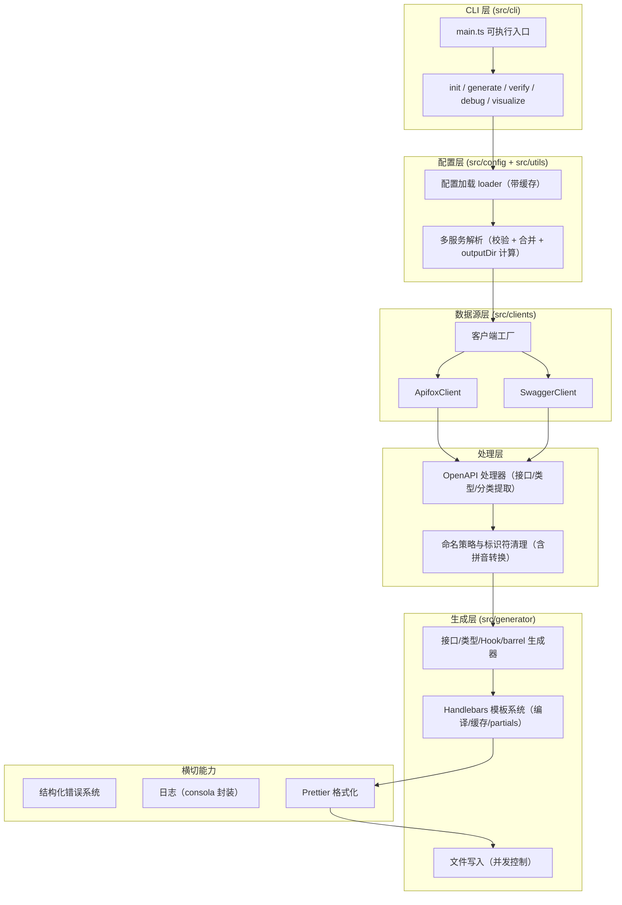

# 架构说明

本文档介绍 `@scxfe/api-tool` 的系统架构、数据流与核心模块。内容依据源码实际实现整理。

## 总体架构

### 设计原则

- **库与 CLI 入口分离**：`src/index.ts` 是库主入口，仅导出公共 API 与类型，不含任何 CLI 副作用（外部 `import { defineConfig }` 不会触发命令解析）；`src/cli/main.ts` 是 bin 专用可执行入口
- **配置驱动**：多服务配置（公共配置 + `services[]`）在 `defineConfig` 内完成校验、合并与输出目录计算，产出 `ApiConfig[]`
- **可插拔数据源**：客户端层分为 `base`（基础抽象）与 `implementations`（Apifox / Swagger 实现），按 `source` URL 自动路由
- **模板渲染 + 统一格式化**：产物由 Handlebars 模板渲染后经 Prettier 格式化，保证机器生成代码的可读性
- **结构化错误**：统一错误系统携带错误码（`E1xxx` 配置 / `E2xxx` 网络 / `E3xxx` 生成）与解决方案建议

### 架构图

## 一次生成的数据流

| 阶段            | 输入                        | 承担者                                                       | 输出                                          |
| --------------- | --------------------------- | ------------------------------------------------------------ | --------------------------------------------- |
| 1. 命令解析     | 命令行参数                  | `src/cli/main.ts` + `src/cli/commands/*`                     | 待执行的子命令                                |
| 2. 配置加载     | `api-power.config.ts/.js`   | `src/config/loader.ts`（动态 import + TTL 缓存 + 缓存穿透）  | `ApiConfig[]`（已在 defineConfig 内校验合并） |
| 3. 数据源拉取   | 各服务 `source`             | `src/clients/implementations/*`（axios，多服务并发）         | 平台无关的 OpenAPI 文档                       |
| 4. 数据处理     | OpenAPI 文档                | `src/processors/openapi.ts`（接口按 path+method 粒度）       | 接口 / 类型 / 分类中间表示                    |
| 5. 命名决策     | 中间表示 + `namingStrategy` | `src/naming/` + `src/utils/path.ts`（pinyin-pro 中文转拼音） | 合法标识符与 tag 目录名                       |
| 6. 模板渲染     | 命名结果 + 模板             | `src/generator/generators/*` + `src/generator/template/*`    | 未格式化的代码文本                            |
| 7. 格式化与落盘 | 渲染结果                    | `src/utils/formatter.ts`（Prettier）+ fileWriter（并发）     | 写入输出目录的最终文件                        |

要点：

- **多服务并发拉取、串行生成**：各服务数据获取并发执行；生成阶段按服务串行（避免目录清理竞争）。单个服务获取失败不中断其他服务，失败服务被跳过并逐个报告
- **生命周期钩子按服务执行**：`beforeGenerate`/`afterGenerate` 随各服务生成各执行一次；获取失败的服务不执行其钩子
- **目录清理**：每个服务只清理自己的输出目录，不会触及共享的 `request.ts`；输出目录必须在项目根之内（配置期校验 `OUTPUT_DIR_ESCAPE`）
- **request 文件仅首次生成**：已存在则跳过，用户在 `customizeAxios` 扩展点中的定制长期保留

## 核心模块

### CLI 层（`src/cli/`）

`program.ts` 注册 5 个子命令：

| 命令        | 职责                                                                   |
| ----------- | ---------------------------------------------------------------------- |
| `init`      | 写入默认配置模板                                                       |
| `generate`  | 核心生成流程；`--watch` 监视配置文件（防抖 + 互斥重跑 + 配置缓存清理） |
| `verify`    | 对产物目录运行 TypeScript `noEmit` 类型检查（复用消费方 tsconfig）     |
| `debug`     | dry-run 诊断：加载配置 → 拉取数据 → 处理 → 打印报告，不写任何文件      |
| `visualize` | 启动可视化配置服务器                                                   |

### 配置层（`src/config/` + `src/utils/multiService.ts`）

- `loader.ts`：动态 import 配置文件（ESM 模块缓存穿透，保证 watch 模式下配置变更生效），带 5 秒 TTL 缓存
- `multiService.ts`（`resolveServiceConfigs`）：先 `validateConfiguration` 完整校验，再对每个服务做 `{...公共配置(应用 preset), ...service}` 浅合并，计算 `outputDir = join(baseOutputDir, folder ?? name)`，规范化 `transformPath`，推导 `requestFunctionFilePath` 默认值
- `src/validation/`：必填、类型、枚举、URL、服务名唯一、目录冲突/嵌套/逃逸、hooks 依赖组合等规则

### 数据源层（`src/clients/`）

`base` 提供客户端抽象，`implementations` 提供 `ApifoxClient`（Apifox OpenAPI 导出 API，携带 token）与 `SwaggerClient`（通用 OpenAPI URL）。工厂按 `source` URL 的 hostname 是否含 `apifox.com` 路由。

### 处理层（`src/processors/` + `src/schema/`）

`processOpenApiData` 把 OpenAPI 文档归一化为：

- `interfaces`：按 path + method 粒度的操作信息（参数、请求体、响应 Schema）
- `types`：`components/schemas` 中的类型定义（含递归 JsonValue、类型别名等形态标记）
- `categories`：接口分组（tag），中文分组名经拼音转换成为输出目录名

### 生成层（`src/generator/`）

| 生成器                  | 产物                                                                           |
| ----------------------- | ------------------------------------------------------------------------------ |
| `interfaceGenerator`    | tag 目录下的 `index.ts`（接口三件套 + 请求函数）                               |
| `typeGenerator`         | `types/` 目录（TypeScript 模式，每类型一个文件 + 索引）                        |
| `zodTypesOnlyGenerator` | Zod 模式的 `schemas/` 与各 tag 的 `schema.ts`                                  |
| `requestFileGenerator`  | `request.ts` / `request.js`（含 `customizeAxios` 扩展点、上传处理）            |
| `hookGenerator`         | `hooks.ts`（按 `hooksLibrary` 路由到 react-query/vue-query/swr/ahooks 适配器） |
| `rootIndexGenerator`    | 各级 barrel `index.ts`                                                         |

模板系统（`src/generator/template/`）负责 Handlebars 编译与缓存、partials/helpers 管理；渲染结果经 Prettier 统一格式化后由 fileWriter 并发写入（`concurrency` 控制）。

### 错误系统（`src/errors/`）

`errorCodes.ts` 定义错误码枚举，`errorFactory.ts` 创建携带解决方案建议的结构化错误，`handleError` 统一呈现并以退出码 1 结束。

### 类型系统（`src/types/`）

`config.ts`（`MultiServiceConfig` / `ServiceConfig` / `ApiConfig` / `PRESETS`）、`api.ts`（OpenAPI Schema 与模板数据类型）、`hooks.ts`（`CliHooks`）、`enums.ts`（`ServerType`、`RequestMethodStyle` 等）。

## 质量保障

- **单元测试**：各模块 `__tests__/`，验证内部函数行为（mock 文件写入）
- **生成结果 E2E 测试**（`tests/e2e/`）：本地 HTTP 数据源 + 真实 `generateCode` 全链路，验证生成结果本身——结构断言与快照、TypeScript `noEmit` 类型检查、运行时请求行为（axios 适配器捕获请求事实）
- **产物类型检查命令**：`api-power verify` 把同样的类型检查能力开放给使用方

## 延伸阅读

- [配置参考](../guides/config-reference.md) - 配置字段与校验规则
- [生成模板说明](../guides/templates.md) - 模板体系与扩展点
- `.wiki/` - 仓库的 AI 友好 Wiki（架构、模块、调用关系、设计决策）
