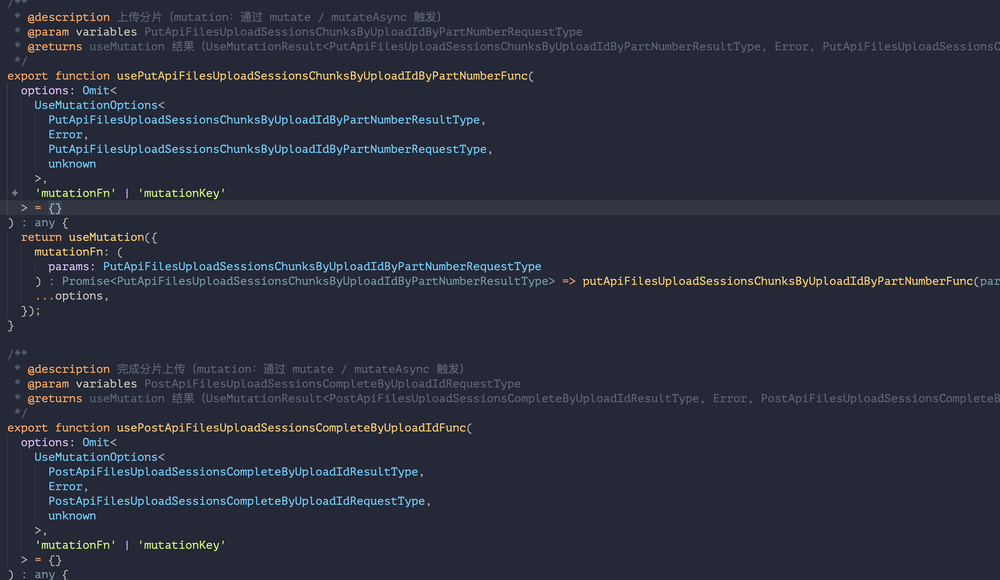
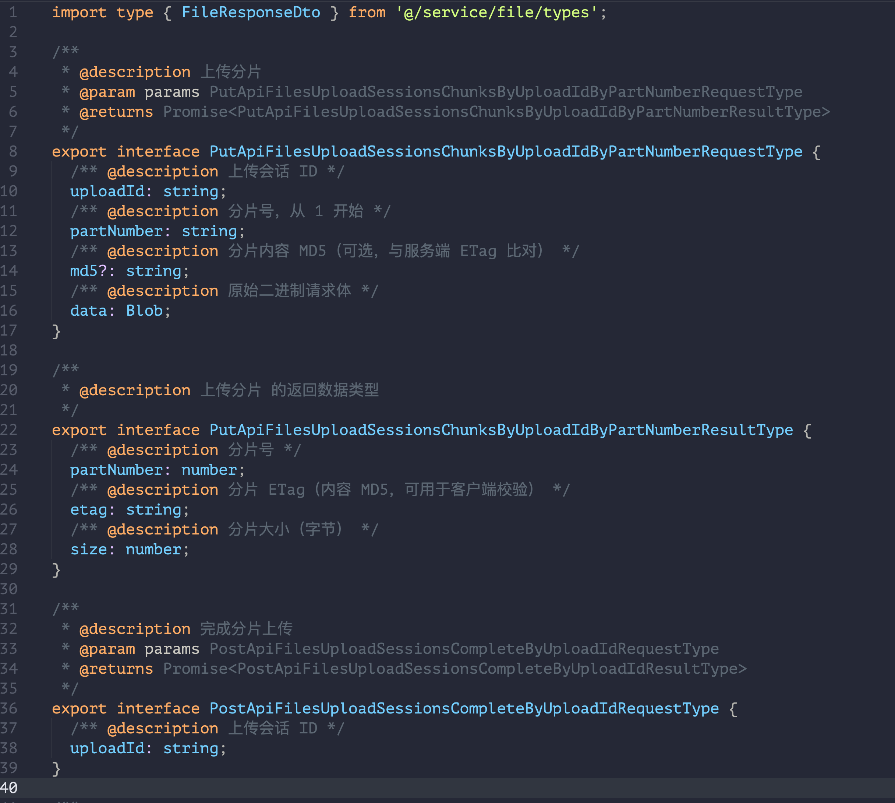
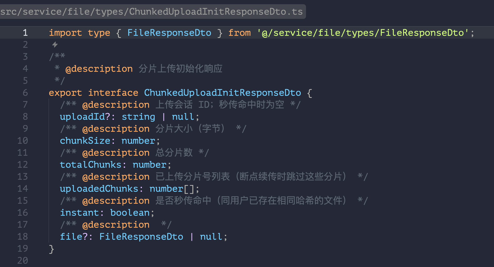
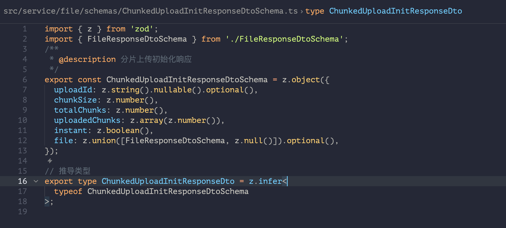
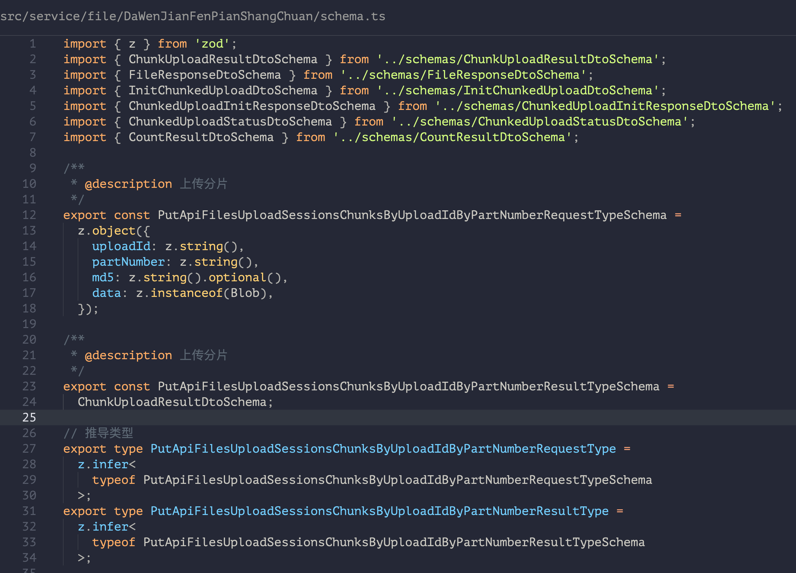
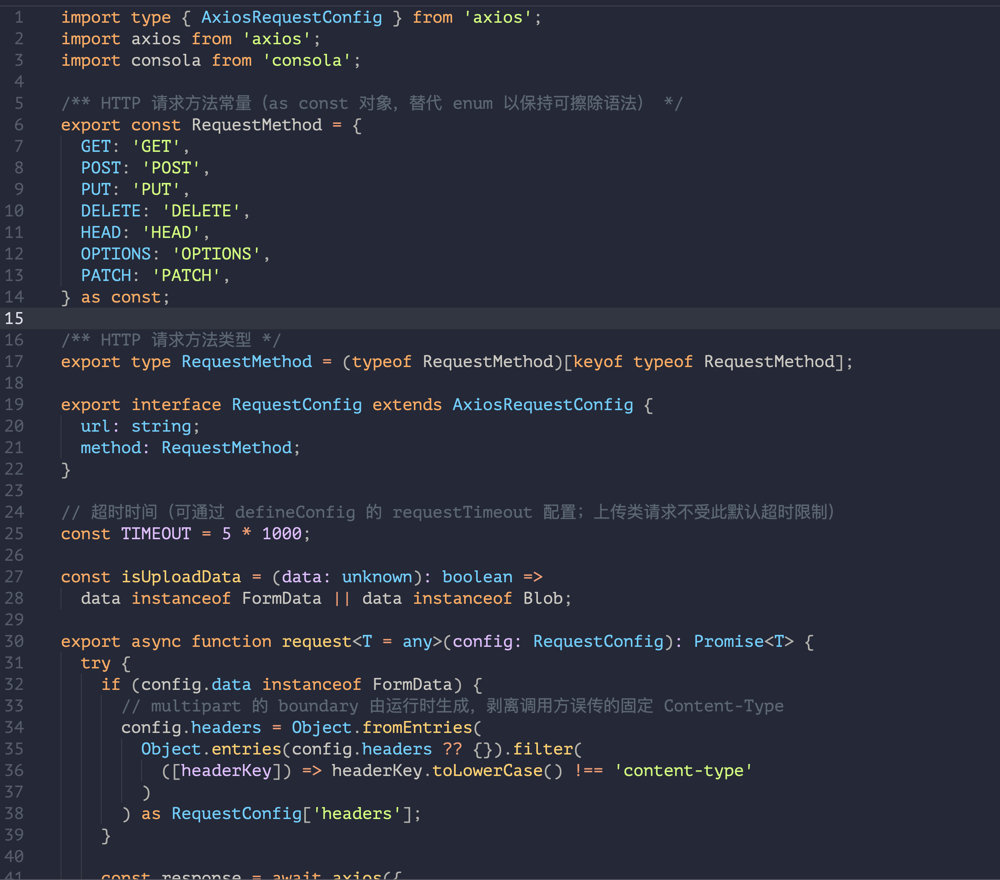

# 配置参考

本页是 `api-power.config.ts` 的完整字段参考：每个字段的类型、默认值与含义，以及配置的合并规则与校验规则。上手步骤见[配置指南](./configuration.md)。

## 配置文件与 defineConfig

- 推荐使用 `api-power.config.ts`（完整类型提示），也支持 `api-power.config.js`。
- 查找顺序：`--config` 指定的路径 → 当前目录的 `api-power.config.ts` → 当前目录的 `api-power.config.js`。
- 配置必须用 `defineConfig` 包裹并默认导出。`defineConfig` 返回 `ApiConfig[]`——每个元素是一个服务的运行时配置，单源即数组长度为 1。

```typescript
import { defineConfig } from '@scxfe/api-tool';

export default defineConfig({
  /* 公共配置：所有服务继承 */
  services: [/* 服务列表：每个服务独立的数据源与输出位置 */],
});
```

## 配置结构总览

配置分两层，服务级字段**浅合并覆盖**公共配置：

```typescript
export default defineConfig({
  // —— 公共配置（顶层）——
  baseOutputDir: 'src/service',
  typesFormat: 'typescript',

  // —— 服务列表（必填）——
  services: [
    {
      name: 'rbac', // 必填
      source: 'https://api.apifox.com/v1/projects/8779779/export-openapi', // 必填
      token: 'APS-xxx', // Apifox 必填
      folder: 'rbac', // 可选，默认取 name
      // 其余公共字段均可在此覆盖，如 transformPath、generateTypes
    },
  ],
});
```

## 顶层字段

| 字段            | 类型              | 默认值          | 说明                                                                                             |
| --------------- | ----------------- | --------------- | ------------------------------------------------------------------------------------------------ |
| `baseOutputDir` | `string`          | `'src/service'` | 公共根输出目录。共享 `request.ts` 位于此层级，各服务输出至 `join(baseOutputDir, folder ?? name)` |
| `services`      | `ServiceConfig[]` | —（必填）       | 服务列表，数组长度 ≥ 1，见下表                                                                   |

## 服务字段（`ServiceConfig`）

| 字段     | 类型     | 必填 | 说明                                                                                                                                                 |
| -------- | -------- | ---- | ---------------------------------------------------------------------------------------------------------------------------------------------------- |
| `name`   | `string` | 是   | 服务名，全局唯一。用于日志、错误提示，以及 `folder` 缺省时的输出目录名                                                                               |
| `source` | `string` | 是   | 该服务的 API 数据源完整 URL。URL 的 hostname 含 `apifox.com` 时走 Apifox 客户端（并从路径提取项目 ID），否则走 Swagger/OpenAPI 客户端                |
| `token`  | `string` | 否   | API 访问令牌。Apifox 数据源必填；Swagger 数据源可省                                                                                                  |
| `folder` | `string` | 否   | 服务输出子目录（相对 `baseOutputDir`），省略时默认取 `name`；支持多段路径（如 `'trade/order'`）；传 `'.'` 时输出直接落在 `baseOutputDir`（单源常用） |

除上述字段外，**所有公共字段**（`typesFormat`、`generateApi`、`transformPath`、`hooks` 等）都可以写在服务级，用于覆盖该服务的公共默认值。

## 公共字段

以下字段既可写在顶层（作为所有服务的默认值），也可写在单个服务中覆盖。默认值取自源码 `DEFAULT_CONFIG_VALUES`（`src/utils/config.ts`）。

### 输出与生成开关

| 字段            | 类型                                   | 默认值         | 说明                                                                   |
| --------------- | -------------------------------------- | -------------- | ---------------------------------------------------------------------- |
| `generateApi`   | `boolean`                              | `true`         | 是否生成 API 请求函数（`xxxFunc`）                                     |
| `generateTypes` | `boolean`                              | `true`         | 是否生成类型定义（关闭后生成代码中的类型注解退化为 `any`）             |
| `typesFormat`   | `'typescript' \| 'zod'`                | `'typescript'` | 类型生成格式，两种模式的产物结构见[下文](#类型生成模式)                |
| `target`        | `'typescript' \| 'javascript'`         | `'typescript'` | 目标语言。`'javascript'` 时所有输出扩展名为 `.js`，不含类型与 Zod 内容 |
| `indentSize`    | `number`                               | `2`            | 生成代码缩进大小                                                       |
| `comment`       | `boolean`                              | `true`         | 是否生成 JSDoc 注释                                                    |
| `prodEnvName`   | `string`                               | `'production'` | 生产环境名称（当前版本仅参与配置校验，未参与产物生成）                 |
| `preset`        | `'minimal' \| 'standard' \| 'verbose'` | —              | 预设，仅作用于公共配置层，见[下文](#预设preset)                        |

### 路径转换

| 字段            | 类型                       | 默认值   | 说明                                                                                                                                                                              |
| --------------- | -------------------------- | -------- | --------------------------------------------------------------------------------------------------------------------------------------------------------------------------------- |
| `transformPath` | `(path: string) => string` | 恒等函数 | 接收原始 OpenAPI path，返回写入生成代码的 path。**必须是函数**（字符串形式已在 0.6.0 废弃，配置为字符串会报 `E1002`）。注意 path 会参与生成的函数命名，修改 path 会连带改变函数名 |

```typescript
// 去除前缀：文档是 /api/users，生成代码里是 /users
transformPath: (p) => (p.startsWith('/api') ? p.slice(4) : p),
// 添加前缀：文档是 /users，生成代码里调用 /api/v1/users
transformPath: (p) => '/api/v1' + p,
```

函数抛异常或返回非字符串时，生成阶段抛 `E3005 GENERATE_PATH_TRANSFORM_ERROR`。

### 请求函数

| 字段                       | 类型                                      | 默认值                                 | 说明                                                                                                                                                                              |
| -------------------------- | ----------------------------------------- | -------------------------------------- | --------------------------------------------------------------------------------------------------------------------------------------------------------------------------------- |
| `requestFunctionFilePath`  | `string`                                  | `join(baseOutputDir, 'request.<ext>')` | 请求函数文件路径。未显式配置时跟随 `baseOutputDir`，扩展名按 `target` 调整；显式配置则原样使用。**该文件仅首次生成，之后不再覆盖**，项目级定制可长期保留                          |
| `requestMode`              | `'shared' \| 'isolated'`                  | `'shared'`                             | `shared`：所有服务共享一份 request 文件（全局 axios 实例）；`isolated`：本服务生成独立 request 文件（默认在服务输出目录内），基于 `axios.create` 私有实例，baseURL/拦截器互不影响 |
| `requestBaseURL`           | `string`                                  | —                                      | 请求实例 baseURL，**仅 `requestMode: 'isolated'` 时生效**，烘焙进独立实例                                                                                                         |
| `requestTimeout`           | `number`                                  | `5000`                                 | 默认请求超时（毫秒）。上传类请求（`data` 为 `FormData`/`Blob`）不受此默认超时限制；单次请求可用 `RequestConfig.timeout` 覆盖                                                      |
| `requestMethodStyle`       | `'config' \| 'method-specific' \| 'both'` | `'config'`                             | 请求调用风格：`config` 只生成 `request(config)`；`method-specific` / `both` 额外生成 `requestMethods` 对象（`request.get/post/...` 快捷方法）                                     |
| `requestFunctionName`      | `string`                                  | `'request'`                            | 请求函数名（生成代码中的导入名）                                                                                                                                                  |
| `requestMethodsObjectName` | `string`                                  | `'requestMethods'`                     | method-specific 风格下方法对象名                                                                                                                                                  |
| `requestParamName`         | `string`                                  | `'params'`                             | 生成请求函数的参数名（`function xxxFunc(params: ...)`）                                                                                                                           |
| `responseTypeName`         | `string`                                  | `'Response'`                           | 自定义返回数据类型名（用于命名策略上下文）                                                                                                                                        |

`isolated` 服务未显式配置 `requestFunctionFilePath` 时，默认路径为 `join(outputDir, 'request.<ext>')`（服务输出目录内）。

### Hooks 生成

在 API 请求函数之上额外生成数据请求 Hook，**依赖 `generateApi: true`**（否则校验报 `E1002`）。

| 字段                    | 类型                                                | 默认值          | 说明                                                                                                                                         |
| ----------------------- | --------------------------------------------------- | --------------- | -------------------------------------------------------------------------------------------------------------------------------------------- |
| `generateHooks`         | `boolean`                                           | `false`         | 是否生成 Hooks。开启后每个 tag 目录生成 `hooks.ts`，服务根目录生成 `hooks.ts` barrel                                                         |
| `hooksLibrary`          | `'react-query' \| 'vue-query' \| 'swr' \| 'ahooks'` | `'react-query'` | Hook 依赖的客户端库，四个库均已实现。**peer dependency 需自行安装**                                                                          |
| `queryKeyPrefix`        | `string[]`                                          | `[]`            | 缓存 key 前缀（进 key 数组首位；ahooks 映射为 `cacheKey`）。多服务场景建议配 `[serviceName]` 隔离缓存                                        |
| `hooksValidateResponse` | `boolean`                                           | `false`         | 是否在 Hook 的 queryFn/mutationFn 内注入 Zod 响应运行时校验。依赖 `generateHooks: true` + `typesFormat: 'zod'` + TS 目标，非法组合报 `E1002` |

各库语义：

| 库          | peer dependency            | 适用框架 | query 行为                                                                            | mutation 触发                    |
| ----------- | -------------------------- | -------- | ------------------------------------------------------------------------------------- | -------------------------------- |
| react-query | `@tanstack/react-query@^5` | React    | `useQuery`，key 含 params，变化自动重新请求；queryFn 透传 `signal` 支持取消           | `mutate` / `mutateAsync`         |
| vue-query   | `@tanstack/vue-query@^5`   | Vue 3    | 同 react-query（Composition API；需注册 `VueQueryPlugin`）                            | `mutate` / `mutateAsync`         |
| swr         | `swr@^2`                   | React    | `useSWR` 数组 key，变化自动重新请求（无 signal 透传）                                 | `trigger`                        |
| ahooks      | `ahooks@^3`                | React    | `useRequest` 自动模式，params 变化**不会**自动重新请求（透传 `refreshDeps` 手动控制） | `manual: true`，`run(variables)` |

分类规则：`GET` / `HEAD` 接口生成 query hook；`POST` / `PUT` / `PATCH` / `DELETE` 生成 mutation hook。命名默认 `use` + API 函数名首字母大写（`getPetsFunc` → `useGetPetsFunc`），可通过 `namingStrategy.hookName` 自定义。不支持无限列表/分页 hook（分页结构无法从 OpenAPI 静态推断）。

生成的 Hook 形态（真实产物截图）：



### 命名策略（`namingStrategy`）

完全覆盖默认的命名生成逻辑。每个字段都是可选函数，接收 `NamingContext`：

```typescript
interface NamingContext {
  path: string; // API 路径（transformPath 之后）
  method: string; // HTTP 方法，如 'GET'
  summary?: string; // 操作摘要
  description?: string; // 操作详细描述
  operationId?: string; // OpenAPI operationId（如果存在）
  tags?: string[]; // 标签
  config: ApiConfig; // 完整配置
}
```

| 字段               | 类型              | 默认产物示例                |
| ------------------ | ----------------- | --------------------------- |
| `interfaceName`    | `(ctx) => string` | `GetPetsByPetId`            |
| `functionName`     | `(ctx) => string` | `getPetsByPetIdFunc`        |
| `hookName`         | `(ctx) => string` | `useGetPetsByPetIdFunc`     |
| `requestTypeName`  | `(ctx) => string` | `GetPetsByPetIdRequestType` |
| `responseTypeName` | `(ctx) => string` | `GetPetsByPetIdResultType`  |

默认命名规则：函数名 = HTTP 方法（小写）+ 路径各段驼峰 + `Func` 后缀；请求/响应类型分别为函数名 + `RequestType` / `ResultType`。tag（接口分组）目录名由中文转拼音驼峰生成（如「权限管理」→ `QuanXianGuanLi`）。

### 性能与钩子

| 字段          | 类型       | 默认值 | 说明                                                          |
| ------------- | ---------- | ------ | ------------------------------------------------------------- |
| `concurrency` | `number`   | `50`   | 并发写入数量（文件生成的并发控制）                            |
| `hooks`       | `CliHooks` | —      | 生成过程钩子，见[高级用法 - 钩子系统](./advanced.md#钩子系统) |

```typescript
interface CliHooks {
  beforeGenerate?: () => void;
  afterGenerate?: () => void;
  beforeWriteFile?: (filePath: string, content: string) => string; // 返回值作为写入内容
  afterWriteFile?: (filePath: string) => void;
}
```

生命周期钩子**按服务执行**：顶层 `hooks` 被每个服务继承、随各服务生成各执行一次；服务级 `hooks` 覆盖公共值、仅自身生成前后执行；获取数据失败的服务不执行其生命周期钩子。

## 默认值与合并优先级

单个服务的最终配置按以下优先级浅合并（高优先级覆盖低优先级）：

```
内置默认值 < preset 预设值 < 顶层公共配置 < 服务级字段
```

- `preset` 仅作用于公共配置层，服务不可覆盖 preset（服务级直接写字段即可）。
- 合并发生在 `defineConfig` 内（`resolveServiceConfigs`），配置文件导出的已是合并后的 `ApiConfig[]`。
- `transformPath` 会被规范化为函数：未配置时注入恒等函数。
- `requestFunctionFilePath` 默认值按上述规则跟随 `baseOutputDir` / 服务目录推导；显式配置则原样使用。

## 预设（`preset`）

| 预设       | 生成 API | 生成类型 | 注释 | 缩进 | 请求风格 |
| ---------- | -------- | -------- | ---- | ---- | -------- |
| `minimal`  | ✗        | ✓        | ✗    | 2    | `config` |
| `standard` | ✓        | ✓        | ✓    | 2    | `config` |
| `verbose`  | ✓        | ✓        | ✓    | 4    | `both`   |

三种预设的 `typesFormat` 均为 `'typescript'`。预设之后仍可用顶层/服务级字段覆盖任意选项。

## 校验规则

`defineConfig` 在返回前执行完整校验（`validateConfiguration`），无效配置在配置加载阶段即失败。主要规则：

| 规则                                                                                               | 错误码                                      |
| -------------------------------------------------------------------------------------------------- | ------------------------------------------- |
| `services` 非空，每个服务 `name` / `source` 必填                                                   | `E1002` / `E1004`                           |
| 服务 `name` 全局唯一                                                                               | `E1002`                                     |
| 各服务 `outputDir`（`join(baseOutputDir, folder ?? name)`）两两不同、不嵌套                        | `E1002`（`OUTPUT_DIR_CONFLICT`）            |
| `outputDir` 必须严格位于项目根之内，且不得为项目根本身                                             | `E1002`（`OUTPUT_DIR_ESCAPE`）              |
| `transformPath` 必须是函数（字符串形式已废弃）                                                     | `E1002`                                     |
| 枚举字段取值合法（`typesFormat` / `target` / `requestMethodStyle` / `hooksLibrary` 等）            | `E1002`                                     |
| `source` 是合法的 HTTP/HTTPS URL                                                                   | `E1005`                                     |
| `generateHooks: true` 依赖 `generateApi: true`                                                     | `E1002`（`HOOKS_REQUIRE_API`）              |
| `hooksValidateResponse: true` 依赖 `generateHooks` + `typesFormat: 'zod'` + `target: 'typescript'` | `E1002`（`HOOKS_VALIDATION_MISCONFIGURED`） |

错误码分段：`E1xxx` 配置错误、`E2xxx` 网络错误、`E3xxx` 生成错误。完整清单见 [CLI 参考 - 错误码](./cli.md#错误码)。

## 类型生成模式

`typesFormat` 决定类型部分的产物形态（API 请求函数两种模式都会生成，由 `generateApi` 控制）。

### TypeScript 模式（默认）

```
<服务输出目录>/
├── index.ts                  # 服务入口（barrel）
├── QuanXianGuanLi/index.ts   # tag 目录（中文转拼音）：RequestType/ResultType 接口 + xxxFunc 函数
└── types/                    # components/schemas 中的每个类型一个文件
    ├── RoleResponseDto.ts
    └── index.ts
```

真实产物截图：





### Zod 模式

```
<服务输出目录>/
├── index.ts                  # 服务入口（barrel）
├── ChongWuGuanLi/
│   ├── index.ts              # API 函数（类型从 schema.ts 导入）
│   └── schema.ts             # 接口级 Request/Result Schema（z.object + z.infer 推导类型）
└── schemas/                  # components/schemas 中的每个类型一个 Schema 文件
    ├── PetSchema.ts
    └── index.ts
```

真实产物截图：





| 特性           | TypeScript 模式 | Zod 模式                    |
| -------------- | --------------- | --------------------------- |
| 编译时类型检查 | ✓               | ✓（`z.infer` 推导）         |
| 运行时验证     | ✗               | ✓（`Schema.parse`）         |
| 类型产物形态   | `interface`     | `z.object` + `z.infer` 类型 |
| 运行时开销     | 无              | 引入 zod 依赖               |

## 共享请求文件（request.ts）

`request.ts`（或 `.js`）由工具生成在 `requestFunctionFilePath` 指定的位置，包含：

- `RequestMethod` 常量与 `RequestConfig` 接口（`url` + `method` 必填的 AxiosRequestConfig 扩展）；
- `request<T>(config)` 请求函数：默认超时 `requestTimeout`，上传类请求（`FormData`/`Blob`）不限时；multipart 请求自动剥离误传的固定 `Content-Type`；
- `customizeAxios` 扩展点：模块加载时调用一次，可注入拦截器、Token、响应解包等。**该文件仅在首次生成时创建，后续重新生成不会覆盖**，此处自定义可长期保留。

真实产物截图（首次生成时的完整内容）：



## 完整配置示例

```typescript
import { defineConfig } from '@scxfe/api-tool';

export default defineConfig({
  // 公共配置：所有服务继承
  baseOutputDir: 'src/service',
  typesFormat: 'typescript',
  target: 'typescript',
  generateApi: true,
  generateTypes: true,
  indentSize: 2,
  comment: true,
  concurrency: 5,
  transformPath: (path) => `/api${path}`,

  // 公共钩子：每个服务各执行一次
  hooks: {
    afterGenerate: () => console.log('一个服务生成完成'),
  },

  services: [
    {
      name: 'notification', // folder 省略 → 输出 src/service/notification
      source: 'https://api.apifox.com/v1/projects/8779774/export-openapi',
      token: 'APS-YourAccessTokenHere',
    },
    {
      name: 'rbac',
      source: 'https://api.apifox.com/v1/projects/8779779/export-openapi',
      token: 'APS-YourAccessTokenHere',
    },
    {
      name: 'order',
      folder: 'trade/order', // 多段 folder → 输出 src/service/trade/order
      source: 'https://order-svc.example.com/v3/api-docs',
      transformPath: (p) => '/order' + p, // 服务级覆盖公共配置
    },
    {
      name: 'legacy',
      source: 'https://legacy-svc.example.com/swagger.json',
      requestMode: 'isolated', // 独立 request 文件 + axios.create 私有实例
      requestBaseURL: 'https://legacy-svc.example.com',
      requestTimeout: 10000,
    },
  ],
});
```

对应的输出结构：

```
src/service/                    # baseOutputDir
├── request.ts                  # 共享请求文件（仅生成一次，之后不覆盖）
├── notification/               # join(base, 'notification')
│   ├── index.ts
│   ├── XiaoXiGuanLi/index.ts
│   └── types/
├── rbac/                       # join(base, 'rbac')
│   ├── index.ts
│   ├── QuanXianGuanLi/index.ts
│   └── types/
├── trade/order/                # join(base, 'trade/order')
│   ├── index.ts
│   └── request.ts              # isolated 服务默认在服务目录内的独立请求文件
└── legacy/
    ├── index.ts
    └── request.ts              # isolated：axios.create 私有实例 + requestBaseURL
```

> 单源场景：`services: [{ name: 'main', folder: '.', source, token }]`，输出直接落在 `baseOutputDir`。
