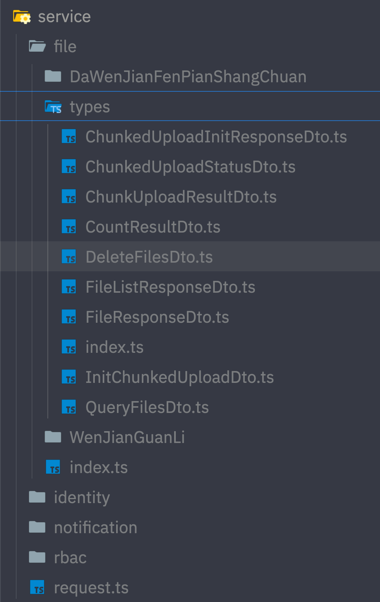

# 使用示例

本文档展示不同配置模式下的**真实生成产物**。所有截图均来自真实生成结果（仓库 `src/service/` 为多服务真实数据，Zod / Hooks / 多服务 isolated 示例来自项目 E2E 测试的真实链路产物）。

## 示例 1: TypeScript 模式（默认）

### 配置

```typescript
import { defineConfig } from '@scxfe/api-tool';

export default defineConfig({
  baseOutputDir: 'src/service',
  typesFormat: 'typescript', // 默认值，可省略
  generateApi: true,
  generateTypes: true,

  services: [
    {
      name: 'main',
      folder: '.',
      source: 'https://api.apifox.com/v1/projects/YOUR_PROJECT_ID/export-openapi',
      token: 'APS-YourAccessTokenHere',
    },
  ],
});
```

### 输出结构

```
src/service/
├── request.ts                  # 共享请求文件（仅首次生成）
├── index.ts                    # 根导出 barrel
├── QuanXianGuanLi/index.ts     # tag 目录：接口三件套（RequestType/ResultType + xxxFunc）
└── types/                      # components/schemas 类型目录
    ├── RoleResponseDto.ts
    └── index.ts
```

### 真实产物

接口文件（请求类型 + 响应类型 + 请求函数，path 参数插值、query/body 自动分离）：


类型文件：


请求文件：


### 使用

```typescript
import { putPermissionsUpdateFunc } from '@/service/rbac/QuanXianGuanLi';

// 参数结构与 PutPermissionsUpdateRequestType 一一对应
const updated = await putPermissionsUpdateFunc({
  id: '1',
  name: '用户管理',
});

// 第二参数可选：透传单次请求级 Axios 配置
const result = await putPermissionsUpdateFunc(
  { id: '1' },
  { timeout: 10_000, headers: { 'X-Trace-Id': 'abc' } },
);
```

## 示例 2: Zod 模式

`typesFormat: 'zod'` 时，类型以 Zod Schema 生成，**同样会生成 API 请求函数**（由 `generateApi` 控制，与 typesFormat 无关），并提供运行时验证能力。

### 配置

```typescript
export default defineConfig({
  baseOutputDir: 'src/service',
  typesFormat: 'zod',

  services: [
    {
      name: 'pet',
      source: 'https://petstore.example.com/v3/api-docs',
    },
  ],
});
```

### 输出结构

```
src/service/pet/
├── index.ts                     # API 函数（类型从 schema.ts 导入）
├── ChongWuGuanLi/
│   ├── index.ts                 # API 请求函数
│   └── schema.ts                # 接口级 Request/Result Schema + z.infer 类型
└── schemas/                     # components/schemas 中每个类型一个 Schema 文件
    ├── PetSchema.ts
    └── index.ts
```

### 真实产物

类型 Schema 文件（`schemas/PetSchema.ts`）：


接口级合并 Schema 文件（`ChongWuGuanLi/schema.ts`，请求/响应 Schema + 推导类型）：


### 使用

```typescript
import { getPetsFunc } from '@/service/pet/ChongWuGuanLi';
import { PetSchema } from '@/service/pet/schemas';

// 正常调用（返回值类型由 z.infer 推导）
const page = await getPetsFunc({ page: 1, pageSize: 20 });

// 需要运行时校验时，用 Schema.parse 校验任意数据
const pet = PetSchema.parse(someUntrustedData);
```

## 示例 3: 只生成类型（Types Only）

```typescript
export default defineConfig({
  baseOutputDir: 'src/service',
  generateApi: false,
  generateTypes: true,

  services: [{ name: 'main', folder: '.', source: 'https://...', token: 'APS-xxx' }],
});
```

不生成请求函数与 `request.ts`，只生成类型（TypeScript 模式为 `types/` 目录 + 接口文件中的类型；Zod 模式为 `schemas/` + `schema.ts`）。适合只需要类型契约、请求层自建的项目。

反过来，`generateApi: true, generateTypes: false` 则只生成请求函数，参数与返回值类型退化为 `any`。

## 示例 4: 生成数据请求 Hooks

`generateHooks: true` 在 API 函数之上生成 Hook 包装（`GET`/`HEAD` → query hook，其余 → mutation hook）：

```typescript
export default defineConfig({
  baseOutputDir: 'src/service',
  generateApi: true,
  generateHooks: true,
  hooksLibrary: 'react-query', // 需自行安装 @tanstack/react-query@^5
  queryKeyPrefix: ['pet'], // 多服务场景建议用服务名隔离缓存

  services: [{ name: 'pet', source: 'https://petstore.example.com/v3/api-docs' }],
});
```

每个 tag 目录多生成一个 `hooks.ts`，服务根目录生成 `hooks.ts` barrel。真实产物（query hook 透传 `signal` 支持请求取消，mutation 通过 `mutate` / `mutateAsync` 触发）：


### 使用

```tsx
function PetDetail({ petId }: { petId: number }) {
  const { data, isPending, error } = useGetPetsByPetIdFunc({ petId });
  if (isPending) return <div>加载中...</div>;
  if (error) return <div>加载失败</div>;
  return <div>{data.name}</div>;
}
```

除 `react-query` 外还支持 `vue-query`、`swr`、`ahooks`，语义差异与 `hooksValidateResponse`（Hook 内注入 Zod 响应校验）见[配置参考 - Hooks 生成](./config-reference.md#hooks-生成)。

## 示例 5: 多服务 / 微服务

多个后端服务统一声明在一个配置里，共享公共配置与 `baseOutputDir` 下的 `request.ts`：

```typescript
export default defineConfig({
  baseOutputDir: 'src/service',
  typesFormat: 'typescript',

  services: [
    { name: 'user', source: 'https://user-svc.example.com/v3/api-docs', token: 'APS-xxx' },
    {
      name: 'order',
      folder: 'trade/order', // 多段 folder → src/service/trade/order
      source: 'https://order-svc.example.com/swagger.json',
      generateTypes: false, // 服务级覆盖：order 服务不生成类型
    },
    {
      name: 'legacy',
      source: 'https://legacy-svc.example.com/swagger.json',
      requestMode: 'isolated', // 独立 request 文件 + axios.create 私有实例
      requestBaseURL: 'https://legacy-svc.example.com',
    },
  ],
});
```

仓库自身的真实多服务结构（4 个服务）：



要点：

- 每个服务输出到 `join(baseOutputDir, folder ?? name)`，校验保证互不相同、不嵌套；
- 共享 `request.ts` 只生成一次；`isolated` 服务在自己的输出目录内获得独立请求文件与私有 axios 实例；
- 单个服务数据获取失败不会中断其他服务，失败服务被跳过并逐个报告。

## 示例 6: 环境变量管理敏感信息

```typescript
export default defineConfig({
  baseOutputDir: process.env.OUTPUT_DIR || 'src/service',

  services: [
    {
      name: 'main',
      folder: '.',
      source: process.env.API_SOURCE!,
      token: process.env.API_TOKEN!,
    },
  ],
});
```

## 模式对比

| 特性           | TypeScript 模式  | Zod 模式                |
| -------------- | ---------------- | ----------------------- |
| 编译时类型检查 | ✓（interface）   | ✓（`z.infer` 推导类型） |
| 运行时验证     | ✗                | ✓（`Schema.parse`）     |
| API 请求函数   | ✓                | ✓                       |
| 类型产物形态   | `interface` 文件 | `z.object` Schema 文件  |
| 运行时依赖     | 无               | 需安装 zod              |

## 下一步

- [配置参考](./config-reference.md) — 全部字段的类型、默认值与校验规则
- [高级用法](./advanced.md) — 命名策略、钩子系统、请求扩展点
- [迁移指南](./migration.md) — 从旧版本迁移
